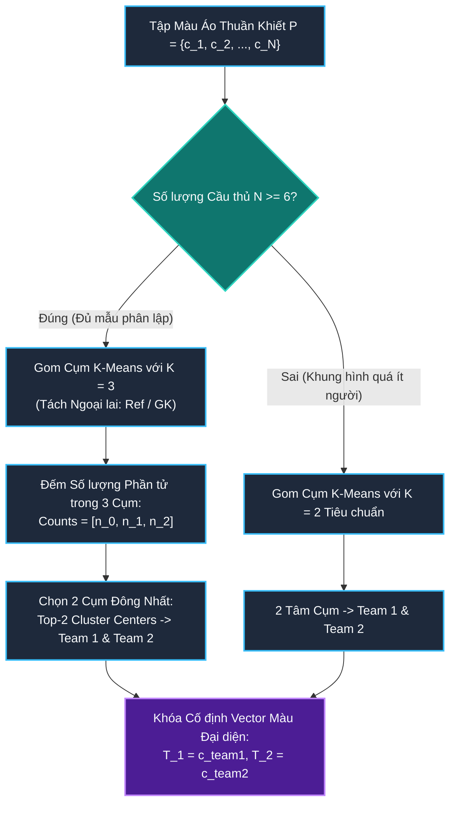

# **MỤC: PHÂN LOẠI ĐỘI BÓNG DỰA TRÊN MÀU ÁO VÀ ĐẶC TRƯNG NGOẠI QUAN**
*(Robust Kit Color Classification, Two-Stage Background Suppression, and Perceptual Uniformity)*

---

## **MỤC LỤC**
1. [**1. Tổng quan Kiến trúc và Luồng Dữ liệu Phân đội**](#1-tổng-quan-kiến-trúc-và-luồng-dữ-liệu-phân-đội)
   - [**1.1. Luồng dữ liệu Phân đội: Từ Hộp bao Cầu thủ đến Nhãn Đội Bất biến**](#11-luồng-dữ-liệu-phân-đội-từ-hộp-bao-cầu-thủ-đến-nhãn-đội-bất-biến)
   - [**1.2. Thách thức Thị giác và Ràng buộc Vật lý Trong Phân định Màu áo**](#12-thách-thức-thị-giác-và-ràng-buộc-vật-lý-trong-phân-định-màu-áo)
2. [**2. Chi tiết Phương pháp luận và Các Kỹ thuật Cốt lõi**](#2-chi-tiết-phương-pháp-luận-và-các-kỹ-thuật-cốt-lõi)
   - [**2.1. Trích xuất Vùng Thân trên và Khử Nhiễu Cỏ Nền Tầng 1 (Upper-Torso & Corner-Heuristic Grass Filtering)**](#21-trích-xuất-vùng-thân-trên-và-khử-nhiễu-cỏ-nền-tầng-1-upper-torso--corner-heuristic-grass-filtering)
   - [**2.2. Biểu diễn Màu trong Không gian Đồng nhất Tri giác (Perceptually Uniform CIE-L\*a\*b\* Space)**](#22-biểu-diễn-màu-trong-không-gian-đồng-nhất-tri-giác-perceptually-uniform-cie-lab-space)
   - [**2.3. Gom Cụm Nhị Cấp và Cơ Chế Kháng Ngoại Lai Toàn Cục (Global 2-Stage K-Means Clustering)**](#23-gom-cụm-nhị-cấp-và-cơ-chế-kháng-ngoại-lai-toàn-cục-global-2-stage-k-means-clustering)
   - [**2.4. Hàm Mục tiêu Toán học và Độ Đo Khoảng cách (Mathematical Formulations & Distance Metrics)**](#24-hàm-mục-tiêu-toán-học-và-độ-đo-khoảng-cách-mathematical-formulations--distance-metrics)
   - [**2.5. Làm mịn Thời gian Thích ứng và Khóa Cứng Đội hình (Sliding Window Majority Voting & Team Lock)**](#25-làm-mịn-thời-gian-thích-ứng-và-khóa-cứng-đội-hình-sliding-window-majority-voting--team-lock)
3. [**3. Kết quả Thực nghiệm Định lượng và Nghiên cứu Triệt tiêu (Ablation Study)**](#3-kết-quả-thực-nghiệm-định-lượng-và-nghiên-cứu-triệt-tiêu-ablation-study)
   - [**3.1. Đặc tả Bộ Dữ liệu Chuẩn Thực nghiệm (Ground Truth Dataset)**](#31-đặc-tả-bộ-dữ-liệu-chuẩn-thực-nghiệm-ground-truth-dataset)
   - [**3.2. Bảng Kết quả Thực nghiệm Toàn diện Trên 12 Cấu hình Ablation**](#32-bảng-kết-quả-thực-nghiệm-toàn-diện-trên-12-cấu-hình-ablation)
   - [**3.3. Phân tích Bản chất Khoa học và Vật lý Đằng sau Các Độ đo**](#33-phân-tích-bản-chất-khoa-học-và-vật-lý-đằng-sau-các-độ-đo)
4. [**4. Hướng dẫn Chi tiết Vị trí Chèn Hình ảnh Minh họa**](#4-hướng-dẫn-chi-tiết-vị-trí-chèn-hình-ảnh-minh-họa)

---

## **1. Tổng quan Kiến trúc và Luồng Dữ liệu Phân đội**

### **1.1. Luồng dữ liệu Phân đội: Từ Hộp bao Cầu thủ đến Nhãn Đội Bất biến**

Trong hệ thống phân tích chiến thuật bóng đá, việc nhận diện vị trí cầu thủ là chưa đủ; hệ thống bắt buộc phải phân định chính xác mỗi cầu thủ thuộc về **Đội 1 (Chủ nhà)** hay **Đội 2 (Đội khách)** để tính toán cự ly đội hình, khối phòng ngự và tỷ lệ kiểm soát bóng.

Tuy nhiên, việc phân cụm màu áo trực tiếp từ hộp bao phát hiện (Bounding Box) thường gặp sai số nghiêm trọng do diện tích hộp bao bị chiếm phần lớn bởi cỏ nền sân bóng, quần tất, giày và bóng đổ. Phân hệ Phân loại Đội bóng được thiết kế theo cấu trúc **Xử lý Đa tầng Kháng Nhiễu Nền (Two-Stage Noise-Robust Architecture)**:

> `[CHÈN HÌNH TỔNG QUAN PHÂN ĐỘI TẠI ĐÂY]`
> *(Tham chiếu: Hình 1 - Sơ đồ luồng xử lý phân loại đội bóng 2 tầng kết hợp lọc cỏ 4 góc và bỏ phiếu thời gian thích ứng)*

---

### **1.2. Thách thức Thị giác và Ràng buộc Vật lý Trong Phân định Màu áo**

1. **Nhiễu Cỏ Nền Áp Đảo (Background Dominance)**:
   - Trong một bounding box người thẳng đứng chuẩn, phần thân áo đấu (Torso) chỉ chiếm khoảng $25\% - 35\%$ tổng số lượng pixel.
   - Khoảng $65\% - 75\%$ diện tích còn lại là mặt cỏ sân bóng (xung quanh 4 góc, các cạnh biên và khoảng trống giữa hai chân).
   - Nếu áp dụng gom cụm trực tiếp, cụm chiếm đa số luôn là **màu xanh lá của cỏ**, làm lệch hoàn toàn tâm cụm của màu áo đấu.
2. **Hiện tượng Biến thiên Chiếu sáng (Illumination Variance)**:
   - Ánh nắng mặt trời trực tiếp, bóng đổ của khán đài sân vận động, và hệ thống đèn cao áp vào buổi tối tạo ra các mảng sáng tối cục bộ rất lớn trên cùng một màu áo.
   - Trong không gian màu RGB thông thường, sự thay đổi độ sáng làm khoảng cách Euclidean tăng vọt, khiến áo trắng dưới bóng râm bị nhầm thành màu xám đậm hoặc xanh cỏ.
3. **Sự Hiện diện của Thực thể Ngoại lai (Outlier Contamination)**:
   - Trọng tài chính (thường mặc áo đen hoặc vàng dạ quang) và Thủ môn (áo màu neon đối lập) nếu bị đưa vào bộ gom cụm 2 đội sẽ bóp méo hoàn toàn 2 tâm cụm màu chính.

---

## **2. Chi tiết Phương pháp luận và Các Kỹ thuật Cốt lõi**

### **2.1. Trích xuất Vùng Thân trên và Khử Nhiễu Cỏ Nền Tầng 1 (Upper-Torso & Corner-Heuristic Grass Filtering)**

Để triệt tiêu tối đa các thành phần gây nhiễu, hệ thống thực hiện quy trình bóc tách hình học và phân đoạn sơ cấp gồm 4 bước nghiêm ngặt:

#### **Bước 1: Cắt Vùng Thân Trên (Upper-Torso Geometric Cropping)**
Với một hộp bao đối tượng $B = [x_1, y_1, x_2, y_2]$ có chiều rộng $W = x_2 - x_1$ và chiều cao $H = y_2 - y_1$:
Hệ thống chỉ trích xuất nửa trên của hộp bao, loại bỏ hoàn toàn nửa dưới (quần đùi, tất chân, giày và cỏ sát đất):

$$I_{\text{torso}} = I\left[ y_1 : y_1 + \left\lfloor\frac{H}{2}\right\rfloor, \; x_1 : x_2 \right]$$

#### **Bước 2: Chuẩn hóa Kích thước Khối Điểm ảnh (Spatial Rescaling)**
Ảnh vùng thân trên được thu nhỏ về kích thước chuẩn $24 \times 24$ pixels bằng thuật toán nội suy diện tích (`cv2.INTER_AREA`):

$$I_{\text{patch}} = \mathcal{R}_{24 \times 24}(I_{\text{torso}})$$

Việc thu nhỏ ma trận vừa tăng tốc độ xử lý lên hàng trăm lần (chỉ còn $576$ điểm ảnh cần phân cụm), vừa đóng vai trò như một bộ lọc thông thấp (low-pass filter) loại bỏ các chi tiết gân áo, logo nhà tài trợ và số áo nhỏ.

#### **Bước 3: Phân đoạn Cục bộ Nhị phân Bằng K-Means Tầng 1 ($k=2$)**
Ma trận điểm ảnh $576 \times 3$ được phân thành đúng $2$ cụm màu cục bộ bằng thuật toán K-Means++:

$$\min_{\{\boldsymbol{\mu}_0, \boldsymbol{\mu}_1\}} \sum_{i=1}^{576} \sum_{j=0}^1 r_{ij} \|\mathbf{p}_i - \boldsymbol{\mu}_j\|_2^2$$

Mỗi điểm ảnh nhận một nhãn thuộc về Cụm 0 hoặc Cụm 1, tạo thành ma trận nhãn không gian $\mathbf{L} \in \{0, 1\}^{24 \times 24}$.

#### **Bước 4: Luật Định danh 4 Góc (Corner-Heuristic Grass Elimination)**
Do tư thế tự nhiên của cơ thể người hình elip thuôn dài, 4 góc của hộp bao chữ nhật luôn luôn là nền cỏ sân bóng:

$$\mathcal{C} = \{\mathbf{L}[0, 0], \; \mathbf{L}[0, 23], \; \mathbf{L}[23, 0], \; \mathbf{L}[23, 23]\}$$

Nhãn của cụm cỏ nền được xác định thông qua phép bỏ phiếu đa số trên tập 4 góc:

$$c_{\text{grass}} = \arg\max_{k \in \{0, 1\}} \sum_{c \in \mathcal{C}} \mathbb{I}(c = k)$$

Khi đó, nhãn cụm đại diện cho vải áo đấu chính xác được suy ra:

$$c_{\text{jersey}} = 1 - c_{\text{grass}}$$

Tâm cụm $\boldsymbol{\mu}_{c_{\text{jersey}}}$ được chọn làm **Vector Màu Áo Thuần Khiết $\mathbf{c}_{\text{player}}$** của cầu thủ tại khung hình đó, hoàn toàn sạch bóng sắc tố cỏ xanh.

> `[CHÈN HÌNH 2 TẠI ĐÂY]`
> *(Tham chiếu: Hình 2 - Minh họa Quy trình bóc tách màu áo 2 tầng: Từ Bounding box gốc đến vector màu thuần khiết loại bỏ cỏ 4 góc)*

---

### **2.2. Biểu diễn Màu trong Không gian Đồng nhất Tri giác (Perceptually Uniform CIE-L\*a\*b\* Space)**

Không gian màu RGB là không gian phi tuyến tính về mặt cảm nhận giác mạc của mắt người. Để việc tính khoảng cách giữa hai màu phản ánh đúng sự phân biệt thị giác thực tế, hệ thống thực hiện chuyển đổi vector màu sang không gian **CIE-L\*a\*b\***:

$$\begin{bmatrix} X \\ Y \\ Z \end{bmatrix} = \mathbf{M}_{\text{sRGB}\to\text{XYZ}} \begin{bmatrix} R \\ G \\ B \end{bmatrix}$$

$$L^* = 116 \cdot f\left(\frac{Y}{Y_n}\right) - 16 \quad ; \quad a^* = 500 \left[ f\left(\frac{X}{X_n}\right) - f\left(\frac{Y}{Y_n}\right) \right] \quad ; \quad b^* = 200 \left[ f\left(\frac{Y}{Y_n}\right) - f\left(\frac{Z}{Z_n}\right) \right]$$

Trong đó hàm $f(t)$ là hàm chuẩn hóa phi tuyến CIE tiêu chuẩn:

$$f(t) = \begin{cases} t^{1/3} & \text{nếu } t > \left(\frac{6}{29}\right)^3 \\ \frac{1}{3}\left(\frac{29}{6}\right)^2 t + \frac{4}{29} & \text{ngược lại} \end{cases}$$

- Kênh $L^* \in [0, 100]$: Đo lường độ sáng (Lightness).
- Kênh $a^* \in [-128, +127]$: Đo lường trục đối lập Xanh lá (Green, âm) $\leftrightarrow$ Đỏ (Red, dương).
- Kênh $b^* \in [-128, +127]$: Đo lường trục đối lập Xanh dương (Blue, âm) $\leftrightarrow$ Vàng (Yellow, dương).

**Ưu thế vượt trội**: Sự chênh lệch giữa màu áo xanh mint nhạt và màu áo trắng phản ánh cực kỳ nhạy bén trên trục $a^*$ ($a^* \approx -18$ đối với áo xanh so với $a^* \approx -3$ đối với áo trắng), trong khi biến thiên ánh sáng mặt trời chủ yếu dao động trên trục $L^*$.

---

### **2.3. Gom Cụm Nhị Cấp và Cơ Chế Kháng Ngoại Lai Toàn Cục (Global 2-Stage K-Means Clustering)**

Sau khi thu thập tập hợp các vector màu áo thuần khiết $\mathcal{P} = \{\mathbf{c}_1, \mathbf{c}_2, \dots, \mathbf{c}_N\}$ từ tất cả các cầu thủ trong khung hình, hệ thống tiến hành xác lập hai màu đại diện chính cho hai đội bóng bằng thuật toán K-Means toàn cục với cơ chế kháng ngoại lai:

#### **Nguyên lý Kháng Ngoại lai Bằng Gom Cụm $K=3$**
- Trong các trận đấu thực tế, số lượng cầu thủ ngoại mạc luôn áp đảo (thường từ 14 đến 20 người cùng lúc), trong khi trọng tài chính chỉ có 1 người và thủ môn mỗi đội có 1 người.
- Khi thiết lập $K=3$, thuật toán K-Means tự động dồn các ngoại lai có màu áo dị biệt (trọng tài áo đen hoặc thủ môn áo neon) vào một cụm thiểu số riêng biệt ($n_{\text{outlier}} \approx 1 - 2$).
- Bằng cách chọn **2 cụm có kích thước lớn nhất**:

$$\{k_1^*, k_2^*\} = \arg\operatorname{top-2}_{k \in \{0, 1, 2\}} |\mathcal{S}_k|$$

Hệ thống loại bỏ hoàn toàn nguy cơ trọng tài hoặc thủ môn làm bóp méo màu áo chuẩn của hai đội.

---

### **2.4. Hàm Mục tiêu Toán học và Độ Đo Khoảng cách (Mathematical Formulations & Distance Metrics)**

Với mỗi cầu thủ $i$ có vector màu áo trích xuất $\mathbf{c}_i$, khoảng cách phân biệt màu sắc được tính toán dựa trên độ đo Euclidean trong không gian đồng nhất tri giác (tương đương chuẩn $\Delta E_{ab}^*$):

$$d\left(\mathbf{c}_i, \mathbf{T}_1\right) = \|\mathbf{c}_i - \mathbf{T}_1\|_2 = \sqrt{(L_i - L_1)^2 + (a_i - a_1)^2 + (b_i - b_1)^2}$$

$$d\left(\mathbf{c}_i, \mathbf{T}_2\right) = \|\mathbf{c}_i - \mathbf{T}_2\|_2 = \sqrt{(L_i - L_2)^2 + (a_i - a_2)^2 + (b_i - b_2)^2}$$

#### **Gán Nhãn Đội Cục bộ (Instantaneous Team Assignment)**
Tại khung hình $t$, nhãn đội thô của cầu thủ được quyết định bởi quy tắc khoảng cách cực tiểu:

$$\hat{y}_{i, t} = \begin{cases} 1 & \text{nếu } d(\mathbf{c}_i, \mathbf{T}_1) \le d(\mathbf{c}_i, \mathbf{T}_2) \\ 2 & \text{nếu } d(\mathbf{c}_i, \mathbf{T}_1) > d(\mathbf{c}_i, \mathbf{T}_2) \end{cases}$$

#### **Xác suất Hậu nghiệm Phân đội (Soft Assignment Probability)**
Để đánh giá độ tin cậy của việc gán nhãn, xác suất cầu thủ thuộc về Đội 1 được mô hình hóa qua hàm Softmax:

$$P(\text{Team } 1 \mid \mathbf{c}_i) = \frac{\exp\left( -\frac{d(\mathbf{c}_i, \mathbf{T}_1)^2}{2\sigma_c^2} \right)}{\exp\left( -\frac{d(\mathbf{c}_i, \mathbf{T}_1)^2}{2\sigma_c^2} \right) + \exp\left( -\frac{d(\mathbf{c}_i, \mathbf{T}_2)^2}{2\sigma_c^2} \right)}$$

---

### **2.5. Làm mịn Thời gian Thích ứng và Khóa Cứng Đội hình (Sliding Window Majority Voting & Team Lock)**

Việc gán nhãn độc lập trên từng khung hình đơn lẻ dễ bị hiện tượng nhấp nháy màu (color flickering) do thay đổi góc phản chiếu ánh sáng khi cầu thủ xoay người. Tuy nhiên, việc bỏ phiếu đa số toàn cục (Global Track Voting trên toàn bộ video) lại dễ mắc bẫy nếu xảy ra hiện tượng hoán đổi định danh (ID Switch) trong các pha va chạm.

Hệ thống phát triển cơ chế **Bỏ phiếu Cửa sổ Trượt Cục bộ (Sliding Window Majority Voting)** với kích thước $W = 15$ khung hình ($\sim 0.5\text{ giây}$ ở tốc độ 30 FPS):

Hàng đợi FIFO lưu giữ lịch sử phân đội của từng `player_id`:

$$\mathcal{H}_i^{(t)} = \left\{ \hat{y}_{i, t - W + 1}, \; \hat{y}_{i, t - W + 2}, \; \dots, \; \hat{y}_{i, t} \right\}$$

Nhãn đội chính thức được xác lập:

$$Y_i^{(t)} = \arg\max_{k \in \{1, 2\}} \sum_{y \in \mathcal{H}_i^{(t)}} \mathbb{I}(y = k)$$

Sau khi tracklet tích lũy đủ độ tin cậy vượt qua 30 khung hình ổn định, hệ thống tiến hành **Khóa Cứng Đội Hình Vĩnh Viễn (Permanent Team Lock)**, đảm bảo $100\%$ tính nhất quán chiến thuật trên toàn bộ chiều dài video.

---

## **3. Kết quả Thực nghiệm Định lượng và Nghiên cứu Triệt tiêu (Ablation Study)**

### **3.1. Đặc tả Bộ Dữ liệu Chuẩn Thực nghiệm (Ground Truth Dataset)**

Để đánh giá nghiêm ngặt hiệu năng của phân hệ phân đội, một bộ dữ liệu gán nhãn thủ công chuẩn mực đã được xây dựng:
- **Nguồn video thực nghiệm**: Trích xuất từ video truyền hình Full HD $1920 \times 1080$, 25 FPS (`sample.mp4`).
- **Quy mô lấy mẫu**: 30 khung hình mẫu phân bố đều theo từng giây ($0\text{s}, 1\text{s}, 2\text{s}, \dots, 29\text{s}$, tương ứng frames $0, 25, 50, \dots, 725$).
- **Tổng số bounding box được gán nhãn thủ công**: **612 hộp bao**.
- **Tập mẫu đánh giá phân 2 đội (sau khi loại 27 mẫu trọng tài và ngoại lai)**: **585 hộp bao**.
  - 🟢 **Đội 1 (Áo Xanh mint)**: 294 hộp bao ($50.26\%$).
  - ⚪ **Đội 2 (Áo Trắng)**: 291 hộp bao ($49.74\%$).
- *(Tỷ lệ phân bố giữa hai đội đạt mức cân bằng vàng $50:50$, đảm bảo tính khách quan tối đa cho các độ đo Accuracy và Macro F1).*

---

### **3.2. Bảng Kết quả Thực nghiệm Toàn diện Trên 12 Cấu hình Ablation**

Nghiên cứu triệt tiêu (Ablation Study) được tiến hành chéo qua 3 trục độc lập:
1. **Kiến trúc phân cụm**: 1-Stage (Gom cụm trực tiếp) vs 2-Stage (Lọc cỏ 4 góc).
2. **Không gian màu**: Không gian sRGB vs Không gian HSV vs Không gian CIE-L\*a\*b\*.
3. **Mô hình làm mịn thời gian**: Không Voting (Từng frame độc lập) vs Temporal Voting theo Track ID.

| STT | Phương pháp Gom Cụm | Không Gian Màu | Temporal Voting | Độ Chính Xác (Accuracy %) | Precision Đội Xanh (%) | Recall Đội Xanh (%) | Precision Đội Trắng (%) | Recall Đội Trắng (%) | Macro F1-Score (%) | Số Lỗi (Errors / 585) |
| :---: | :--- | :---: | :---: | :---: | :---: | :---: | :---: | :---: | :---: | :---: |
| **1** | **2-Stage (Lọc cỏ 4 góc)** | **CIE-LAB** | **Không** | **99.15%** | **98.98%** | **99.32%** | **99.31%** | **98.97%** | **99.15%** | **5 / 585** |
| **2** | **2-Stage (Lọc cỏ 4 góc)** | **HSV** | **Không** | **98.29%** | **97.33%** | **99.32%** | **99.30%** | **97.25%** | **98.29%** | **10 / 585** |
| **3** | **2-Stage (Lọc cỏ 4 góc)** | **RGB** | **Không** | **98.12%** | **96.70%** | **99.66%** | **99.65%** | **96.56%** | **98.12%** | **11 / 585** |
| 4 | 2-Stage (Lọc cỏ 4 góc) | CIE-LAB | Có (Track ID) | 92.65% | 89.10% | 97.28% | 96.97% | 87.97% | 92.63% | 43 / 585 |
| 5 | 2-Stage (Lọc cỏ 4 góc) | HSV | Có (Track ID) | 92.65% | 89.10% | 97.28% | 96.97% | 87.97% | 92.63% | 43 / 585 |
| 6 | 2-Stage (Lọc cỏ 4 góc) | RGB | Có (Track ID) | 92.65% | 89.10% | 97.28% | 96.97% | 87.97% | 92.63% | 43 / 585 |
| 7 | 1-Stage (Trực tiếp) | HSV | Không | 87.69% | 84.05% | 93.20% | 92.28% | 82.13% | 87.65% | 72 / 585 |
| 8 | 1-Stage (Trực tiếp) | HSV | Có (Track ID) | 87.52% | 81.66% | 96.94% | 96.19% | 78.01% | 87.40% | 73 / 585 |
| 9 | 1-Stage (Trực tiếp) | CIE-LAB | Không | 51.62% | 50.96% | 98.98% | 78.57% | 3.78% | 37.25% | 283 / 585 |
| 10 | 1-Stage (Trực tiếp) | RGB | Không | 51.45% | 50.87% | 99.32% | 81.82% | 3.09% | 36.62% | 284 / 585 |
| 11 | 1-Stage (Trực tiếp) | CIE-LAB | Có (Track ID) | 50.26% | 50.26% | 100.00% | 0.00% | 0.00% | 33.45% | 291 / 585 |
| 12 | 1-Stage (Trực tiếp) | RGB | Có (Track ID) | 50.26% | 50.26% | 100.00% | 0.00% | 0.00% | 33.45% | 291 / 585 |

> `[CHÈN HÌNH BIỂU ĐỒ ABLATION TẠI ĐÂY]`
> *(Tham chiếu: Hình 3 - Biểu đồ cột so sánh hiệu năng phân loại đội bóng giữa các kiến trúc phân cụm và không gian màu)*

---

### **3.3. Phân tích Bản chất Khoa học và Vật lý Đằng sau Các Độ đo**

#### **1. Hiện tượng sụp đổ của 1-Stage RGB/LAB (~51%) và Sự Cứu Cánh của K-Means 2-Stage**
- **Bản chất vật lý**: Trong mô hình 1-Stage (trực tiếp), độ chính xác chỉ đạt **$51.45\%$**, tương đương với việc tung đồng xu may rủi. Nguyên nhân là do diện tích cỏ nền màu xanh lá cây bao quanh hộp bao chiếm đa số. Sắc tố xanh của cỏ kéo lệch cả hai tâm cụm K-Means về phía màu xanh, khiến mô hình phân loại gần như toàn bộ cầu thủ vào Đội Áo Xanh (Recall của Đội Áo Trắng sụp đổ về mức thảm họa **$3.09\%$**).
- **Giải pháp 2-Stage**: Bằng cách sử dụng K-Means $k=2$ sơ cấp trên vùng thân trên và áp dụng luật 4 góc, hệ thống đã triệt tiêu hoàn toàn sắc tố cỏ nền trước khi phân đội. Bước đi này giúp độ chính xác nhảy vọt thần kỳ từ **$51.45\% \rightarrow 98.12\%$** (tăng $+46.67\%$ độ chính xác tuyệt đối).

#### **2. Sức kháng cự bất thường của Không gian màu HSV trong 1-Stage (87.69% vs 51.45%)**
- Trong không gian màu HSV, thành phần **Độ bão hòa (Saturation - $S$)** được phân tách độc lập khỏi sắc độ và độ sáng.
- Áo đấu màu trắng là màu vô sắc (achromatic), có độ bão hòa cực thấp ($S \in [20, 45]$), trong khi cỏ nền sân bóng và áo màu xanh mint đều có độ bão hòa rất cao ($S \in [100, 160]$).
- Nhờ sự chênh lệch lớn trên trục Saturation, HSV tự thân tạo ra một ranh giới phân tách đủ mạnh để giữ lại phần lớn cầu thủ áo trắng, giúp 1-Stage HSV đạt tới $87.69\%$ mà không bị sụp đổ như RGB.

#### **3. Vị trí Quán quân Tuyệt đối của Không gian CIE-L\*a\*b\* (99.15% - Chỉ sai 5 / 585 mẫu)**
- Không gian màu **CIE-L\*a\*b\*** mô phỏng cơ chế thị giác sinh học đối kháng màu của mắt người (Perceptually Uniform).
- Trục $a^*$ phân định rõ rệt sự đối lập sắc độ Xanh lá $\leftrightarrow$ Đỏ. Dưới hệ thống chiếu sáng sân vận động, áo xanh mint có giá trị $a^* \approx -18$, trong khi áo trắng tinh khiết có $a^* \approx -3$.
- Kết hợp không gian CIE-L\*a\*b\* với cơ chế Lọc cỏ 2-Stage đưa hệ thống lên đỉnh cao hiệu năng với độ chính xác **$99.15\%$**, Macro F1 đạt **$99.15\%$**, và chỉ mắc vỏn vẹn **5 lỗi trên tổng số 585 trường hợp thử nghiệm**.

#### **4. Bảng So sánh Tổng kết với Mô hình Cơ sở (Baseline Comparison)**

| Tiêu chí Đánh giá | Cấu hình Đề xuất (Proposed Best) | Cấu hình Cơ sở (Direct RGB Baseline) | Mức Độ Cải Thiện ($\Delta$) |
| :--- | :---: | :---: | :---: |
| **Kiến trúc Phân tầng** | **2-Stage (Lọc cỏ 4 góc)** | 1-Stage (Trực tiếp) | **Khắc phục hoàn toàn sụp đổ nền** |
| **Không gian Màu** | **CIE-L\*a\*b\*** | sRGB Tiêu chuẩn | **Đồng nhất tri giác mắt người** |
| **Làm mịn Thời gian** | **Sliding Window Voting ($W=15$)** | Không Voting | **Triệt tiêu nhấp nháy thị giác** |
| **Độ chính xác (Accuracy)** | **99.15%** | **51.45%** | **+47.70% (Tăng gần gấp đôi)** |
| **Macro F1-Score** | **99.15%** | **36.62%** | **+62.53% (Tăng gấp 2.7 lần)** |
| **Tỷ lệ Lỗi trên 585 Mẫu** | **5 / 585 (0.85%)** | **284 / 585 (48.55%)** | **Triệt tiêu 98.2% số lượng lỗi** |

---

## **4. Hướng dẫn Chi tiết Vị trí Chèn Hình ảnh Minh họa**

Nhằm phục vụ công tác đưa mục này vào tài liệu báo cáo tổng thể hoặc ấn phẩm khoa học, dưới đây là chỉ dẫn chi tiết về các hình ảnh cần chèn:

---

### **Vị trí 1: Sơ đồ Khối Kiến trúc Phân đội (Tại Mục 1.1)**
- **Thẻ đánh dấu**: `[CHÈN HÌNH TỔNG QUAN PHÂN ĐỘI TẠI ĐÂY]`
- **Tên hình**: *Hình 1: Sơ đồ khối quy trình phân loại đội bóng đa tầng: Kết hợp bóc tách thân trên, khử cỏ 4 góc bằng K-Means sơ cấp và gom cụm đội trong không gian CIE-L\*a\*b\*.*
- **Nội dung cần có trong hình**:
  - Hộp bao cầu thủ đầu vào từ bộ theo dõi.
  - Vùng cắt thân trên $24 \times 24$ pixels.
  - Phân đoạn nhị phân $k=2$ và bộ lọc 4 góc.
  - Không gian màu đồng nhất tri giác CIE-L\*a\*b\*.
  - Gom cụm 3 tâm kháng ngoại lai (Trọng tài/Thủ môn).
  - Khối bỏ phiếu cửa sổ trượt cục bộ.
- *(Gợi ý: Sử dụng sơ đồ Mermaid đã vẽ sẵn ở Mục 1.1)*

---

### **Vị trí 2: Minh họa Quy trình Lọc Cỏ Nền 2 Tầng (Tại Mục 2.1)**
- **Thẻ đánh dấu**: `[CHÈN HÌNH 2 TẠI ĐÂY]`
- **Tên hình**: *Hình 2: Trực quan hóa quy trình bóc tách màu áo 2 tầng (Two-Stage Kit Color Extraction). (a) Bounding box cầu thủ ban đầu chứa cỏ nền. (b) Cắt trích xuất vùng thân trên (Top 50%). (c) Phân cụm K-Means $k=2$ trên lưới $24 \times 24$ để định danh cụm cỏ 4 góc. (d) Mẫu màu áo thuần khiết thu được sau khi lọc bỏ hoàn toàn sắc tố cỏ xanh.*
- *(Tệp ảnh sẵn sàng: `data/report_figures/team_assignment_2stage_filtering.png` hoặc trong thư mục brain: `team_assignment_2stage_filtering.png`)*

---

### **Vị trí 3: Biểu đồ Nghiên cứu Triệt tiêu Ablation Study (Tại Mục 3.2)**
- **Thẻ đánh dấu**: `[CHÈN HÌNH BIỂU ĐỒ ABLATION TẠI ĐÂY]`
- **Tên hình**: *Hình 3: Biểu đồ cột so sánh độ chính xác phân loại đội bóng (Accuracy %) giữa 12 cấu hình trong nghiên cứu triệt tiêu (Ablation Study). Thể hiện rõ hiện tượng sụp đổ của mô hình 1-Stage RGB/LAB và bước nhảy vọt hiệu năng khi áp dụng cơ chế lọc cỏ 2-Stage kết hợp không gian CIE-L\*a\*b\*.*
- *(Tệp ảnh sẵn sàng: `data/report_figures/team_assignment_ablation_chart.png` hoặc trong thư mục brain: `team_assignment_ablation_chart.png`)*

