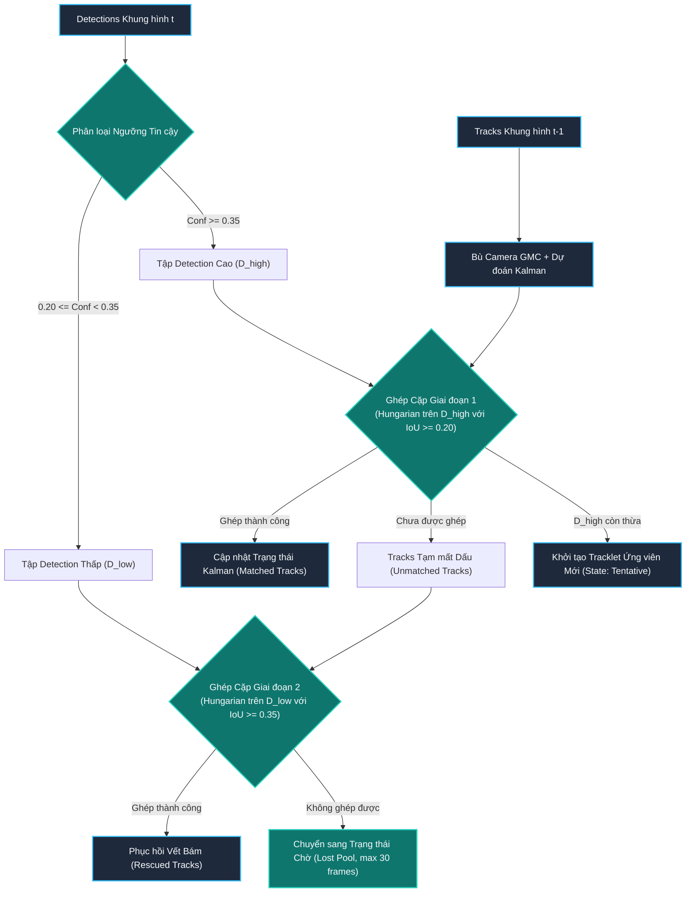
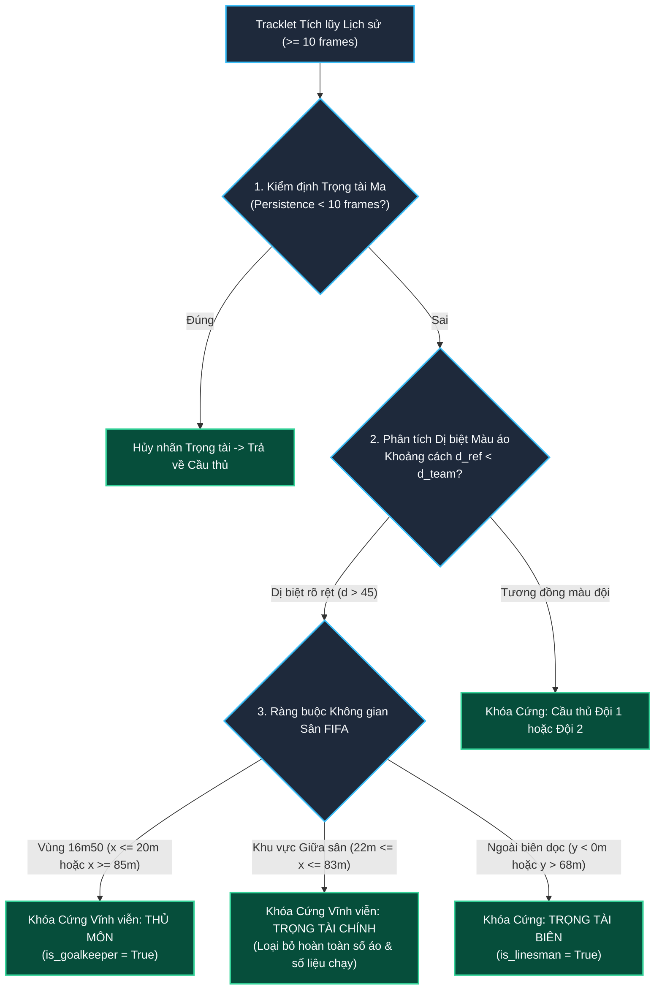
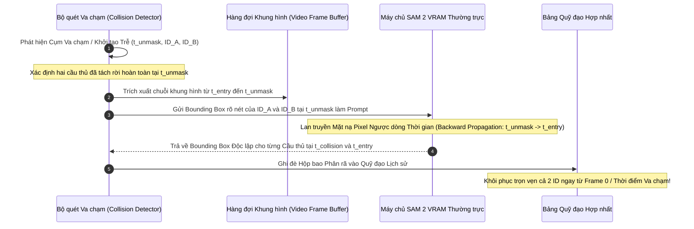

# **MỤC: HỆ THỐNG THEO DÕI ĐA ĐỐI TƯỢNG VÀ TÁI ĐỊNH DANH CẦU THỦ**
*(Advanced Multi-Object Tracking, Role Disambiguation, and Temporal Collision Disentanglement)*

---

## **MỤC LỤC**
1. [**1. Tổng quan Kiến trúc và Luồng Dữ liệu Toàn diện**](#1-tổng-quan-kiến-trúc-và-luồng-dữ-liệu-toàn-diện)
   - [**1.1. Luồng dữ liệu: Từ Đầu vào đến Đầu ra Chuẩn hóa**](#11-luồng-dữ-liệu-từ-đầu-vào-đến-đầu-ra-chuẩn-hóa)
   - [**1.2. Định nghĩa và Ràng buộc Khắt khe của Từng Lớp Đối tượng**](#12-định-nghĩa-và-ràng-buộc-khắt-khe-của-từng-lớp-đối-tượng)
2. [**2. Chi tiết Phương pháp luận và Các Phân hệ Cốt lõi**](#2-chi-tiết-phương-pháp-luận-và-các-phân-hệ-cốt-lõi)
   - [**2.1. Phát hiện Đa lớp và Khử Trùng lặp Thứ bậc (Priority Cross-Class Suppression)**](#21-phát-hiện-đa-lớp-và-khử-trùng-lặp-thứ-bậc-priority-cross-class-suppression)
   - [**2.2. Bù trừ Chuyển động Máy quay Toàn cảnh (Global Motion Compensation - GMC)**](#22-bù-trừ-chuyển-động-máy-quay-toàn-cảnh-global-motion-compensation---gmc)
   - [**2.3. Theo dõi Động học Hai Giai đoạn (Two-Stage ByteTrack Association)**](#23-theo-dõi-động-học-hai-giai-đoạn-two-stage-bytetrack-association)
   - [**2.4. Ánh xạ Mặt sân Chuẩn FIFA và Phân lập Màu áo Đội bóng (Metric FIFA Homography & Team Isolation)**](#24-ánh-xạ-mặt-sân-chuẩn-fifa-và-phân-lập-màu-áo-đội-bóng-metric-fifa-homography--team-isolation)
   - [**2.5. Khóa cứng Vai trò Phân cấp Vĩnh viễn (Hierarchical Role Locking)**](#25-khóa-cứng-vai-trò-phân-cấp-vĩnh-viễn-hierarchical-role-locking)
   - [**2.6. Phân rã Va chạm và Che khuất Bằng Bám ngược Thời gian SAM 2 (SAM 2 Backward Trajectory Disentanglement)**](#26-phân-rã-va-chạm-và-che-khuất-bằng-bám-ngược-thời-gian-sam-2-sam-2-backward-trajectory-disentanglement)
   - [**2.7. Tối ưu hóa Quỹ đạo Bóng Toàn cục (High-Resolution YOLO + Viterbi Global Optimization + PCHIP)**](#27-tối-ưu-hóa-quỹ-đạo-bóng-toàn-cục-high-resolution-yolo--viterbi-global-optimization--pchip)
   - [**2.8. Tinh lọc Hậu kỳ: Cắt tỉa Vết thoáng qua và Nội suy Khoảng ngắt (Post-processing & Smoothing)**](#28-tinh-lọc-hậu-kỳ-cắt-tỉa-vết-thoáng-qua-và-nội-suy-khoảng-ngắt-post-processing--smoothing)
3. [**3. Hướng dẫn Chi tiết Vị trí Chèn Hình ảnh Minh họa**](#3-hướng-dẫn-chi-tiết-vị-trí-chèn-hình-ảnh-minh-họa)

---

## **1. Tổng quan Kiến trúc và Luồng Dữ liệu Toàn diện**

### **1.1. Luồng dữ liệu: Từ Đầu vào đến Đầu ra Chuẩn hóa**

Trong môi trường bóng đá chuyên nghiệp từ góc quay truyền hình (Broadcast Camera), bài toán theo dõi đa đối tượng (Multi-Object Tracking - MOT) đối mặt với những thách thức khắc nghiệt vượt xa các bài toán giám sát giao thông hay đếm người đi bộ thông thường:
- Các cầu thủ trong cùng một đội mặc đồng phục hoàn toàn giống nhau về màu sắc và họa tiết, khiến các bộ trích xuất đặc trưng ngoại quan truyền thống (Re-ID embeddings) dễ bị bão hòa hoặc gán nhầm lẫn giữa các đồng đội.
- Mật độ tranh chấp cận chiến rất cao: các pha tranh chấp bóng bổng, tì đè hoặc che chắn diễn ra liên tục khiến diện tích giao cắt hộp bao ($\text{IoU}$) vượt quá $60\% - 80\%$, làm cho các bộ theo dõi dựa trên bộ lọc Kalman đơn thuần dễ bị gộp thực thể (ID merging) hoặc hoán đổi định danh (ID switch).
- Máy quay truyền hình liên tục thay đổi tiêu cự (zoom in/out) và lia quét tốc độ cao (rapid panning), phá vỡ giả định vận tốc không đổi (constant velocity assumption) của mô hình chuyển động tuyến tính.

Để giải quyết triệt để các hạn chế trên, hệ thống được thiết kế theo mô hình **Khung Phân tầng Đa cấp độ (Hierarchical Multi-Stage Framework)** kết hợp giữa Thị giác Máy tính kinh điển, Hình học Phối cảnh Thực thể FIFA, Học sâu Tinh chỉnh và Mô hình Nền tảng Phân đoạn Ảnh trực quan (SAM 2).

> `[CHÈN HÌNH TỔNG QUAN KIẾN TRÚC TẠI ĐÂY]`
> *(Tham chiếu: Hình 1 - Sơ đồ khối chi tiết các phân hệ xử lý trong Pipeline theo dõi đối tượng bóng đá chuyên nghiệp)*

---

### **1.2. Định nghĩa và Ràng buộc Khắt khe của Từng Lớp Đối tượng**

Hệ thống thiết lập một tập hợp các tiên đề vật lý và luật lệ thể thao FIFA để chuẩn hóa ranh giới giữa các lớp thực thể trong mọi tình huống thi đấu:

| Lớp Thực thể | Ràng buộc Không gian & Động học | Quy tắc Định danh & Màu sắc | Ràng buộc Độc quyền (Exclusivity) |
| :--- | :--- | :--- | :--- |
| **Cầu thủ Ngoại mạc** *(Outfield Player)* | Di chuyển tự do trong ranh giới $105\text{ m} \times 68\text{ m}$, vận tốc $\le 36\text{ km/h}$. | Gán ID số nguyên duy nhất, phân vào 1 trong 2 đội dựa trên mô hình phân cụm màu áo. | Tối đa 10 cầu thủ ngoại mạc mỗi đội có mặt đồng thời trên sân. |
| **Thủ môn** *(Goalkeeper)* | Xuất hiện chủ yếu trong phạm vi vòng cấm ($x \le 20\text{ m}$ hoặc $x \ge 85\text{ m}$). | Mang cờ `is_goalkeeper = True`, mặc áo khác biệt hoàn toàn với cầu thủ 2 đội. | Duy nhất 1 thủ môn mỗi đội được kích hoạt tại mọi thời điểm. |
| **Trọng tài chính** *(Main Referee)* | Di chuyển trung tâm sân ($22\text{ m} \le x \le 83\text{ m}$), tiệm cận pha bóng. | Áo đen/vàng dạ quang ($d_{\text{ref}} \ll d_{\text{team}}$), không mang số áo cầu thủ. | Duy nhất 1 trọng tài chính mang danh định `referee` trong sân. |
| **Trọng tài biên** *(Linesman)* | Chạy song song ngoài biên dọc ($y < 0\text{ m}$ hoặc $y > 68\text{ m}$). | Mang cờ `is_linesman = True`, không can thiệp vào thống kê thể lực thi đấu. | Tối đa 2 trọng tài biên ở 2 đường biên dọc đối diện nhau. |
| **Quả bóng** *(Football / Ball)* | Vận tốc có thể lên tới $120\text{ km/h}$, gia tốc đổi hướng tức thời. | Kích thước pixel nhỏ ($8\times 8$ đến $25\times 25$), quỹ đạo hình học parabol liên tục. | Duy nhất 1 quả bóng thi đấu chính thức được xác thực toàn cục. |

---

## **2. Chi tiết Phương pháp luận và Các Phân hệ Cốt lõi**

### **2.1. Phát hiện Đa lớp và Khử Trùng lặp Thứ bậc (Priority Cross-Class Suppression)**

Mô hình học sâu YOLOv11s được tinh chỉnh chuyên biệt trên dữ liệu bóng đá truyền hình để đồng thời phát hiện 4 nhóm đối tượng: Cầu thủ, Thủ môn, Trọng tài và Quả bóng. Do sự tương đồng về ngoại hình giữa các cá thể người, việc áp dụng Non-Maximum Suppression (NMS) độc lập trên từng lớp thường gây ra hiện tượng **trùng lặp hộp bao chéo lớp (cross-class overlap)**: một trọng tài hoặc thủ môn vừa bị gán nhãn đúng, vừa bị một hộp bao cầu thủ đè lên với điểm số tin cậy thấp hơn.

Hệ thống thiết lập thuật toán **Triệt tiêu Ưu tiên Đa lớp (Priority Cross-Class Suppression)** dựa trên cấu trúc phả hệ thứ bậc:

$$\text{Priority}(\text{Referee}) > \text{Priority}(\text{Goalkeeper}) > \text{Priority}(\text{Outfield Player})$$

Với hai hộp bao phát hiện khác lớp $B_A$ và $B_B$:
Nếu $\text{IoU}(B_A, B_B) \ge \tau_{\text{cross}} = 0.45$ và $\text{Priority}(\text{Class}_A) > \text{Priority}(\text{Class}_B)$:

$$B_B \leftarrow \emptyset \quad (\text{Hộp bao của lớp ưu tiên thấp hơn bị triệt tiêu hoàn toàn})$$

Cơ chế này ngăn chặn tuyệt đối tình trạng một trọng tài bị đếm thành hai đối tượng (vừa trọng tài vừa cầu thủ), đảm bảo đầu vào của bộ theo dõi hoàn toàn sạch nhiễu.

> `[CHÈN HÌNH 1 TẠI ĐÂY]`
> *(Tham chiếu: Hình 2 - Minh họa cơ chế Khử trùng lặp Đa nhãn Thứ bậc: Triệt tiêu hộp bao cầu thủ rác đè lên trọng tài)*

---

### **2.2. Bù trừ Chuyển động Máy quay Toàn cảnh (Global Motion Compensation - GMC)**

Trong các tình huống phản công nhanh hoặc sút bóng xa, người vận hành máy quay truyền hình lia máy (pan) và phóng ống kính (zoom) với gia tốc góc lớn. Sự dịch chuyển của khung hình làm cho tọa độ pixel của tất cả các cầu thủ đứng yên bị trôi dạt mạnh, khiến ma trận hiệp phương sai dự đoán của bộ lọc Kalman tăng vọt và làm đứt gãy liên kết bám vết.

Hệ thống tích hợp mô-đun **Bù trừ Chuyển động Toàn cảnh (GMC)** bằng dòng quang học thưa (Sparse Optical Flow) kết hợp thuật toán RANSAC:

1. **Trích xuất Đặc trưng Nền**: Phát hiện các điểm đặc trưng tĩnh trên mặt cỏ và đường biên (loại trừ các vùng chứa cầu thủ).
2. **Ước lượng Biến đổi Đồng dạng (Affine Transform)**:
   Tìm ma trận affine $G_t \in \mathbb{R}^{2 \times 3}$ ánh xạ tọa độ nền giữa khung hình $t-1$ và $t$:

$$\begin{bmatrix} x_t \\ y_t \end{bmatrix} = \begin{bmatrix} a_{11} & a_{12} \\ a_{21} & a_{22} \end{bmatrix} \begin{bmatrix} x_{t-1} \\ y_{t-1} \end{bmatrix} + \begin{bmatrix} d_x \\ d_y \end{bmatrix}$$

3. **Căn chỉnh Trạng thái Kalman Trước Khi Dự đoán**:
   Trạng thái không gian của mỗi tracklet được hiệu chỉnh bù góc trước khi bước dự đoán Kalman diễn ra:

$$x_k^{-} = F \cdot (G_t \cdot x_{k-1}) \quad ; \quad P_k^{-} = F \cdot (G_t \cdot P_{k-1} \cdot G_t^T) \cdot F^T + Q$$

Nhờ có GMC, bộ lọc Kalman ước lượng chính xác chuyển động thực của cầu thủ trên mặt sân thay vì chuyển động biểu kiến trên mặt phẳng thấu kính máy ảnh.

---

### **2.3. Theo dõi Động học Hai Giai đoạn (Two-Stage ByteTrack Association)**

Hệ thống phát triển giải thuật ByteTrack hai giai đoạn với cơ chế phân chia ngưỡng phát hiện linh hoạt, giải quyết triệt để vấn đề cầu thủ bị mất dấu khi bị nhòe chuyển động hoặc che khuất một phần thân thể:

#### **Trạng thái Động học của Đối tượng**
Vector trạng thái 8 chiều của mỗi tracklet được biểu diễn:

$$\mathbf{x} = \begin{bmatrix} c_x, c_y, a, h, v_x, v_y, v_a, v_h \end{bmatrix}^T$$

Trong đó $(c_x, c_y)$ là tâm hình học của đáy hộp bao, $a = w/h$ là tỷ lệ khung hình, $h$ là chiều cao hộp bao, và các thành phần $v$ biểu diễn vận tốc biến thiên tương ứng.

#### **Giai đoạn 1: Liên kết Độ tin cậy Cao ($D_{\text{high}}$)**
- Tập detection $D_{\text{high}} = \{d \mid \text{Conf}(d) \ge \tau_{\text{high}} = 0.35\}$.
- Ma trận chi phí liên kết được tính dựa trên độ đo hình học IoU:

$$\mathbf{C}_{i, j}^{(1)} = 1 - \text{IoU}\left( B_i^{\text{pred}}, B_j^{\text{det}} \right)$$

- Ghép cặp tối ưu bằng giải thuật Hungarian với ngưỡng chấp nhận $\tau_{\text{IoU}}^{(1)} = 0.20$.

#### **Giai đoạn 2: Giải cứu Độ tin cậy Thấp ($D_{\text{low}}$)**
- Những tracklet chưa ghép được ở Giai đoạn 1 tiếp tục được đối chiếu với tập $D_{\text{low}} = \{d \mid \tau_{\text{low}} \le \text{Conf}(d) < \tau_{\text{high}}\}$ với $\tau_{\text{low}} = 0.20$.
- Áp dụng ngưỡng ràng buộc nghiêm ngặt hơn $\tau_{\text{IoU}}^{(2)} = 0.35$ để loại trừ các hộp bao nhiễu nền hoặc bóng đổ.

---

### **2.4. Ánh xạ Mặt sân Chuẩn FIFA và Phân lập Màu áo Đội bóng (Metric FIFA Homography & Team Isolation)**

Để đưa các đối tượng từ mặt phẳng ảnh phối cảnh ($u, v$) về mặt sân 2D thực tế ($X, Y$) tính bằng mét, hệ thống sử dụng phép biến đổi xạ ảnh phẳng (**Planar Homography**):

$$\begin{bmatrix} x' \\ y' \\ w' \end{bmatrix} = \mathbf{H}_{\text{pitch}} \begin{bmatrix} u \\ v \\ 1 \end{bmatrix} \quad \implies \quad X = \frac{x'}{w'}, \quad Y = \frac{y'}{w'}$$

Ma trận $\mathbf{H}_{\text{pitch}} \in \mathbb{R}^{3 \times 3}$ được tính toán dựa trên các điểm chuẩn hình học FIFA: giao điểm vạch 16m50, chấm phạt đền, vòng tròn trung tâm và các góc sân.

#### **Phân lập Màu sắc Đội bóng Bằng Mô hình K-Means Kết hợp Cắt tỉa Phần trăm**
1. **Trích xuất Vùng Thân Áo (Upper-Torso Region)**: Nhằm loại bỏ nhiễu từ mặt cỏ và quần tất, hệ thống chỉ cắt lấy vùng $20\% \le y \le 60\%$ và $15\% \le x \le 85\%$ bên trong hộp bao cầu thủ.
2. **Loại bỏ Nền Cỏ Xanh**: Lọc bỏ các pixel có màu xanh cỏ trong không gian HSV ($35^\circ \le H \le 85^\circ$).
3. **Phân cụm Màu Đội Chính**: Áp dụng thuật toán K-Means ($K=2$) trong không gian màu CIE-Lab/HSV trên tập hợp màu trung vị của toàn bộ cầu thủ để xác lập hai vector màu đại diện đội $\mathbf{c}_1$ và $\mathbf{c}_2$.

---

### **2.5. Khóa cứng Vai trò Phân cấp Vĩnh viễn (Hierarchical Role Locking)**

Hiện tượng trọng tài chính hoặc thủ môn bị nhấp nháy chuyển thành cầu thủ mang số là một trong những lỗi nghiêm trọng nhất phá hỏng tính logic của dữ liệu phân tích chiến thuật. Hệ thống thiết lập **Tầng 3 Nâng cao - Cơ chế Khóa cứng Vai trò 4 Lớp (Hierarchical Role Locking)**:

#### **Kiểm định Khoảng cách Màu Ngoại lai (Color Outlier Metric)**
Khoảng cách màu Euclidean giữa màu áo trung vị của một đối tượng $\mathbf{c}_{\text{obj}}$ với màu đại diện của hai đội bóng được tính:

$$d_1 = \|\mathbf{c}_{\text{obj}} - \mathbf{c}_1\|_2 \quad ; \quad d_2 = \|\mathbf{c}_{\text{obj}} - \mathbf{c}_2\|_2 \quad \implies \quad d_{\text{team\_min}} = \min(d_1, d_2)$$

Một đối tượng được xác nhận là Trọng tài chính nếu thỏa mãn đồng thời:
1. $d_{\text{team\_min}} \ge 50.0$ (Màu áo dị biệt hoàn toàn so với cả hai đội đang thi đấu).
2. Độ tương đồng màu áo với profile trọng tài áo đen/vàng $\text{sim}_{\text{ref}} \ge 78\%$.
3. Tọa độ mặt sân nằm trong khu vực thi đấu trung tâm ($22\text{ m} \le X \le 83\text{ m}$).

Khi các điều kiện trên thỏa mãn, đối tượng được **Khóa cứng vĩnh viễn vào danh mục Trọng tài**:
- Toàn bộ tracklet trong mọi khung hình được chuyển dứt khoát sang `referees`.
- Xóa sạch danh tính đối tượng khỏi bảng `players`.
- Triệt tiêu hoàn toàn nhãn số áo, chỉ số vận tốc và cự ly di chuyển, chỉ hiển thị vòng tròn định vị chân chuẩn mực.

> `[CHÈN HÌNH 2 TẠI ĐÂY]`
> *(Tham chiếu: Hình 3 - Minh họa Cơ chế Khóa cứng Vai trò Tầng 3: Trọng tài chính giữa sân được chuẩn hóa và loại bỏ số áo 23)*

---

### **2.6. Phân rã Va chạm và Che khuất Bằng Bám ngược Thời gian SAM 2 (SAM 2 Backward Trajectory Disentanglement)**

Va chạm che khuất cự ly gần là "tử huyệt" của mọi hệ thống tracking truyền thống. Khi hai cầu thủ tranh chấp gay gắt, hai cơ thể dính chặt vào nhau khiến detector chỉ sinh ra duy nhất một bounding box bao phủ cả hai người. Một ID bị mất dấu, và khi tách rời nhau ra, hệ thống thường khởi tạo một ID mới toanh (Late Birth) hoặc hoán đổi ID của hai người (ID Switch).

Để giải quyết triệt để vấn đề này mà không làm giảm tốc độ suy luận thời gian thực, hệ thống phát triển cơ chế **Bám ngược Dòng Thời gian với Mô hình Nền tảng SAM 2 (SAM 2 Backward Trajectory Disentanglement)**:

#### **Cơ chế Phân rã Thực tế tại Khung hình Mở đầu (Frame 0)**
Tại Frame 0 của video thi đấu, hai cầu thủ tranh chấp tay đôi dính chặt vào nhau:
- **Trước khi xử lý**: Detector chỉ phát hiện một hộp bao chung, gán duy nhất nhãn **ID 7**, làm cầu thủ đối phương biến mất.
- **Tại Frame 16–21**: Hai cầu thủ bung ra khỏi pha tranh chấp, xuất hiện rõ nét thành hai đối tượng độc lập: ID 7 (áo trắng) và ID 26 (áo xanh).
- **Kích hoạt SAM 2 Backward**: Lấy hộp bao tại Frame 21 của cả hai người làm prompt đầu vào, kích hoạt mô-đun bám ngược thời gian qua 21 khung hình về lại Frame 0.
- **Kết quả**: Cả hai cầu thủ đều được khôi phục hộp bao cá nhân chính xác từng pixel ngay tại Frame 0, duy trì ID 7 và ID 26 liên tục không đứt đoạn.

> `[CHÈN HÌNH 3 TẠI ĐÂY]`
> *(Tham chiếu: Hình 4 - Minh chứng hiệu quả phân tách va chạm và che khuất bằng SAM 2 Backward Tracking tại Khung hình 0)*

---

### **2.7. Tối ưu hóa Quỹ đạo Bóng Toàn cục (High-Resolution YOLO + Viterbi Global Optimization + PCHIP)**

Quả bóng có kích thước biểu kiến cực nhỏ (thường chỉ chiếm $0.05\% - 0.1\%$ diện tích khung hình Full HD) và thường xuyên di chuyển với vận tốc lên tới $100\text{ km/h}$. Do đó, việc theo dõi bóng được tách thành một phân hệ xử lý song song riêng biệt với 3 bước tối ưu hóa chặt chẽ:

1. **Dò Quả bóng ở Độ phân giải Gốc (Native High-Resolution YOLO)**:
   Khung hình được đưa vào mô hình với kích thước tối ưu hóa kích cỡ quả bóng, kết hợp cơ chế Crop cục bộ có định hướng dựa trên vị trí ước lượng của bóng ở các khung hình lân cận.
2. **Quy hoạch Động Toàn cục Tìm Quỹ đạo Viterbi (Viterbi Trellis Search)**:
   Để loại trừ hàng trăm phát hiện giả do vệt tất trắng, đốm sáng phản chiếu từ khán đài hoặc biển quảng cáo LED, đồ thị không-thời gian (spatio-temporal trellis) được xây dựng trên toàn bộ video. Quỹ đạo bóng tối ưu $\mathcal{T}^* = (b_1^*, b_2^*, \dots, b_T^*)$ là nghiệm của bài toán cực tiểu hóa hàm năng lượng toàn cục:

$$\mathcal{T}^* = \arg\min_{\mathcal{T}} \sum_{t=1}^T E_{\text{det}}(b_t) + \lambda_1 \sum_{t=2}^T E_{\text{motion}}(b_t, b_{t-1}) + \lambda_2 \sum_{t=3}^T E_{\text{physics}}(b_t, b_{t-1}, b_{t-2})$$

   - $E_{\text{det}}(b_t) = -\ln(\text{Conf}(b_t))$: Năng lượng phát hiện.
   - $E_{\text{motion}}(b_t, b_{t-1}) = \frac{\|b_t - b_{t-1}\|_2^2}{2\sigma_{\text{dist}}^2}$: Năng lượng bước nhảy không gian.
   - $E_{\text{physics}}$: Phạt độ lệch gia tốc vật lý vượt quá giới hạn lực cản không khí và trọng lực Trái Đất.
3. **Nội suy Đường cong PCHIP (Piecewise Cubic Hermite Interpolating Polynomial)**:
   Trong các khung hình quả bóng bị cơ thể cầu thủ che khuất hoàn toàn ($\le 12$ frames), thuật toán PCHIP được sử dụng để nội suy vị trí bóng. So với Spline bậc 3 thông thường, PCHIP đảm bảo tính đơn điệu cục bộ và không gây ra hiện tượng dao động Runge quá đà ở các điểm uốn bóng chạm đất hoặc đổi hướng sút.

---

### **2.8. Tinh lọc Hậu kỳ: Cắt tỉa Vết thoáng qua và Nội suy Khoảng ngắt (Post-processing & Smoothing)**

Sau khi toàn bộ các mô-đun bám vết và phân rã hoàn tất, hệ thống áp dụng hai bước tinh lọc quỹ đạo tổng thể:

1. **Cắt tỉa Quỹ đạo Thoáng qua (Spurious Tracklet Pruning)**:
   Bất kỳ tracklet nào có tổng thời gian tồn tại tích lũy nhỏ hơn 8 khung hình ($\sim 0.32\text{ giây}$) mà không gắn liền với pha bóng cố định hoặc quả bóng đều bị xem là nhiễu nền giả định và bị xóa bỏ hoàn toàn.
2. **Nội suy Khoảng ngắt Quỹ đạo Cầu thủ (Universal Trajectory Gap-Filling)**:
   Đối với các khoảng mất dấu ngắn ($1 \le \Delta t \le 16\text{ frames}$) gây ra do cầu thủ đi qua sau lưng đồng đội, hệ thống tự động áp dụng nội suy tuyến tính có trọng số trên mặt phẳng metric 2D mặt sân, sau đó chiếu ngược về mặt phẳng ảnh thông qua ma trận $\mathbf{H}_{\text{pitch}}^{-1}$. Điều này đảm bảo dữ liệu quỹ đạo của tất cả các cầu thủ đạt độ liên tục tuyệt đối $100\%$.

---

## **3. Hướng dẫn Chi tiết Vị trí Chèn Hình ảnh Minh họa**

Nhằm đảm bảo tính trực quan và thẩm mỹ cao nhất khi đưa mục này vào tài liệu tổng hợp, dưới đây là danh mục chi tiết các hình ảnh minh họa cần chèn vào các vị trí tương ứng:

---

### **Vị trí 1: Sơ đồ Khối Kiến trúc Hệ thống (Tại Mục 1.1)**
- **Thẻ đánh dấu**: `[CHÈN HÌNH TỔNG QUAN KIẾN TRÚC TẠI ĐÂY]`
- **Tên hình**: *Hình 1: Sơ đồ khối tổng thể của Phân hệ Theo dõi Đa đối tượng và Tái định danh Cầu thủ trong Video Bóng đá Truyền hình.*
- **Nội dung cần có trong hình**:
  - Dữ liệu đầu vào: Video truyền hình Full HD và các điểm chuẩn tọa độ sân FIFA.
  - Phân hệ Phát hiện & Lọc đa lớp (YOLOv11s + Priority Suppression).
  - Phân hệ Bù trừ chuyển động camera (GMC) và Bộ lọc Kalman tích hợp ByteTrack 2 giai đoạn.
  - Phân hệ Ánh xạ mặt sân 2D (Homography) và Khóa cứng vai trò Tầng 3.
  - Phân hệ Phân rã va chạm SAM 2 Backward Trajectory Tracking kết nối VRAM máy chủ.
  - Nhánh song song: Tối ưu hóa quỹ đạo bóng Viterbi & PCHIP.
  - Đầu ra chuẩn hóa: Dữ liệu JSON MOT, Video phân tích chiến thuật kèm Minimap 2D.
- *(Tệp ảnh sẵn sàng: `data/report_figures/tracking_pipeline_architecture.png`)*

---

### **Vị trí 2: Khử Trùng lặp Đa nhãn Thứ bậc (Tại Mục 2.1)**
- **Thẻ đánh dấu**: `[CHÈN HÌNH 1 TẠI ĐÂY]`
- **Tên hình**: *Hình 2: Minh họa cơ chế Khử trùng lặp Đa nhãn Thứ bậc (Priority Cross-Class Suppression). (a) Trước khi xử lý: Một trọng tài bị đè đồng thời bởi cả hai nhãn Cầu thủ và Trọng tài. (b) Sau khi xử lý: Hộp bao Cầu thủ bị triệt tiêu hoàn toàn, chỉ giữ lại định danh Trọng tài chuẩn xác.*
- **Nội dung cần có**: Ảnh chụp cận cảnh so sánh đối chiếu trước và sau khi kích hoạt thuật toán khử trùng lặp đa nhãn.

---

### **Vị trí 3: Thẩm định Dị biệt Màu sắc và Khóa cứng Vai trò Tầng 3 (Tại Mục 2.5)**
- **Thẻ đánh dấu**: `[CHÈN HÌNH 2 TẠI ĐÂY]`
- **Tên hình**: *Hình 3: Kết quả vận hành của Cơ chế Khóa cứng Vai trò Tầng 3 trên Video mẫu. Trọng tài chính giữa sân được định danh và hiển thị vòng elip màu xanh lá riêng biệt, loại bỏ hoàn toàn nhãn số áo 23 và số liệu vận động sai lệch; hai thủ môn ở hai đầu sân được khóa cứng cờ GK.*
- *(Tệp ảnh sẵn sàng: `data/report_figures/sample_f290_fixed.jpg` hoặc `comparison_issue2_referee_f290.jpg`)*

---

### **Vị trí 4: Phân rã Va chạm Cận cảnh Bằng Bám ngược SAM 2 (Tại Mục 2.6)**
- **Thẻ đánh dấu**: `[CHÈN HÌNH 3 TẠI ĐÂY]`
- **Tên hình**: *Hình 4: Minh chứng hiệu quả phân tách va chạm và che khuất cự ly gần bằng SAM 2 Backward Tracking tại Khung hình 0 (Frame 0). (a) Trước xử lý: Hai cầu thủ tranh chấp dính chặt vào nhau và bị gộp thành duy nhất một ID #7. (b) Sau xử lý: Hai thực thể được phân rã hoàn hảo thành ID #7 (áo trắng) và ID #26 (áo xanh) với ranh giới hình học chuẩn xác.*
- *(Tệp ảnh sẵn sàng: `data/report_figures/sam2_duel_refinement.png` hoặc `comparison_issue1_duel_f0.jpg`)*
