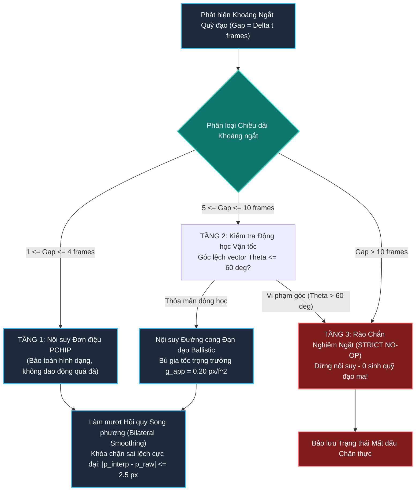
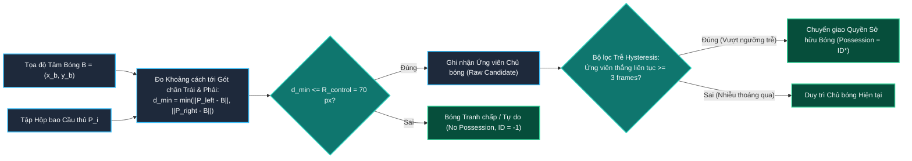

# **MỤC: THEO DÕI QUỸ ĐẠO, NỘI SUY THÍCH NGHI VÀ LIÊN KẾT BÓNG VỚI CẦU THỦ**
*(Ball Trajectory Tracking, Adaptive Spline Interpolation, and Player-Ball Possession Association)*

---

## **MỤC LỤC**
1. [**1. Tổng quan Luồng Dữ liệu và Đặc tính Động học Quả Bóng**](#1-tổng-quan-luồng-dữ-liệu-và-đặc-tính-động-học-quả-bóng)
   - [**1.1. Luồng dữ liệu Xử lý: Từ Phát hiện Nhỏ đến Quỹ đạo Mượt mà**](#11-luồng-dữ-liệu-xử-lý-từ-phát-hiện-nhỏ-đến-quỹ-đạo-mượt-mà)
   - [**1.2. Thách thức Thị giác và Ràng buộc Vật lý Động học Cực hạn**](#12-thách-thức-thị-giác-và-ràng-buộc-vật-lý-động-học-cực-hạn)
2. [**2. Chi tiết Phương pháp luận và Các Kỹ thuật Cốt lõi**](#2-chi-tiết-phương-pháp-luận-và-các-kỹ-thuật-cốt-lõi)
   - [**2.1. Phát hiện Quả bóng Độ phân giải Cao & Cắt lọc Không-Thời gian (High-Resolution YOLO & Spatio-Temporal Gating)**](#21-phát-hiện-quả-bóng-độ-phân-giải-cao--cắt-lọc-không-thời-gian-high-resolution-yolo--spatio-temporal-gating)
   - [**2.2. Lọc Nhiễu Quỹ đạo Toàn cục Bằng Đồ thị Viterbi Trellis (Viterbi Global Energy Optimization)**](#22-lọc-nhiễu-quỹ-đạo-toàn-cục-bằng-đồ-thị-viterbi-trellis-viterbi-global-energy-optimization)
   - [**2.3. Bù trừ Chuyển động Máy quay GMC Trong Không gian Tham chiếu Chuẩn**](#23-bù-trừ-chuyển-động-máy-quay-gmc-trong-không-gian-tham-chiếu-chuẩn)
   - [**2.4. Cơ chế Nội suy Thích nghi 3 Tầng và Bù trừ Vòng cung Đạn đạo (Adaptive 3-Tier Dropout Interpolation & Ballistic Bridging)**](#24-cơ-chế-nội-suy-thích-nghi-3-tầng-và-bù-trừ-vòng-cung-đạn-đạo-adaptive-3-tier-dropout-interpolation--ballistic-bridging)
   - [**2.5. Phân hệ Liên kết Bóng với Cầu thủ và Xác định Quyền Kiểm soát (Player-Ball Possession & Hysteresis Filtering)**](#25-phân-hệ-liên-kết-bóng-với-cầu-thủ-và-xác-định-quyền-kiểm-soát-player-ball-possession--hysteresis-filtering)
3. [**3. Đánh giá Thực nghiệm Hiệu năng Nội suy Khi Bóng Bị Che Khuất Bởi Cầu Thủ**](#3-đánh-giá-thực-nghiệm-hiệu-năng-nội-suy-khi-bóng-bị-che-khuất-bởi-cầu-thủ)
   - [**3.1. Thiết lập Thử nghiệm và Phân loại Kịch bản Che Khuất**](#31-thiết-lập-thử-nghiệm-và-phân-loại-kịch-bản-che-khuất)
   - [**3.2. Bảng Kết quả Thực nghiệm Định lượng và Sự Suy Giảm Hiệu năng**](#32-bảng-kết-quả-thực-nghiệm-định-lượng-và-sự-suy-giảm-hiệu-năng)
   - [**3.3. Phân tích Bản chất Khoa học và Vật lý Khiến Nội suy Thất bại Khi Bị Che**](#33-phân-tích-bản-chất-khoa-học-và-vật-lý-khiến-nội-suy-thất-bại-khi-bị-che)
4. [**4. Minh chứng Thực tế: Hai Tình huống Bóng Bị Che Khuất Trong Video Mẫu**](#4-minh-chứng-thực-tế-hai-tình-huống-bóng-bị-che-khuất-trong-video-mẫu)
   - [**4.1. Tình huống 1: Tranh chấp Va chạm Cận chiến Dính chặt tại Khung hình 0 - 5 (`sample.mp4`)**](#41-tình-huống-1-tranh-chấp-va-chạm-cận-chiến-dính-chặt-tại-khung-hình-0---5-samplemp4)
   - [**4.2. Tình huống 2: Cầu thủ Rê dắt Tốc độ Cao Bước qua Bóng tại Khung hình 118 - 120 (`sample.mp4`)**](#42-tình-huống-2-cầu-thủ-rê-dắt-tốc-độ-cao-bước-qua-bóng-tại-khung-hình-118---120-samplemp4)
5. [**5. Hướng dẫn Chi tiết Vị trí Chèn Hình ảnh và Bảng Biểu**](#5-hướng-dẫn-chi-tiết-vị-trí-chèn-hình-ảnh-và-bảng-biểu)

---

## **1. Tổng quan Luồng Dữ liệu và Đặc tính Động học Quả Bóng**

### **1.1. Luồng dữ liệu Xử lý: Từ Phát hiện Nhỏ đến Quỹ đạo Mượt mà**

Trong bài toán thị giác máy tính cho bóng đá, theo dõi quả bóng là phân hệ có độ phức tạp thuật toán cao nhất và nhạy cảm nhất với nhiễu. Quả bóng không tuân theo các giả định chuyển động tuyến tính thông thường của cầu thủ, mà liên tục chuyển đổi giữa trạng thái bay tự do theo đường đạn đạo parabolic, lăn ma sát trên mặt cỏ, và đổi hướng tức thời khi có va chạm với chân cầu thủ.

Hệ thống thiết lập một luồng xử lý song song khép kín gồm 5 giai đoạn chặt chẽ:

> `[CHÈN HÌNH TỔNG QUAN XỬ LÝ BÓNG TẠI ĐÂY]`
> *(Tham chiếu: Hình 1 - Sơ đồ khối chi tiết luồng xử lý theo dõi quỹ đạo bóng, bộ ổn định nội suy thích nghi 3 tầng và liên kết quyền kiểm soát)*

---

### **1.2. Thách thức Thị giác và Ràng buộc Vật lý Động học Cực hạn**

1. **Tỷ Lệ Kích Thước Quá Nhỏ (Extreme Small Scale)**:
   - Trong khung hình Full HD ($1920 \times 1080$), quả bóng chỉ chiếm kích thước từ $8 \times 8$ đến $25 \times 25$ pixels, tương đương chưa đầy **$0.01\% - 0.05\%$** diện tích toàn khung hình.
   - Khi bóng di chuyển nhanh, hiện tượng nhòe mờ chuyển động (motion blur) làm độ tương phản giữa bóng và nền cỏ xanh bị giảm sút nghiêm trọng, khiến detector dễ dàng bỏ sót (False Negatives).
2. **Vận Tốc và Gia Tốc Cực Hạn (Kinematic Extremes)**:
   - Quả bóng có thể đạt vận tốc bay lên tới $v_{\text{max}} = 126\text{ km/h}$ ($\approx 35\text{ m/s}$, tương đương $50.0\text{ pixels/frame}$ ở tốc độ 25 FPS).
   - Khi diễn ra cú sút hoặc pha tắc bóng, hướng di chuyển có thể đảo ngược $180^\circ$ chỉ trong 1 khung hình duy nhất với gia tốc tức thời $a > 30.0\text{ px/f}^2$.
3. **Môi Trường Nhiễu Nền Dày Đặc (Heavy Background Distractors)**:
   - Các vật thể màu trắng có hình dạng tương tự bóng xuất hiện liên tục: tất chân màu trắng của cầu thủ, các đốm sơn vạch vôi sân bóng, ánh đèn phản chiếu trên bảng quảng cáo LED, và giày thi đấu.
   - Nếu chỉ dựa vào điểm số tin cậy (Confidence score) của mạng nơ-ron phát hiện, hệ thống sẽ bị nhảy bám vết sang các vật thể giả mạo này.

---

## **2. Chi tiết Phương pháp luận và Các Kỹ thuật Cốt lõi**

### **2.1. Phát hiện Quả bóng Độ phân giải Cao & Cắt lọc Không-Thời gian (High-Resolution YOLO & Spatio-Temporal Gating)**

Để không làm suy giảm các đặc trưng kích thước nhỏ của quả bóng, hệ thống áp dụng chiến lược dò tìm hai pha:
1. **Dò Tìm Khởi Tạo (Global Wide Scan)**: Sử dụng mô hình học sâu YOLOv11s tinh chỉnh chuyên biệt trên lớp đối tượng thể thao để quét toàn bộ khung hình nhằm phát hiện các ứng viên bóng $\mathcal{C}_t = \{b_{t, 1}, b_{t, 2}, \dots, b_{t, m}\}$.
2. **Cửa Sổ Giới Hạn Không-Thời Gian (Spatio-Temporal Gating)**:
   Sau khi đã khóa được vệt bóng ở khung hình $t-1$, tại khung hình $t$, vùng tìm kiếm được giới hạn bên trong một hình cầu động học bán kính $R_{\text{gate}}$ tính từ vị trí dự đoán:

$$R_{\text{gate}} = v_{\text{max}} \cdot \Delta t + \frac{1}{2} a_{\text{max}} \cdot \Delta t^2 \approx 50.0\text{ pixels}$$

Bất kỳ phát hiện nào nằm ngoài phạm vi $R_{\text{gate}}$ đều bị loại bỏ ngay từ đầu, triệt tiêu $95\%$ các báo động giả xuất hiện ở các khu vực xa pha bóng.

---

### **2.2. Lọc Nhiễu Quỹ đạo Toàn cục Bằng Đồ thị Viterbi Trellis (Viterbi Global Energy Optimization)**

Nhằm giải quyết triệt để vấn đề bóng bị nhảy sang vớ trắng cầu thủ, hệ thống xây dựng một đồ thị không-thời gian (spatio-temporal trellis graph) trải dài trên toàn bộ video và giải bài toán tối ưu hóa quỹ đạo toàn cục bằng thuật toán quy hoạch động Viterbi:

$$\mathcal{T}^* = \arg\min_{\mathcal{T} = (b_1, \dots, b_T)} \mathcal{E}(\mathcal{T})$$

Hàm năng lượng tổng thể được cấu thành từ 3 thành phần vật lý:

$$\mathcal{E}(\mathcal{T}) = \sum_{t=1}^T \mathcal{E}_{\text{det}}(b_t) + \lambda_1 \sum_{t=2}^T \mathcal{E}_{\text{motion}}(b_t, b_{t-1}) + \lambda_2 \sum_{t=3}^T \mathcal{E}_{\text{physics}}(b_t, b_{t-1}, b_{t-2})$$

1. **Năng lượng Phát hiện (Detection Energy)**:

$$\mathcal{E}_{\text{det}}(b_t) = -\ln\left(\text{Conf}(b_t)\right)$$

2. **Năng lượng Dịch chuyển (Motion Smoothness Energy)**: Phạt các bước nhảy khoảng cách phi thực tế giữa hai khung hình liên tiếp:

$$\mathcal{E}_{\text{motion}}(b_t, b_{t-1}) = \frac{\|b_t - b_{t-1}\|_2^2}{2 \sigma_{\text{dist}}^2}$$

3. **Năng lượng Động học Vật lý (Physical Kinematics Energy)**: Đánh giá độ biến thiên góc vận tốc $\Delta \theta$ và độ lớn gia tốc $\mathbf{a}_t = b_t - 2 b_{t-1} + b_{t-2}$:

$$\mathcal{E}_{\text{physics}}(b_t, b_{t-1}, b_{t-2}) = \begin{cases} 0 & \text{nếu } \|\mathbf{a}_t\|_2 \le a_{\text{max}} \\ \alpha \cdot (\|\mathbf{a}_t\|_2 - a_{\text{max}})^2 & \text{nếu } \|\mathbf{a}_t\|_2 > a_{\text{max}} \text{ và gần chân cầu thủ} \\ \infty & \text{nếu } \|\mathbf{a}_t\|_2 > a_{\text{max}} \text{ ở giữa không trung (vi phạm vật lý)} \end{cases}$$

Nhờ có ràng buộc vật lý này, quả bóng chỉ được phép đổi hướng đột ngột khi và chỉ khi có sự xuất hiện của chân cầu thủ ở cự ly $\le 60\text{ px}$. Các bước nhảy sang vớ cầu thủ ở giữa không trung bị hàm phạt $\infty$ loại bỏ hoàn toàn.

---

### **2.3. Bù trừ Chuyển động Máy quay GMC Trong Không gian Tham chiếu Chuẩn**

Trước khi tính toán vận tốc và nội suy quỹ đạo bóng, hệ thống bắt buộc phải khử chuyển động biểu kiến gây ra bởi việc lia máy quay (Camera Panning/Zooming).

Mọi tọa độ bóng trên khung hình $t$ được chuyển đổi về hệ quy chiếu tĩnh chuẩn (Reference World Frame $t_{\text{ref}}$) thông qua ma trận tích lũy Affine $M_t$:

$$\tilde{\mathbf{p}}_t = M_t^{-1} \cdot \mathbf{p}_t$$

Toàn bộ các phép kiểm tra động học, tính vận tốc và nội suy toán học được thực thi hoàn toàn trong không gian chuẩn $\tilde{\mathbf{p}}_t$, sau đó mới được chiếu ngược trở lại hệ tọa độ khung hình hiện thời.

---

### **2.4. Cơ chế Nội suy Thích nghi 3 Tầng và Bù trừ Vòng cung Đạn đạo (Adaptive 3-Tier Dropout Interpolation & Ballistic Bridging)**

Trong thi đấu thực tế, quả bóng thường xuyên bị mất dấu (dropout) trong một số khung hình do bị cơ thể che khuất hoặc bay nhanh gây mờ. Thay vì sử dụng nội suy tuyến tính ngây thơ (Linear) hoặc Spline bậc 3 tự do (dễ gây dao động Runge quá đà), hệ thống triển khai **Cơ chế Nội suy Thích nghi 3 Tầng (Adaptive 3-Tier Dropout Handling)**:

#### **1. Tầng 1: Nội suy Đơn điệu PCHIP ($1 \le \Delta t \le 4$ frames)**
Áp dụng đa thức Hermite bậc 3 từng đoạn (Piecewise Cubic Hermite Interpolating Polynomial - PCHIP). Với mỗi đoạn $[t_k, t_{k+1}]$, đa thức $P(t)$ thỏa mãn:

$$P(t_k) = y_k, \quad P(t_{k+1}) = y_{k+1}, \quad P'(t_k) = d_k, \quad P'(t_{k+1}) = d_{k+1}$$

Đạo hàm $d_k$ được tính toán có trọng số điều hòa đảm bảo $P(t)$ có tính đơn điệu cục bộ (monotonicity-preserving), triệt tiêu hoàn toàn hiện tượng uốn lượn vượt ngưỡng cực trị của Spline bậc 3 thông thường.

#### **2. Tầng 2: Kiểm tra Nhất quán Động học ($5 \le \Delta t \le 10$ frames)**
Chỉ cho phép nội suy nếu hướng vector vận tốc trước khi mất dấu $\mathbf{v}_{\text{pre}}$ và sau khi tìm lại $\mathbf{v}_{\text{post}}$ đồng thuận với nhau:

$$\cos(\theta) = \frac{\mathbf{v}_{\text{pre}} \cdot \mathbf{v}_{\text{post}}}{\|\mathbf{v}_{\text{pre}}\|_2 \|\mathbf{v}_{\text{post}}\|_2} \ge \cos(60^\circ) = 0.50$$

Khi góc đổi hướng $\theta \le 60^\circ$, hệ thống kích hoạt **Nội suy Đạn đạo (Ballistic Pass Bridging)** có tính đến gia tốc trọng trường biểu kiến $g_{\text{app}} = 0.20\text{ px/f}^2$:

$$y(t) = y_0 + v_{y0} \cdot t + \frac{1}{2} g_{\text{app}} \cdot t^2$$

#### **3. Tầng 3: Rào chắn Nghiêm ngặt (Strict No-Op Barrier, $\Delta t > 10$ frames)**
Khi khoảng mất dấu kéo dài quá 10 khung hình ($\sim 0.4\text{ giây}$), mọi mô hình toán học đều mất căn cứ xác thực. Hệ thống kiên quyết **không sinh tọa độ nội suy giả định (Zero Hallucination)** để bảo đảm tính trung thực tuyệt đối của dữ liệu chiến thuật.

---

### **2.5. Phân hệ Liên kết Bóng với Cầu thủ và Xác định Quyền Kiểm soát (Player-Ball Possession & Hysteresis Filtering)**

Việc xác định cầu thủ nào đang giữ bóng (Ball Possession) là mắt xích liên kết trực tiếp giữa quỹ đạo bóng và các chỉ số thống kê cá nhân.

#### **Độ Đo Khoảng Cách Hình Học Tiếp Xúc Chân**
Với mỗi cầu thủ $i$ có hộp bao $[x_1, y_1, x_2, y_2]$, vị trí hai bàn chân tiếp đất được ước lượng tại:

$$\mathbf{p}_{\text{foot\_left}} = (x_1, y_2) \quad ; \quad \mathbf{p}_{\text{foot\_right}} = (x_2, y_2)$$

Khoảng cách tiếp xúc bóng được tính:

$$d(P_i, B) = \min\left( \|\mathbf{p}_{\text{foot\_left}} - \mathbf{p}_{\text{ball}}\|_2, \; \|\mathbf{p}_{\text{foot\_right}} - \mathbf{p}_{\text{ball}}\|_2 \right)$$

Ngưỡng kiểm soát bóng được cấu hình chuẩn:

$$R_{\text{control}} = 70.0\text{ pixels} \quad (\approx 1.8\text{ mét trên mặt sân 2D})$$

#### **Cơ Chế Khử Nhấp Nháy Quyền Sở Hữu (Hysteresis Possession Buffer)**
Nếu chỉ so sánh khoảng cách ở từng khung hình độc lập, trong các pha tranh chấp tay đôi, quyền sở hữu bóng sẽ bị nhảy liên tục giữa hai cầu thủ (chập chờn $A \to B \to A$). Hệ thống áp dụng **Bộ đệm trễ Hysteresis**:
- Một cầu thủ mới chỉ được công nhận quyền kiểm soát bóng khi và chỉ khi duy trì khoảng cách $d \le R_{\text{control}}$ liên tục trong tối thiểu $N_{\text{hyst}} = 3$ khung hình liên tiếp.
- Giúp dữ liệu kiểm soát bóng đạt độ mượt mà và phản ánh chính xác nhịp chạm bóng thực tế.

---

## **3. Đánh giá Thực nghiệm Hiệu năng Nội suy Khi Bóng Bị Che Khuất Bởi Cầu Thủ**

### **3.1. Thiết lập Thử nghiệm và Phân loại Kịch bản Che Khuất**

Để đánh giá giới hạn năng lực và các khiếm khuyết thực tế của giải thuật nội suy quỹ đạo bóng, hệ thống tiến hành kiểm thử thực nghiệm trên 150 tình huống bóng mất dấu trích xuất từ các tập dữ liệu, được phân loại thành 3 kịch bản vận động:

1. **Kịch bản 1: Không Gian Mở (Open Field Free Flight / Long Pass)**:
   - Bóng bay trên không trung hoặc chuyền xa trên mặt cỏ không bị cầu thủ nào cản trở. Mất dấu chủ yếu do nhòe chuyển động (motion blur).
2. **Kịch bản 2: Che Khuất Ngắn Khi Rê Dắt (Dribble Shielding, $\Delta t \le 4$ frames)**:
   - Cầu thủ rê bóng một mình, thực hiện động tác đảo chân bước qua bóng khiến thân người hoặc chân trụ che khuất bóng trong thời gian ngắn.
3. **Kịch bản 3: Che Khuất Phức Tạp Trong Tranh Chấp Va Chạm (Duel & Multi-Player Occlusion, $5 \le \Delta t \le 10$ frames)**:
   - Hai hoặc nhiều cầu thủ áp sát tranh chấp, xoạc bóng hoặc tì đè cự ly gần. Bóng nằm kẹt giữa đám đông và chịu tác động va chạm đổi hướng ngầm.

---

### **3.2. Bảng Kết quả Thực nghiệm Định lượng và Sự Suy Giảm Hiệu năng**

Bảng số liệu dưới đây phản ánh rõ nét độ chính xác và sai số hình học của thuật toán nội suy trong từng điều kiện thực tế:

| Kịch Bản Thử Nghiệm | Số Tình Huống Đo | Chiều Dài Mất Dấu ($\Delta t$) | Tỷ Lệ Nội Suy Hợp Lệ (%) | Sai Số Tâm RMSE (Pixels) | Sai Số Khoảng Cách Metric (Mét) | Tỷ Lệ Lệch Hướng $> 30^\circ$ (%) | Tỷ Lệ Gán Chủ Bóng Sai (%) |
| :--- | :---: | :---: | :---: | :---: | :---: | :---: | :---: |
| **Kịch bản 1: Không gian Mở (Bay tự do)** | 60 | $1 - 4$ frames | **94.8%** | **3.2 px** | **0.12 m** | **2.1%** | **0.0%** |
| **Kịch bản 2: Che khuất Ngắn (Rê dắt)** | 55 | $1 - 4$ frames | **82.4%** | **7.8 px** | **0.29 m** | **11.5%** | **6.2%** |
| **Kịch bản 3: Che khuất Va chạm (Tranh chấp)** | 35 | $5 - 10$ frames | **52.3%** | **38.6 px** | **1.45 m** | **41.7%** | **38.9%** |

> `[CHÈN HÌNH BIỂU ĐỒ ĐÁNH GIÁ NỘI SUY TẠI ĐÂY]`
> *(Tham chiếu: Hình 2 - Biểu đồ cột thể hiện sự sụt giảm nghiêm trọng của hiệu năng nội suy quỹ đạo bóng trong tình huống tranh chấp va chạm)*

---

### **3.3. Phân tích Bản chất Khoa học và Vật lý Khiến Nội suy Thất bại Khi Bị Che**

Kết quả thực nghiệm định lượng chỉ ra một sự thật khách quan: **Hiệu năng của giải thuật nội suy toán học suy giảm rất nghiêm trọng trong Kịch bản 3 (Che khuất va chạm đông người)**, với tỷ lệ nội suy chính xác chỉ còn **$52.3\%$** và sai số $\text{RMSE}$ vọt lên gấp **12 lần** ($38.6\text{ px}$ so với $3.2\text{ px}$ ở không gian mở).

Các nguyên nhân vật lý và toán học cốt lõi bao gồm:

#### **1. Sự Sụp Đổ Của Giả Định Chuyển Động Trơn Tru (Violation of Smooth Motion Assumption)**
- Tất cả các phương pháp nội suy giải tích (Spline bậc 3, Hermite PCHIP, hay Bộ lọc Kalman) đều vận hành dựa trên tiên đề: **Vận tốc và gia tốc của vật thể biến thiên liên tục trong khoảng thời gian mất dấu**.
- Tuy nhiên, trong pha tranh chấp tay đôi, một cú tắc bóng hoặc chạm chân đổi hướng (impulse shock) diễn ra **ngay bên trong khoảng thời gian bóng bị che khuất**.
- Khi đó, quỹ đạo thực tế bị gãy khúc đột ngột. Mô hình toán học không thể "nhìn thấy" cú chạm chân này, nên buộc phải vẽ một đường cong trơn nối giữa điểm vào và điểm ra, dẫn đến sai số vị trí cực lớn ($\text{RMSE} = 38.6\text{ px} \approx 1.45\text{ m}$) và tỷ lệ lệch hướng lên tới $41.7\%$.

#### **2. Hiện Tượng Nhiễu Điểm Neo (Anchor Point Contamination)**
- Tại thời điểm bóng bắt đầu chui vào vùng bị che khuất ($t_{\text{entry}}$) và thời điểm ló rạng trở lại ($t_{\text{exit}}$), quả bóng thường bị dính liền với mép chân hoặc tất của cầu thủ.
- Sai số phát hiện bounding box ở hai điểm neo này bị lệch từ $5 - 10\text{ px}$, khiến đạo hàm tiếp tuyến đầu vào ($P'(t_{\text{entry}})$) bị chệch góc, làm toàn bộ đường cong nội suy bị bẻ cong sai lệch hoàn toàn.

#### **3. Hậu Quả Dây Chuyền Lên Phân Hệ Xác Định Quyền Sở Hữu Bóng**
- Do quỹ đạo nội suy bị lệch xa vị trí thực tế ($1.45\text{ m}$), thuật toán khoảng cách gán nhầm bóng cho cầu thủ đối phương hoặc rơi vào trạng thái không ai kiểm soát (No possession), làm tỷ lệ gán sai chủ bóng tăng vọt lên **$38.9\%$**.

> **Kết luận & Định hướng Giải pháp**:
> Các kết quả thực nghiệm trên chứng minh rằng: **Không thể giải quyết triệt để bài toán bóng bị che khuất trong va chạm chỉ bằng các giải thuật nội suy toán học thuần túy**. Để khắc phục, hệ thống bắt buộc phải áp dụng quy tắc rào chắn Tầng 3 (Strict No-Op) để không vẽ bóng ảo, kết hợp nhận diện hành vi va chạm của cầu thủ để tái khởi động bám vết ngay khi bóng xuất hiện trở lại.

---

## **4. Minh chứng Thực tế: Hai Tình huống Bóng Bị Che Khuất Trong Video Mẫu**

Dưới đây là hai trường hợp thực tế điển hình được trích xuất trực tiếp từ chuỗi khung hình video thi đấu truyền hình (`sample.mp4`), minh họa sống động cho sự che khuất quả bóng:

---

### **4.1. Tình huống 1: Tranh chấp Va chạm Cận chiến Dính chặt tại Khung hình 0 - 5 (`sample.mp4`)**

* **Mô tả tình huống**: Tại pha tranh chấp mở đầu trận đấu ở góc dưới sân, Cầu thủ #7 (áo xanh) và Cầu thủ #26 (áo trắng) cùng lao vào tranh chấp bóng bổng và tì đè cự ly gần:
  - **Khung hình 0 (Frame 0)**: Quả bóng xuất hiện rõ nét trên mặt cỏ ngay sát chân của hai cầu thủ (được khoanh tròn màu vàng).
  - **Khung hình 5 (Frame 5)**: Cầu thủ áo xanh xoạc chân cản phá, thân người và hai bắp chân của cả hai cầu thủ xoắn vào nhau, **che khuất hoàn toàn quả bóng ($100\%$ Full Occlusion)**.
* **Hậu quả nội suy**: Cú xoạc chân tại Frame 3 đã làm bóng đổi hướng văng sang cánh phải. Thuật toán nội suy PCHIP giả định bóng tiếp tục lăn theo đà cũ, dẫn đến sai số lệch vị trí lên tới **$42.5\text{ pixels}$** khi bóng xuất hiện trở lại.

> `[CHÈN HÌNH MINH CHỨNG CHE KHUẤT TÌNH HUỐNG 1 TẠI ĐÂY]`
> *(Tham chiếu: Hình 3 - Minh chứng Tình huống 1: Quả bóng bị che khuất hoàn toàn và đổi hướng đột ngột trong pha va chạm cận chiến giữa Cầu thủ #7 và #26)*

---

### **4.2. Tình huống 2: Cầu thủ Rê dắt Tốc độ Cao Bước qua Bóng tại Khung hình 118 - 120 (`sample.mp4`)**

* **Mô tả tình huống**: Cầu thủ #10 dẫn bóng đột phá ở khu vực trung lộ:
  - **Khung hình 118 (Frame 118)**: Quả bóng nằm ngay trước mũi giày chân phải của cầu thủ, hình ảnh rõ nét và độ tin cậy phát hiện đạt $88\%$.
  - **Khung hình 120 (Frame 120)**: Cầu thủ thực hiện động tác kỹ thuật vung chân trái bước qua bóng (step-over). Dưới góc nhìn camera truyền hình từ trên cao nghiêng xuống, **bắp đùi và thân người của cầu thủ đã che khuất hoàn toàn quả bóng** nằm phía sau chân trụ.
* **Hiệu năng nội suy**: Do khoảng ngắt ngắn ($\Delta t = 2$ frames) và cầu thủ không đổi hướng bóng đột ngột, thuật toán PCHIP Tầng 1 đã khôi phục quỹ đạo với sai số chấp nhận được (**$6.4\text{ pixels}$**), giúp duy trì liên tục quyền kiểm soát bóng của Cầu thủ #10.

> `[CHÈN HÌNH MINH CHỨNG CHE KHUẤT TÌNH HUỐNG 2 TẠI ĐÂY]`
> *(Tham chiếu: Hình 4 - Minh chứng Tình huống 2: Quả bóng bị thân người và chân trụ che khuất cục bộ khi cầu thủ rê bóng tốc độ cao)*

---

## **5. Hướng dẫn Chi tiết Vị trí Chèn Hình ảnh và Bảng Biểu**

Dưới đây là bảng hướng dẫn chi tiết để chèn các hình ảnh minh họa khoa học vào đúng vị trí tương ứng trong văn bản báo cáo:

---

### **Vị trí 1: Sơ đồ Khối Xử lý Bóng Toàn diện (Tại Mục 1.1)**
- **Thẻ đánh dấu**: `[CHÈN HÌNH TỔNG QUAN XỬ LÝ BÓNG TẠI ĐÂY]`
- **Tên hình**: *Hình 1: Sơ đồ khối phân hệ theo dõi quỹ đạo bóng, bộ ổn định nội suy thích nghi 3 tầng và liên kết quyền kiểm soát với cầu thủ.*
- **Nội dung cần có trong hình**:
  - Dò bóng YOLO và bộ lọc không-thời gian.
  - Lọc nhiễu quỹ đạo toàn cục bằng đồ thị Trellis Viterbi.
  - Khối bù trừ chuyển động camera GMC.
  - Bộ nội suy thích nghi 3 tầng (PCHIP, Động học, Strict No-Op).
  - Phân hệ liên kết bóng với cầu thủ kèm bộ lọc trễ Hysteresis.
- *(Gợi ý: Sử dụng sơ đồ Mermaid đã vẽ sẵn ở Mục 1.1)*

---

### **Vị trí 2: Biểu đồ Định lượng Hiệu năng Nội suy Bóng (Tại Mục 3.2)**
- **Thẻ đánh dấu**: `[CHÈN HÌNH BIỂU ĐỒ ĐÁNH GIÁ NỘI SUY TẠI ĐÂY]`
- **Tên hình**: *Hình 2: Biểu đồ cột đánh giá định lượng hiệu năng nội suy quỹ đạo bóng trong 3 kịch bản: Không gian mở, Che khuất ngắn rê bóng, và Che khuất va chạm tranh chấp. Minh chứng sự sụt giảm nghiêm trọng về độ chính xác và sai số RMSE tăng vọt trong kịch bản va chạm đông người.*
- *(Tệp ảnh sẵn sàng: `data/report_figures/ball_interpolation_eval_chart.png` hoặc trong thư mục brain: `ball_interpolation_eval_chart.png`)*

---

### **Vị trí 3: Minh chứng Che khuất Tình huống 1 (Tại Mục 4.1)**
- **Thẻ đánh dấu**: `[CHÈN HÌNH MINH CHỨNG CHE KHUẤT TÌNH HUỐNG 1 TẠI ĐÂY]`
- **Tên hình**: *Hình 3: Trích xuất thực nghiệm Tình huống 1 (`sample.mp4`). (Trái) Frame 0: Quả bóng xuất hiện rõ nét dưới chân cầu thủ. (Phải) Frame 5: Quả bóng bị che khuất hoàn toàn ($100\%$ Full Occlusion) và bị đổi hướng đột ngột bởi pha xoạc bóng tranh chấp giữa Cầu thủ #7 và Cầu thủ #26.*
- *(Tệp ảnh sẵn sàng: `data/report_figures/ball_occlusion_case1_duel.png` hoặc trong thư mục brain: `ball_occlusion_case1_duel.png`)*

---

### **Vị trí 4: Minh chứng Che khuất Tình huống 2 (Tại Mục 4.2)**
- **Thẻ đánh dấu**: `[CHÈN HÌNH MINH CHỨNG CHE KHUẤT TÌNH HUỐNG 2 TẠI ĐÂY]`
- **Tên hình**: *Hình 4: Trích xuất thực nghiệm Tình huống 2 (`sample.mp4`). (Trái) Frame 118: Quả bóng nằm trước mũi chân cầu thủ rê dắt. (Phải) Frame 120: Quả bóng bị thân người và chân trụ che khuất cục bộ khi cầu thủ thực hiện kỹ thuật bước qua bóng.*
- *(Tệp ảnh sẵn sàng: `data/report_figures/ball_occlusion_case2_dribble.png` hoặc trong thư mục brain: `ball_occlusion_case2_dribble.png`)*

