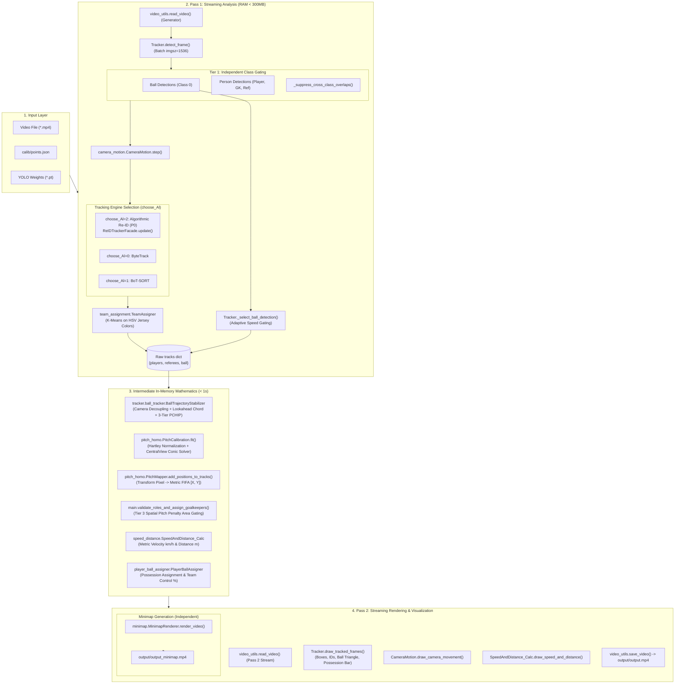
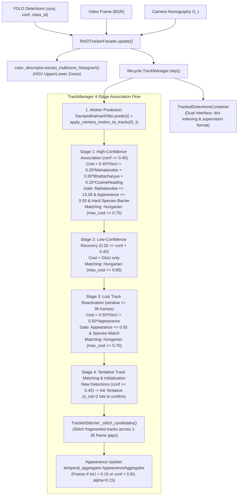

# PROJECT ARCHITECTURE REPORT: CV FOOTBALL ANALYSIS
**Hệ thống Phân tích Video Bóng đá Tự động bằng Thị giác Máy tính (Computer Vision Football Analytics)**

> **Loại tài liệu**: Reverse-Engineering Architecture & Technical Specification Report  
> **Phiên bản codebase**: Milestone P1 / Stage 4 Integration (master)  
> **Thời điểm thẩm định**: 11/2026  
> **Công cụ hỗ trợ phân tích**: Graphify Knowledge Graph & `codebase-memory-mcp`  

---

## 1. Executive Summary

Dự án **CV Football Analysis** (`CV_Football_Analys`) là một hệ thống thị giác máy tính toàn diện (End-to-End AI/CV Pipeline) chuyên dụng cho việc tự động theo dõi, tái định danh, hiệu chuẩn hình học và phân tích chiến thuật trong video trận đấu bóng đá.

### Điểm nhấn kiến trúc chính
1. **Kiến trúc Two-Pass Streaming tiết kiệm bộ nhớ**: Pass 1 thực hiện inference YOLO, bóc tách chuyển động camera và tracking đối tượng theo cơ chế streaming 1 frame/lần, duy trì RAM dưới 300MB ngay cả trên video dài độ phân giải cao. Toàn bộ tính toán toán học không gian sân diễn ra trên metadata trong RAM (< 1s), trước khi Pass 2 tiến hành streaming render video phân tích và video sa bàn chiến thuật (2D Minimap).
2. **Hệ thống theo dõi & phân định vai trò 3 Tầng (Three-Tier Role Disambiguation)**:
   - **Tầng 1 (Detection)**: Lọc độc lập 4 lớp với ngưỡng confidence riêng và khử trùng lặp giao cắt (Cross-Class Suppression: Referee > Goalkeeper > Player).
   - **Tầng 2 (Tracking / Temporal Voting)**: Bỏ phiếu chuỗi thời gian khóa cứng vai trò hoặc Hard Species Isolation trong ma trận chi phí gán Re-ID.
   - **Tầng 3 (Spatial Pitch Analysis)**: Dùng tọa độ hình học thực tế trên sân cỏ FIFA để phân định thủ môn (nằm trong khu vực 16m50 của hai đầu sân) và trọng tài (phân bố di chuyển tự do khắp sân nhưng không thuộc đội nào).
3. **Bộ theo dõi Re-ID phi học sâu (Modular Algorithmic Re-ID Framework)**:
   - Thay thế các mạng trích xuất đặc trưng Re-ID nặng nề bằng thuật toán hình thức 4 tầng liên kết: Damped Kalman Filter (với hệ số suy giảm vận tốc $\gamma = 0.90$ khi mất dấu), ma trận khoảng cách kết hợp Distance-IoU (DIoU), Mahalanobis, tương đồng cosine hướng di chuyển và khoảng cách Bhattacharyya trên biểu đồ màu HSV đa vùng (Multi-zone Torso/Legs).
   - Cơ chế bảo vệ mẫu màu EMA có rào chắn đóng băng (Freeze Guard) khi cầu thủ bị che khuất ($IoU > 0.15$) hoặc độ tin cậy thấp ($conf < 0.50$).
4. **Ổn định quỹ đạo bóng & Nội suy thích nghi 3 Tầng (Ball Trajectory Stabilizer)**:
   - Bù trừ chuyển động camera đưa bóng về hệ quy chiếu chuẩn tĩnh.
   - Lọc nhiễu vệt cỏ/cầu thủ bằng thuật toán nhìn trước đa khung hình (Lookahead Chord Burst Gating).
   - Nội suy đơn điệu PCHIP cho khoảng mất dấu ngắn ($1-4$ frame), kiểm tra động học cho khoảng vừa ($5-10$ frame) và dừng hoàn toàn (Strict NO-OP) khi mất dấu dài ($> 10$ frame) để chống bóng ma (ghost ball).
5. **Hiệu chuẩn sân & Hình học Cung tròn Central View**:
   - Sử dụng mô hình hình học FIFA chuẩn ($105\text{m} \times 68\text{m}$) kết hợp chuẩn hóa Hartley giải phương trình Homography trực tiếp.
   - Trang bị bộ giải suy biến góc quay trung tâm (`CentralViewHomographySolver`): khai thác ma trận Conic của vòng tròn giữa sân và đường giữa sân để khôi phục Homography ngay cả khi các điểm mốc quan sát bị thẳng hàng (collinear).

---

## 2. Project Purpose

### 2.1 Bài toán nghiệp vụ
Phân tích dữ liệu video bóng đá từ góc quay truyền hình (Broadcast Camera) gặp các thách thức cực lớn:
- Máy quay liên tục lia (pan), nghiêng (tilt) và thu phóng (zoom).
- Các cầu thủ cùng đội mặc áo giống hệt nhau, thường xuyên va chạm, che khuất lẫn nhau (severe occlusion).
- Quả bóng có kích thước rất nhỏ ($< 15$ pixel), tốc độ bay nhanh ($> 100\text{ km/h}$), thường xuyên bị nhòe mờ (motion blur) hoặc biến mất tạm thời.
- Hiệu ứng phối cảnh xạ ảnh (perspective distortion) khiến pixel trên ảnh không thể hiện đúng khoảng cách và vận tốc thực tế trên sân cỏ.

### 2.2 Đầu vào (Input)
- **Video trận đấu**: Video định dạng `.mp4`, `.avi` (ví dụ `video/sample.mp4`), tốc độ khung hình thường là 25 hoặc 30 FPS.
- **Tập điểm hiệu chuẩn sân (Calibration Points)**: File JSON tọa độ các mốc sân trên một hoặc nhiều frame mẫu (ví dụ `calib/points.json`).
- **Trọng số mô hình phát hiện**: Checkpoint PyTorch YOLO (ví dụ `best_YOLOV11s_FB_detect.pt`, `best_V26_over_6000.pt`).

### 2.3 Đầu ra (Output)
- **Video chính (`output/output.mp4`)**: Video gốc được vẽ bounding box, ID ổn định, màu áo đội, vệt di chuyển camera, tam giác định vị bóng, bảng điều khiển tốc độ di chuyển (km/h) và khoảng cách chạy (m) của từng cầu thủ, thanh tỷ lệ kiểm soát bóng (Ball Possession %).
- **Video Sa bàn chiến thuật 2D Minimap (`output/output_minimap.mp4`)**: Radar 2D độ phân giải $1280 \times 720$ tái hiện toàn bộ vị trí các cầu thủ theo màu áo, thủ môn viền vàng, trọng tài chấm xanh lá neon, và quỹ đạo bay của quả bóng trên sơ đồ sân cỏ FIFA chuẩn.
- **Dữ liệu phân tích lưu trữ (Pickle Stubs)**: `stubs/track_stubs_reid.pkl`, `stubs/camera_motion.pkl` phục vụ việc tái sử dụng kết quả tracking mà không cần chạy lại inference AI.

---

## 3. Technology Stack

| Thành phần | Công nghệ / Thư viện | Phiên bản / Chi tiết cấu hình | Vai trò kỹ thuật |
| :--- | :--- | :--- | :--- |
| **Ngôn ngữ chính** | Python | 3.10 - 3.12 | Toàn bộ codebase được phát triển bằng Python chuẩn |
| **Deep Learning Inference** | Ultralytics YOLO | YOLOv11s / YOLOv8 / YOLOv26 | Phát hiện 4 lớp: `ball`, `goalkeeper`, `player`, `referee` |
| **Phần cứng AI** | PyTorch / CUDA | CUDA GPU (Fallback an toàn sang CPU) | Tăng tốc độ suy luận batch (`imgsz=1536`, `batch_size=8`) |
| **Xử lý ảnh & Video** | OpenCV (`cv2`) | `>= 4.8.0` | Đọc/ghi video, xử lý màu HSV, tính Optical Flow, biến đổi phối cảnh |
| **Tracking cơ sở** | Supervision (`sv`) | ByteTrack / BoT-SORT | Cung cấp tracker baseline (chế độ `choose_Al=0` và `choose_Al=1`) |
| **Toán học & Giải tích** | NumPy & SciPy | `numpy`, `scipy.optimize`, `scipy.interpolate` | Đại số tuyến tính, giải bài toán phân công Hungarian (`linear_sum_assignment`), nội suy đơn điệu PCHIP |
| **Học máy phân cụm** | Scikit-learn | `sklearn.cluster.KMeans` | Phân cụm 2 màu áo đội bóng trong không gian màu HSV |
| **Định dạng cấu hình** | YAML / JSON | PyYAML, Standard `json` | Định nghĩa nhãn dataset (`data.yaml`), lưu tọa độ mốc sân (`calib/points.json`) |

---

## 4. Repository Structure

Cấu trúc thư mục mã nguồn thực tế và phân loại vai trò:

```text
CV_Football_Analys/
├── main.py                             # [Core] Entry point chính của toàn bộ pipeline Two-Pass
├── camera_motion.py                    # [Core] Hệ thống ước lượng chuyển động camera (Affine/Homography & RANSAC)
├── central_view_geometry.py            # [Core] Bộ giải hình học Conic cho vòng tròn giữa sân góc Central View
├── pitch_homo.py                       # [Core] Hệ thống hiệu chuẩn sân FIFA và ánh xạ tọa độ mét (PitchMapper)
├── pitch_homo_v2.py                    # [Supporting] Công cụ UI tương tác click mốc sân và đo sai số hold-out
│
├── tracker/                            # [Core] Package quản lý tracking và điều phối
│   ├── __init__.py                     # Export Tracker, BallTrajectoryStabilizer
│   ├── tracker.py                      # [Core] Lớp Tracker trung tâm, quản lý YOLO, Pass 1 streaming, Pass 2 drawing
│   └── ball_tracker.py                 # [Core] BallTrajectoryStabilizer: lọc ngoại lai & nội suy PCHIP 3 tầng
│
├── algorithmic_reid/                   # [Core] Framework Re-ID không dùng Deep Learning (Modular Architecture)
│   ├── __init__.py                     # Package entry point
│   ├── config.py                       # [Configuration] Dataclass ReIDConfig lưu toàn bộ siêu tham số
│   ├── reid_tracker_facade.py          # [Core] Facade điều phối và TrackedDetectionsContainer (Dual-Interface)
│   ├── appearance/                     # Module trích xuất đặc trưng ngoại hình
│   │   ├── color_descriptor.py         # Biểu đồ màu HSV 2 vùng (Upper/Lower) & khoảng cách Bhattacharyya
│   │   └── temporal_aggregator.py      # Bộ tích lũy mẫu ngoại hình EMA có Freeze Guard chống che khuất
│   ├── association/                    # Module ma trận chi phí và liên kết cặp
│   │   ├── cost_matrix.py              # Tính ma trận chi phí kết hợp DIoU + Mahalanobis + Appearance + Heading
│   │   ├── gating.py                   # Rào chắn gating cứng (Hard Species Isolation, Mahalanobis threshold)
│   │   └── hungarian.py                # Thuật toán Hungarian có ngưỡng cắt gating
│   ├── lifecycle/                      # Module quản lý vòng đời tracklet
│   │   ├── tracklet.py                 # Trạng thái Tracklet (TENTATIVE, CONFIRMED, LOST, DELETED)
│   │   ├── track_manager.py            # Quản lý danh sách track, bộ cấp phát ID, liên kết 4 giai đoạn
│   │   └── stitcher.py                 # Khâu nối các tracklet bị đứt đoạn sau thời gian mất dấu
│   └── motion/                         # Module dự đoán chuyển động
│       ├── kalman_filter.py            # DampedKalmanFilter: 8 trạng thái, suy giảm vận tốc gamma=0.90
│       ├── mahalanobis.py              # Tính khoảng cách Mahalanobis trong không gian đo [xc, yc, a, h]
│       └── motion_predictor.py         # Bù trừ chuyển động camera CMC vào trạng thái Kalman
│
├── team_assignment/                    # [Important] Phân cụm đội bóng
│   ├── __init__.py
│   └── team_assigner.py                # K-Means clustering trích xuất màu áo cầu thủ trong không gian HSV
│
├── speed_distance/                     # [Important] Tính toán vật lý
│   ├── __init__.py
│   └── speed_distance_calc.py          # Tính vận tốc (km/h) và quãng đường (m) từ tọa độ sân
│
├── player_ball_assigner/               # [Important] Gán quyền kiểm soát bóng
│   ├── __init__.py
│   └── player_ball_assigner.py         # Xác định cầu thủ chạm bóng dựa trên khoảng cách Euclidean tới chân
│
├── minimap/                            # [Important] Sa bàn chiến thuật 2D
│   ├── __init__.py
│   └── minimap_renderer.py             # Sinh video Radar 2D độc lập (1280x720) mô phỏng trận đấu
│
├── utils/                              # [Supporting] Tiện ích dùng chung
│   ├── __init__.py
│   ├── bbox_utils.py                   # Tính tâm box, vị trí chân, khoảng cách Euclidean pixel
│   └── video_utils.py                  # Đọc video generator tiết kiệm RAM và ghi video ra đĩa
│
├── view_transformer/                   # [Legacy] Prototype ánh xạ 4 điểm ban đầu (được thay bằng pitch_homo.py)
│   ├── __init__.py
│   └── view_transformer.py
│
├── camera_movement_estimate/           # [Legacy] Prototype Optical Flow viền ảnh (được thay bằng camera_motion.py)
│   ├── __init__.py
│   └── camera_movement_estimate.py
│
├── calib/                              # [Configuration / Artifact] Dữ liệu hiệu chuẩn
│   ├── points.json                     # Tọa độ mốc sân mặc định
│   ├── sample.json, sample3.json       # Tọa độ mốc sân thử nghiệm
│
├── reports/                            # [Documentation] Báo cáo kiểm toán mã nguồn chi tiết
│   ├── CODE_AUDIT_TRACKING.md          # Báo cáo tổng hợp kiểm toán tracking
│   ├── CODE_AUDIT_TRACKING_part1.md    # Phần 1: Kiến trúc tổng quan & Tầng 1, Tầng 2
│   ├── CODE_AUDIT_TRACKING_part2.md    # Phần 2: Tracking người & Algorithmic Re-ID
│   ├── CODE_AUDIT_TRACKING_part3.md    # Phần 3: Tracking bóng & Hợp đồng dữ liệu
│   └── CODE_AUDIT_TRACKING_part4.md    # Phần 4: Danh mục test suite & 7 điểm bất thường
│
├── [Test Suites]                       # [Important] Hệ thống kiểm thử tự động
│   ├── test_reid_tracking_suite.py     # Bộ 8 kịch bản kiểm thử Re-ID chuẩn
│   ├── test_ball_trajectory_suite.py   # Bộ 10 kịch bản kiểm thử ổn định bóng & nội suy
│   ├── test_stage2_suite.py            # Kiểm thử Re-ID Stage 2 & liên kết ngoại hình
│   ├── test_stage3_suite.py            # Kiểm thử Camera Motion & bù trừ CMC
│   ├── test_stage4_suite.py            # Kiểm thử Conic Central View & tích hợp Downstream
│   ├── test_challenger_p0_stress.py    # Kiểm thử đối kháng áp lực Re-ID
│   ├── test_challenger_p1_stress.py    # Kiểm thử đối kháng áp lực bóng
│   └── test_reid_adversarial_stress.py # Kiểm thử Re-ID trong điều kiện nhiễu cực đoan
│
├── [CLI / Scripts]                     # [Supporting] Scripts phụ trợ
│   ├── benchmark_pipeline.py           # Benchmark thời gian thực thi pipeline
│   ├── benchmark_reid_tracking.py      # Benchmark độ ổn định Re-ID trên video thật
│   ├── run_benchmark_m6.py             # Script chạy benchmark tổng hợp
│   ├── evaluate_video_stage3.py        # Đánh giá độ chính xác Stage 3
│   ├── verify_central_view_real_frame.py # Xác thực thuật toán Central View trên frame thật
│   ├── high_frame.py                   # Tải và chuyển mã video từ nguồn bên ngoài
│   └── extract_frame.py                # Trích xuất frame ảnh tĩnh từ video
│
├── data.yaml                           # [Configuration] Cấu hình 4 class của mô hình phát hiện
└── README.md                           # [Documentation] Hướng dẫn sử dụng tổng quan
```

---

## 5. High-Level Architecture

Sơ đồ kiến trúc tổng thể toàn bộ hệ thống từ đầu vào đến đầu ra:



---

## 6. Module Inventory

| Module | Đường dẫn thực tế | Vai trò kỹ thuật chính | Mức độ quan trọng | Dependencies trực tiếp | Dependents (Module gọi) |
| :--- | :--- | :--- | :--- | :--- | :--- |
| **Pipeline Runner** | `main.py` | Entry point chính, điều phối luồng 2 pass và thẩm định Tầng 3 | **Core** | `tracker`, `camera_motion`, `pitch_homo`, `team_assignment`, `speed_distance`, `player_ball_assigner`, `minimap`, `utils` | CLI / Người dùng |
| **Tracking Coordinator** | `tracker/tracker.py` | Lớp `Tracker`: chạy YOLO, điều phối tracking, Pass 1 và Pass 2 | **Core** | `ultralytics`, `supervision`, `algorithmic_reid`, `tracker/ball_tracker.py`, `utils/bbox_utils.py` | `main.py` |
| **Ball Stabilizer** | `tracker/ball_tracker.py` | Lớp `BallTrajectoryStabilizer`: ổn định và nội suy quỹ đạo bóng 3 tầng | **Core** | `scipy.interpolate.PchipInterpolator`, `numpy`, `camera_motion` | `tracker/tracker.py` |
| **Re-ID Facade** | `algorithmic_reid/reid_tracker_facade.py` | Giao diện Facade bọc bộ theo dõi Re-ID và `TrackedDetectionsContainer` | **Core** | `algorithmic_reid/lifecycle/track_manager.py`, `algorithmic_reid/appearance/color_descriptor.py` | `tracker/tracker.py` |
| **Re-ID Lifecycle** | `algorithmic_reid/lifecycle/` | Quản lý vòng đời tracklet, liên kết 4 tầng, khâu nối tracklet | **Core** | `algorithmic_reid/association/`, `algorithmic_reid/motion/` | `reid_tracker_facade.py` |
| **Re-ID Association** | `algorithmic_reid/association/` | Ma trận chi phí đa nguồn (DIoU, Motion, Appearance, Heading) và gating cứng | **Core** | `scipy.optimize.linear_sum_assignment`, `numpy` | `track_manager.py` |
| **Re-ID Motion** | `algorithmic_reid/motion/` | Damped Kalman Filter, khoảng cách Mahalanobis và bù trừ CMC | **Core** | `numpy`, `scipy.spatial.distance` | `tracklet.py`, `cost_matrix.py` |
| **Re-ID Appearance** | `algorithmic_reid/appearance/` | Trích xuất HSV 2 vùng, khoảng cách Bhattacharyya và EMA Freeze Guard | **Core** | `cv2`, `numpy` | `reid_tracker_facade.py`, `cost_matrix.py` |
| **Camera Motion** | `camera_motion.py` | Ước lượng Homography liên frame $G_t$ và Re-localization qua Anchor | **Core** | `cv2`, `numpy`, `pickle` | `main.py`, `tracker/tracker.py`, `pitch_homo.py` |
| **Pitch Geometry** | `pitch_homo.py` | Hiệu chuẩn sân FIFA (`PitchCalibration`) và ánh xạ sang tọa độ mét (`PitchMapper`) | **Core** | `central_view_geometry.py`, `cv2`, `numpy` | `main.py` |
| **Central Conic Solver** | `central_view_geometry.py` | Giải Homography Central View bằng Conic vòng tròn giữa sân | **Core** | `cv2`, `numpy` | `pitch_homo.py` |
| **Team Assigner** | `team_assignment/team_assigner.py` | K-Means clustering phân định 2 đội bóng theo màu áo | **Important** | `sklearn.cluster.KMeans`, `cv2`, `numpy` | `main.py` |
| **Speed & Distance** | `speed_distance/speed_distance_calc.py` | Tính vận tốc (km/h) và quãng đường (m) từ tọa độ sân thực tế | **Important** | `utils/bbox_utils.py`, `cv2`, `numpy` | `main.py` |
| **Ball Assigner** | `player_ball_assigner/player_ball_assigner.py` | Gán bóng cho cầu thủ gần chân nhất và theo dõi quyền kiểm soát bóng | **Important** | `utils/bbox_utils.py` | `main.py` |
| **Minimap Renderer** | `minimap/minimap_renderer.py` | Trực quan hóa toàn bộ trận đấu trên sa bàn radar 2D | **Important** | `cv2`, `numpy` | `main.py` |
| **Bounding Box Utils** | `utils/bbox_utils.py` | Tiện ích hình học: tâm box, vị trí chân, khoảng cách Euclidean | **Supporting** | `numpy` | `tracker.py`, `player_ball_assigner.py`, `speed_distance_calc.py` |
| **Video Utils** | `utils/video_utils.py` | Đọc video dạng generator và lưu video ra file `.mp4` | **Supporting** | `cv2` | `main.py` |
| **View Transformer** | `view_transformer/` | Prototype biến đổi 4 điểm góc sân ban đầu | **Legacy** | `cv2`, `numpy` | Không còn dùng trong pipeline chính (được thay bởi `pitch_homo.py`) |
| **Camera Estimate** | `camera_movement_estimate/` | Prototype Optical Flow viền ảnh ban đầu | **Legacy** | `cv2`, `numpy` | Không còn dùng trong pipeline chính (được thay bởi `camera_motion.py`) |

---

## 7. Phân tích chi tiết từng Module cốt lõi

### 7.1 Module: Pipeline Orchestration & CLI (`main.py`)
- **Vị trí**: `main.py`
- **Vai trò**: Điểm điều phối trung tâm của toàn bộ hệ thống. Khởi tạo tất cả các lớp xử lý, điều khiển quá trình đọc streaming Pass 1, thực hiện chuyển đổi toán học trung gian trong RAM, và điều khiển streaming Pass 2 để lưu video kết quả và video minimap.
- **Lớp chính**: Không có lớp (chứa hàm `main()` và các hàm tiện ích).
- **Hàm chính**:
  - `main(...)`: Hàm điều phối chính (nhận các tham số cấu hình: video, model, confidence thresholds, batch size, calib file).
  - `validate_roles_and_assign_goalkeepers(tracks, team_assigner)`: Thẩm định Tầng 3 (Spatial Pitch Role Validation). Tính vị trí trung bình trên sân của các tracklet để chuyển đổi các cầu thủ đứng sâu trong khu vực 16m50 thành Thủ môn (`is_goalkeeper = True`) và gán màu áo thủ môn.
- **Dữ liệu vào**: Đường dẫn video (`video/sample.mp4`), trọng số mô hình (`best_YOLOV11s_FB_detect.pt`), tọa độ mốc sân (`calib/points.json`).
- **Dữ liệu ra**: Video `output/output.mp4`, `output/output_minimap.mp4`, các file stubs pickle.
- **Rủi ro kiến trúc**:
  - Tham số `choose_Al=2` đang bị hardcode tại dòng 217 khi gọi `tracker.process_pass1(...)`, khiến người dùng không thể chuyển sang ByteTrack hay BoT-SORT từ tham số dòng lệnh CLI.
  - Hàm `validate_roles_and_assign_goalkeepers` sửa đổi trực tiếp dictionary `tracks` sau khi Pass 1 hoàn tất, không đồng bộ ngược lại vào đối tượng `Tracklet` bên trong `algorithmic_reid`.

---

### 7.2 Module: Tracking Coordinator & YOLO Engine (`tracker/tracker.py`)
- **Vị trí**: `tracker/tracker.py`
- **Vai trò**: Quản lý mô hình phát hiện YOLO, thực hiện batch inference trên GPU, khử trùng lặp giao cắt lớp Tầng 1, điều phối bộ chọn bóng `_select_ball_detection`, và trực quan hóa bounding box/ID/tam giác bóng trên Pass 2.
- **Lớp chính**: `Tracker`
- **Hàm / Phương thức chính**:
  - `detect_frame(list_frame)`: Generator nhận chuỗi frame, gom thành batch (mặc định 8) và chạy `model.predict(..., imgsz=1536)`.
  - `process_pass1(...)`: Vòng lặp phân tích Pass 1. Gọi YOLO, trích xuất camera motion, gọi bộ theo dõi người, chọn ứng viên bóng Top-1, phân màu áo đội qua TeamAssigner.
  - `_select_ball_detection(ball_det, frame_index, frame_shape, state)`: Thuật toán chọn quả bóng Top-1 thích nghi theo vận tốc và bán kính gating elip.
  - `_suppress_cross_class_overlaps(detections, ids, iou_thresh=0.45)`: Khử trùng lặp Tầng 1 theo thứ tự ưu tiên: Trọng tài $\to$ Thủ môn $\to$ Cầu thủ.
  - `interpolate_ball_position(...)`: Khởi tạo và ủy quyền xử lý ổn định bóng cho `BallTrajectoryStabilizer`.
  - `draw_tracked_frames(...)`: Generator Pass 2 vẽ hộp định danh, màu áo, tam giác bóng và thanh sở hữu bóng lên từng frame video.
- **Chi tiết kỹ thuật**:
  - Khi `choose_Al=2`, `Tracker` khởi tạo `self.reid_tracker = ReIDTrackerFacade(config=ReIDConfig(fps=self.fps))`.
  - Quả bóng được theo dõi bằng cơ chế chọn Top-1 độc lập: lưu vào `tracks["ball"][frame_index][1]`.
- **Rủi ro kiến trúc**:
  - Trong `draw_tracked_frames` (dòng 634-635), câu lệnh `if ball.get("is_interpolated", False): continue` bỏ qua hoàn toàn việc vẽ quả bóng ở các frame được nội suy lên video chính, gây hiện tượng nhấp nháy dù dữ liệu trong Minimap vẫn liên tục.
  - Tiền lọc confidence `det.confidence >= self.player_conf` (0.35) trước khi truyền vào `reid_tracker.update` làm vô hiệu hóa cơ chế phục hồi detection yếu của Stage 2 Re-ID.

---

### 7.3 Module: Modular Algorithmic Re-ID Framework (`algorithmic_reid/`)
- **Vị trí**: `algorithmic_reid/`
- **Vai trò**: Cung cấp thuật toán theo dõi và tái định danh cầu thủ/thủ môn/trọng tài đạt chuẩn SOTA mà không cần mạng nơ-ron Re-ID trích xuất đặc trưng nặng nề. Xử lý triệt để hiện tượng tráo ID khi cầu thủ giao cắt, bị che khuất và lia máy quay.
- **Kiến trúc phân tầng bên trong**:



- **Các lớp và hàm nòng cốt**:
  - `ReIDConfig` (`config.py`): Chứa tập siêu tham số chuẩn hóa: weights ma trận chi phí (`w_diou=0.40`, `w_mot=0.20`, `w_app=0.30`, `w_dir=0.10`), gating (`mahalanobis_gate=13.28`, `appearance_gate=0.55`), suy giảm vận tốc Kalman (`velocity_damping_gamma=0.90`).
  - `DampedKalmanFilter` (`motion/kalman_filter.py`): Mô hình trạng thái 8 chiều $[x_c, y_c, a, h, v_x, v_y, 0, v_h]^T$. Khóa cố định đạo hàm tỷ lệ khung hình $\dot{a} = 0$. Khi không có quan sát (dropout), vận tốc bị triệt tiêu dần theo hàm mũ $\gamma = 0.90$.
  - `extract_multizone_histogram` (`appearance/color_descriptor.py`): Chia bounding box làm 2 vùng: Thân trên (Upper $15\% - 55\%$) đại diện cho màu áo đấu và Thân dưới (Lower $55\% - 90\%$) đại diện cho quần đùi. Trích xuất biểu đồ màu HSV chuẩn hóa ($H:16, S:8, V:8$) và đo khoảng cách bằng Bhattacharyya distance.
  - `AppearanceAggregator` (`appearance/temporal_aggregator.py`): Cập nhật mẫu đặc trưng theo cấp số nhân (EMA, $\alpha=0.15$). Tích hợp rào chắn an toàn (Freeze Guard): đóng băng hoàn toàn việc cập nhật màu khi phát hiện độ che khuất $IoU > 0.15$ với đối tượng khác hoặc confidence của detection $< 0.50$.
  - `apply_gating_barriers` (`association/gating.py`): **Hard Species Isolation Barrier** — gán chi phí cực lớn ($10^5$) cho mọi cặp ứng viên khác loài (Player vs Goalkeeper vs Referee), ngăn chặn tuyệt đối hiện tượng ô nhiễm danh tính giữa các vai trò.
  - `TrackletStitcher` (`lifecycle/stitcher.py`): Nối liền các đoạn tracklet bị phân mảnh do mất dấu ngắn (1 đến 30 frame) khi thỏa mãn cùng loài, động học khả thi và khoảng cách ngoại hình $\le 0.40$.
- **Rủi ro kiến trúc**:
  - Trong `motion/motion_predictor.py::apply_camera_motion_to_tracks`, khi camera lia nhanh, hàm chỉ biến đổi 4 góc của bounding box qua ma trận homography $G_t$ rồi gán lại tọa độ $[x_c, y_c, a, h]$, nhưng để nguyên 4 thành phần vận tốc $[v_x, v_y, 0, v_h]$ không xoay/biến đổi theo camera, gây sai lệch quán tính khi camera đổi hướng lia đột ngột.

---

### 7.4 Module: Ball Trajectory Stabilizer & Adaptive Interpolation (`tracker/ball_tracker.py`)
- **Vị trí**: `tracker/ball_tracker.py`
- **Vai trò**: Xử lý toàn bộ chuỗi vị trí quả bóng từ Pass 1: bù trừ chuyển động camera, loại bỏ ngoại lai động học, lọc chùm nhiễu đa khung hình, thực hiện nội suy thích nghi 3 tầng và làm mượt hồi quy ballistic.
- **Lớp chính**: `BallTrajectoryStabilizer`
- **Quy trình 6 bước trong `process()`**:
  1. **Trích xuất thông số thô**: Thu thập tọa độ tâm, kích thước $W \times H$, độ tin cậy của bóng trên từng frame.
  2. **Bù trừ chuyển động camera (`_to_reference`)**: Dùng `camera_motion.to_reference()` đưa toàn bộ tâm bóng về hệ quy chiếu chuẩn tĩnh.
  3. **Lọc ngoại lai động học**:
     - *Boundary Gating*: Kiểm tra 2 frame đầu và 2 frame cuối, loại bỏ nếu tốc độ $> 50\text{ px/f}$ và không gần chân cầu thủ.
     - *Lookahead Chord Burst Gating*: Khi phát hiện bước nhảy tốc độ $> 50\text{ px/f}$, tìm kiếm tiếp tối đa $k_{\max} = 4$ frame phát hiện tiếp theo. Nếu cung dây kết nối lại với vận tốc hợp lệ mà các frame ở giữa không giải thích được bằng cú sút gần chân cầu thủ ([`_is_near_player`](file:///e:/CV_Football_Analys/tracker/ball_tracker.py#L458)), loại bỏ toàn bộ chùm frame nhiễu ở giữa.
  4. **Nội suy thích nghi 3 tầng (3-Tier Dropout Handling)**:
     - **Tier 1 ($1 \le gap \le 4$)**: Nội suy đa thức PCHIP đơn điệu (`PchipInterpolator`) trên tọa độ X và Y độc lập, mượt mà và không overshoot.
     - **Tier 2 ($5 \le gap \le 10$)**: Kiểm tra tính nhất quán động học: tốc độ trung bình $\le 50\text{ px/f}$ và góc lệch vector vận tốc vào/ra $\le 60^\circ$. Nếu thỏa mãn thì nội suy PCHIP; nếu đổi hướng mạnh $\to$ Từ chối nội suy.
     - **Tier 3 ($gap > 10$)**: Strict NO-OP (0 frame ảo), giữ trạng thái `LOST`.
  5. **Làm mượt hồi quy Ballistic**: Cửa sổ trượt $W=4$, hồi quy đa thức bậc 2 ở vùng trong và bậc 1 ở cận biên. Chặn cứng độ lệch tối đa so với detection gốc $\le 2.5\text{ px}$ (`max_smoothing_deviation`).
  6. **Chuyển đổi ngược về ảnh (`_to_frame`)**: Chuyển tọa độ từ hệ tham chiếu về tọa độ pixel frame và gán cờ `is_interpolated = True`, `confidence = 0.30` cho các frame nội suy.

---

### 7.5 Module: Camera Motion Estimation & Anchor Re-localization (`camera_motion.py`)
- **Vị trí**: `camera_motion.py`
- **Vai trò**: Tính toán ma trận biến đổi Affine/Homography liên frame $G_t$ giữa frame $t-1$ và frame $t$, khử chuyển động của góc máy quay. Quản lý hệ thống neo toàn cục (`GlobalCalibrationAnchor`) để phục hồi lại ma trận hiệu chuẩn sân ngay cả sau khi máy quay bị cắt cảnh (camera cut).
- **Lớp chính**:
  - `AnchorTrackingConfig`: Dataclass chứa ngưỡng số lượng đặc trưng tối thiểu, RMS reprojection error tối đa, độ phủ Convex Hull.
  - `CameraMotionResult`: Đối tượng chứa danh sách ma trận $M_t$, cờ segment, phân loại trạng thái chuyển động (PAN, TILT, ZOOM, STATIC).
  - `PitchRelocalizer`: Bộ tái định vị góc quay sân bóng thông qua đặc trưng ORB/SIFT kết hợp so khớp RANSAC với các anchor đã lưu.
  - `CameraMotion`: Lớp điều phối trung tâm.
- **Phương thức chính**:
  - `step(frame, prev_boxes)`: Nhận frame hiện tại và danh sách bounding box của người/bóng ở frame trước để **tạo mask che khuất** (tránh bắt nhầm đặc trưng di động trên thân cầu thủ). Dùng Lucas-Kanade Optical Flow hoặc RANSAC Homography để tính ma trận dịch chuyển.
  - `add_global_anchor(frame_idx, frame_gray, H, seg)`: Lưu lại frame hiệu chuẩn mốc chuẩn làm neo định vị.
  - `to_reference(t, pts)` / `to_frame(t, pts_ref)`: Chuyển đổi tọa độ qua lại giữa hệ ảnh thô và hệ quy chiếu camera chuẩn.
- **Rủi ro kiến trúc**:
  - Phụ thuộc vào chất lượng mặt cỏ và vạch sơn. Khi máy quay quay cận cảnh (close-up) chỉ thấy thân cầu thủ mà không thấy vạch sân, RANSAC có thể bị phân đoạn (`seg` tăng), chuyển sang trạng thái `UNREGISTERED`.

---

### 7.6 Module: Pitch Calibration & Homography Mapping (`pitch_homo.py` & `central_view_geometry.py`)
- **Vị trí**: `pitch_homo.py` và `central_view_geometry.py`
- **Vai trò**: Chuyển đổi tọa độ từ pixel ảnh 2D sang tọa độ mét thực tế trên sân bóng theo tiêu chuẩn FIFA ($105\text{m} \times 68\text{m}$). Cung cấp dữ liệu vị trí cho bộ tính tốc độ, cự ly và sa bàn Minimap.
- **Lớp chính trong `pitch_homo.py`**:
  - `PitchCalibration`: Đọc tập điểm mốc đã gán nhãn trong `calib/points.json`, chuẩn hóa tọa độ Hartley (`hartley_normalize_2d`), giải ma trận Homography $H$ ban đầu, lan truyền $H$ qua các frame thông qua ma trận Camera Motion $M_t$.
  - `PitchMapper`: Cung cấp hàm `add_positions_to_tracks(tracks)` thực thi hợp đồng dữ liệu chuẩn 4 trường cho mọi đối tượng.
- **Hợp đồng dữ liệu 4 trường (Data Contract)**:
  1. `position_local_raw`: Toạ độ pixel gốc trên ảnh $(u, v)$ tại chân đối tượng (hoặc tâm bóng).
  2. `position_adjusted`: Toạ độ pixel sau khi bù trừ chuyển động camera quy về hệ tham chiếu.
  3. `position_transformed`: Toạ độ mét $[X, Y]$ trên mặt sân FIFA (nằm trong dải $X \in [0, 105], Y \in [0, 68]$).
  4. `projection_valid` & `calibration_status`: Trạng thái chiếu xạ ảnh (`DIRECT_CALIBRATED`, `PROPAGATED`, `PREDICTED`, `UNREGISTERED`) và mức rủi ro ngoại suy `extrapolation_risk`.
- **Module đột phá: `central_view_geometry.py`**:
  - Khi máy quay truyền hình đặt chính giữa khán đài A nhìn thẳng vào vòng tròn giữa sân, các điểm mốc vạch sân thường nằm trên một đường thẳng (collinear), khiến phương pháp DLT 4 điểm bị suy biến (rank deficiency).
  - Lớp `CenterCircleConic` biểu diễn vòng tròn giữa sân bán kính $R=9.15\text{m}$ dưới dạng ma trận đối xứng Conic $C_{pitch}$ (3x3).
  - Lớp `EllipseFitter` khớp elip từ các điểm cung tròn nhìn thấy trên ảnh.
  - Lớp `CentralViewHomographySolver` dùng điểm biến mất $v_h$ dọc đường giữa sân và đường đối cực (polar line) để khôi phục đầy đủ 8 bậc tự do của ma trận Homography, giải quyết triệt để tính mơ hồ 2 nghiệm bằng ràng buộc vị trí khán đài máy quay.

---

### 7.7 Module: Team Assignment by Jersey Color (`team_assignment/team_assigner.py`)
- **Vị trí**: `team_assignment/team_assigner.py`
- **Vai trò**: Phân chia các cầu thủ trên sân thành 2 đội bóng dựa trên phân cụm màu sắc áo đấu bằng thuật toán K-Means.
- **Lớp chính**: `TeamAssigner`
- **Thuật toán**:
  1. `get_player_color(frame, bbox)`: Cắt phần nửa trên của bounding box cầu thủ (vùng áo đấu). Dùng K-Means với 2 cụm để phân tách màu nền (mặt cỏ) và màu áo cầu thủ (dựa vào góc của vùng cắt).
  2. `assign_team_color(frame, player_detections)`: Thu thập màu áo của tất cả các cầu thủ trong những frame đầu tiên, áp dụng K-Means ($k=2$) để tìm ra 2 tâm cụm màu đại diện cho Team 1 và Team 2.
  3. `get_player_team(frame, bbox, player_id)`: So khớp màu áo của cầu thủ với 2 tâm cụm màu để gán nhãn đội (1 hoặc 2) kèm mã màu RGB phục vụ vẽ đồ họa.
- **Điểm tinh chỉnh trong `main.py`**: Trong Pass 1, chỉ các cầu thủ ngoài sân (`outfield_players`, loại trừ thủ môn `is_goalkeeper == True`) mới được đưa vào phân cụm K-Means để màu áo đặc trưng của thủ môn không làm sai lệch tâm màu của đội.

---

### 7.8 Module: Speed and Distance Calculation (`speed_distance/speed_distance_calc.py`)
- **Vị trí**: `speed_distance/speed_distance_calc.py`
- **Vai trò**: Tính toán vận tốc di chuyển tức thời (km/h) và quãng đường tích lũy (m) của từng cầu thủ dựa trên tọa độ mặt sân FIFA.
- **Lớp chính**: `SpeedAndDistance_Calc`
- **Thuật toán**:
  - Sử dụng cửa sổ trượt (mặc định 5 frame) để làm mịn bước nhảy vị trí, tránh biến động do nhiễu detection.
  - Vận tốc tính theo công thức:
    $$v = \frac{\Delta s_{\text{meters}}}{\Delta t_{\text{seconds}}} \times 3.6 \quad (\text{km/h})$$
  - Quãng đường tích lũy được cộng dồn qua từng frame nếu bước nhảy khoảng cách nằm trong giới hạn vật lý hợp lý ($< 12\text{ m/s}$).
  - Ghi trực tiếp kết quả vào `tracks['players'][frame_idx][track_id]['speed']` và `'distance'`.

---

### 7.9 Module: Player-Ball Assigner (`player_ball_assigner/player_ball_assigner.py`)
- **Vị trí**: `player_ball_assigner/player_ball_assigner.py`
- **Vai trò**: Xác định cầu thủ nào đang có bóng ở từng thời điểm và tổng hợp tỷ lệ kiểm soát bóng của từng đội.
- **Lớp chính**: `PlayerBallAssigner`
- **Thuật toán**:
  - Nhận tọa độ bounding box của quả bóng và danh sách cầu thủ trong frame.
  - Tính khoảng cách Euclidean từ tâm bóng tới 2 góc dưới chân của bounding box cầu thủ:
    $$dist = \min\left(\|p_{\text{ball}} - p_{\text{foot\_left}}\|, \|p_{\text{ball}} - p_{\text{foot\_right}}\|\right)$$
  - Nếu $dist < \text{max\_distance}$ (mặc định 70 pixel) và đạt giá trị nhỏ nhất trong số các cầu thủ, cầu thủ đó được gán cờ `has_ball = True`.
  - Từ `has_ball`, `main.py` tổng lũy mảng `team_ball_control` và tính tỷ lệ phần trăm kiểm soát bóng của Team 1 vs Team 2 hiển thị trên thanh Dashboard.
- **Rủi ro kiến trúc**: Ngưỡng 70 pixel được cố định trong không gian pixel ảnh thô. Do biến dạng phối cảnh, 70px ở gần camera tương đương $\approx 1.5\text{m}$, nhưng ở xa camera có thể tương đương $6-8\text{m}$, dẫn đến việc nhận nhầm cầu thủ giữ bóng ở phía xa.

---

### 7.10 Module: Tactical 2D Minimap Renderer (`minimap/minimap_renderer.py`)
- **Vị trí**: `minimap/minimap_renderer.py`
- **Vai trò**: Kết xuất video Sa bàn chiến thuật 2D độc lập (`output/output_minimap.mp4`, $1280 \times 720$), trực quan hóa toàn bộ trận đấu dưới góc nhìn từ trên cao (Top-down bird's-eye view).
- **Lớp chính**: `MinimapRenderer`
- **Thành phần kết xuất**:
  - Sân bóng chuẩn FIFA với vạch vôi, vòng tròn giữa sân, khu vực 16m50, chấm phạt đền, khung thành.
  - Trọng tài: Vòng tròn màu xanh lá neon viền đen kèm chữ "R".
  - Cầu thủ: Vòng tròn màu áo đội tuyển viền trắng kèm số ID. Cầu thủ đang giữ bóng có hiệu ứng hào quang kép (Dual Halo ring).
  - Thủ môn: Vòng tròn lớn hơn, viền vàng rực kèm chữ "GK".
  - Quả bóng: Chấm tròn màu cam/trắng kèm vệt di chuyển (motion trail) nối giữa các vị trí liên tiếp.
  - Header Dashboard: Thanh hiển thị thời gian, tỷ số/tỷ lệ kiểm soát bóng động của 2 đội.

---

## 8. Function/Class Relationships

Dưới đây là bảng phân tích chi tiết quan hệ giữa các lớp và hàm trung tâm được trích xuất từ `codebase-memory-mcp`:

| Lớp / Thành phần | Phương thức / Hàm | Được gọi bởi (Callers) | Gọi đến (Callees) | Bản chất quan hệ |
| :--- | :--- | :--- | :--- | :--- |
| `main.py` | `main()` | CLI invocation (`if __name__ == '__main__'`) | `Tracker`, `CameraMotion`, `TeamAssigner`, `PitchCalibration.fit`, `PitchMapper`, `PlayerBallAssigner`, `MinimapRenderer` | Điều phối toàn cục |
| `Tracker` | `detect_frame()` | `Tracker.process_pass1` | `YOLO.predict` | Generator sinh kết quả detection theo batch |
| `Tracker` | `process_pass1()` | `main.py:210` | `detect_frame`, `CameraMotion.step`, `ReIDTrackerFacade.update`, `_select_ball_detection`, `TeamAssigner.get_player_team` | Phân tích Pass 1 trực tiếp từ luồng video |
| `Tracker` | `_select_ball_detection()` | `Tracker.process_pass1:340` | `np.hypot`, `np.linalg.norm` | Lọc Top-1 tâm bóng theo elip gating vận tốc |
| `Tracker` | `interpolate_ball_position()` | `main.py:230` | `BallTrajectoryStabilizer.process` | Facade chuyển giao dữ liệu bóng sang bộ ổn định |
| `Tracker` | `draw_tracked_frames()` | `main.py:283` | `draw_ellipse`, `draw_triangle`, `draw_team_ball_control` | Generator Pass 2 vẽ annotation lên video chính |
| `BallTrajectoryStabilizer` | `process()` | `Tracker.interpolate_ball_position` | `_to_reference`, `_is_near_player`, `_interpolate_segment`, `_to_frame` | Khử rung camera, loại bỏ ngoại lai, nội suy PCHIP |
| `BallTrajectoryStabilizer` | `_interpolate_segment()` | `BallTrajectoryStabilizer.process` | `scipy.interpolate.PchipInterpolator` | Nội suy đa thức đơn điệu trên khoảng gap $1-4$ frame |
| `ReIDTrackerFacade` | `update()` | `Tracker.process_pass1:296` | `color_descriptor.extract_multizone_histogram`, `TrackManager.step`, `TrackedDetectionsContainer` | Cầu nối giữa giao diện Tracker và lõi thuật toán Re-ID |
| `TrackManager` | `step()` | `ReIDTrackerFacade.update:116` | `kalman_filter.DampedKalmanFilter.predict`, `cost_matrix.compute_fused_cost_matrix`, `gating.apply_gating_barriers`, `hungarian.min_cost_matching`, `stitcher.TrackletStitcher` | Quản lý 4 giai đoạn gán cặp ID |
| `CameraMotion` | `step()` | `Tracker.process_pass1:276` | `_mask`, `_detect`, `_step`, `PitchRelocalizer.relocalize` | Ước lượng dịch chuyển máy quay giữa 2 frame liên tiếp |
| `PitchCalibration` | `fit()` | `main.py:191, 239` | `central_view_geometry.CentralViewHomographySolver`, `hartley_normalize_2d`, `safe_project` | Khớp ma trận Homography mặt sân sang mét |
| `PitchMapper` | `add_positions_to_tracks()` | `main.py:252` | `CameraMotion.to_reference`, `map_points`, `compute_extrapolation_risk` | Ánh xạ toàn bộ track sang hệ tọa độ metric FIFA chuẩn |
| `MinimapRenderer` | `render_video()` | `main.py:301` | `generate_frames`, `_draw_header`, `_draw_frame`, `meter_to_pixel` | Sinh video sa bàn chiến thuật 2D độc lập |

---

## 9. Function-Level Call Graph

Dưới đây là Call Graph chi tiết ở cấp độ Function của luồng thực thi hoàn chỉnh trong hệ thống:

```text
main() [main.py:121]
 ├── read_video(video_path) [utils/video_utils.py:4]
 ├── Tracker.__init__() [tracker/tracker.py:20]
 │    ├── ultralytics.YOLO(model_path)
 │    ├── ByteTrack.__init__()
 │    ├── BoT-SORT.__init__()
 │    └── ReIDTrackerFacade.__init__() [algorithmic_reid/reid_tracker_facade.py:82]
 │         └── TrackManager.__init__() [algorithmic_reid/lifecycle/track_manager.py:34]
 ├── CameraMotion.__init__() [camera_motion.py:264]
 ├── TeamAssigner.__init__() [team_assignment/team_assigner.py:8]
 │
 ├── [STAGE 3 ANCHOR PRE-LOAD]
 │    ├── load_points(calib_path) [pitch_homo.py:211]
 │    ├── PitchCalibration.fit() [pitch_homo.py:230]
 │    └── CameraMotion.add_global_anchor() [camera_motion.py:275]
 │
 ├── [PASS 1 STREAMING ANALYSIS]
 │    └── Tracker.process_pass1() [tracker/tracker.py:219]
 │         ├── Tracker.detect_frame() [tracker/tracker.py:185]
 │         │    └── YOLO.predict(batch, imgsz=1536)
 │         ├── CameraMotion.step(frame, prev_boxes) [camera_motion.py:442]
 │         │    ├── CameraMotion._mask() [camera_motion.py:296]
 │         │    ├── cv2.calcOpticalFlowPyrLK()
 │         │    ├── cv2.findHomography(RANSAC)
 │         │    └── PitchRelocalizer.relocalize() [camera_motion.py:124]
 │         │
 │         ├── [IF choose_Al == 2: ALGORITHMIC RE-ID]
 │         │    └── ReIDTrackerFacade.update() [algorithmic_reid/reid_tracker_facade.py:93]
 │         │         ├── extract_multizone_histogram() [appearance/color_descriptor.py:44]
 │         │         ├── TrackManager.step() [lifecycle/track_manager.py:116]
 │         │         │    ├── DampedKalmanFilter.predict() [motion/kalman_filter.py:128]
 │         │         │    ├── apply_camera_motion_to_tracks() [motion/motion_predictor.py:15]
 │         │         │    ├── compute_fused_cost_matrix() [association/cost_matrix.py:62]
 │         │         │    │    ├── compute_diou_matrix() [association/cost_matrix.py:16]
 │         │         │    │    ├── compute_mahalanobis_distance_matrix() [motion/mahalanobis.py:16]
 │         │         │    │    └── batch_bhattacharyya_distance() [appearance/color_descriptor.py:140]
 │         │         │    ├── apply_gating_barriers() [association/gating.py:18]
 │         │         │    ├── min_cost_matching() [association/hungarian.py:13]
 │         │         │    │    └── scipy.optimize.linear_sum_assignment()
 │         │         │    ├── TrackletStitcher.can_stitch() [lifecycle/stitcher.py:38]
 │         │         │    ├── TrackletStitcher.stitch_tracklets() [lifecycle/stitcher.py:110]
 │         │         │    └── AppearanceAggregator.update_template() [appearance/temporal_aggregator.py:47]
 │         │         └── TrackedDetectionsContainer.__init__() [reid_tracker_facade.py:28]
 │         │
 │         ├── Tracker._select_ball_detection() [tracker/tracker.py:680]
 │         └── TeamAssigner.assign_team_color() [team_assignment/team_assigner.py:56]
 │              └── sklearn.cluster.KMeans.fit()
 │
 ├── [IN-MEMORY MATHEMATICS PROCESSING]
 │    ├── Tracker.interpolate_ball_position() [tracker/tracker.py:166]
 │    │    └── BallTrajectoryStabilizer.process() [tracker/ball_tracker.py:46]
 │    │         ├── BallTrajectoryStabilizer._to_reference() [tracker/ball_tracker.py:435]
 │    │         ├── BallTrajectoryStabilizer._is_near_player() [tracker/ball_tracker.py:458]
 │    │         ├── BallTrajectoryStabilizer._interpolate_segment() [tracker/ball_tracker.py:506]
 │    │         │    └── scipy.interpolate.PchipInterpolator()
 │    │         └── BallTrajectoryStabilizer._to_frame() [tracker/ball_tracker.py:442]
 │    │
 │    ├── Tracker.add_position_to_track() [tracker/tracker.py:154]
 │    ├── PitchCalibration.fit() [pitch_homo.py:230]
 │    │    ├── hartley_normalize_2d() [pitch_homo.py:70]
 │    │    └── CentralViewHomographySolver.solve() [central_view_geometry.py:289]
 │    ├── PitchMapper.add_positions_to_tracks() [pitch_homo.py:584]
 │    │    ├── PitchMapper.map_points() [pitch_homo.py:540]
 │    │    └── PitchMapper.compute_extrapolation_risk() [pitch_homo.py:504]
 │    ├── validate_roles_and_assign_goalkeepers() [main.py:20]
 │    ├── SpeedAndDistance_Calc.add_speed_and_distance_to_tracks() [speed_distance_calc.py:10]
 │    └── PlayerBallAssigner.assign_ball_to_player() [player_ball_assigner.py:8]
 │
 ├── [PASS 2 STREAMING RENDERING]
 │    ├── Tracker.draw_tracked_frames() [tracker/tracker.py:607]
 │    ├── CameraMotion.draw_camera_movement() [camera_motion.py:609]
 │    ├── SpeedAndDistance_Calc.draw_speed_and_distance() [speed_distance_calc.py:73]
 │    └── save_video() [utils/video_utils.py:18]
 │
 └── [MINIMAP RADAR RENDERING]
      └── MinimapRenderer.render_video() [minimap/minimap_renderer.py:308]
           ├── MinimapRenderer.generate_frames() [minimap/minimap_renderer.py:292]
           │    ├── MinimapRenderer._create_base_pitch() [minimap/minimap_renderer.py:60]
           │    ├── MinimapRenderer._draw_header() [minimap/minimap_renderer.py:126]
           │    └── MinimapRenderer._draw_frame() [minimap/minimap_renderer.py:186]
           └── cv2.VideoWriter.write()
```

---

## 10. End-to-End Execution Flow

Quá trình chạy của ứng dụng diễn ra tuần tự qua các giai đoạn chi tiết sau:

### Giai đoạn 1: Khởi tạo & Đọc cấu hình
- **File**: `main.py`
- **Hành vi**: Phân tích CLI arguments, kiểm tra thiết bị phần cứng (tự động phát hiện CUDA GPU hoặc fallback sang CPU). Khởi tạo `Tracker`, `CameraMotion`, `TeamAssigner`.
- **Pre-load Anchor**: Nếu có file `calib/points.json`, một đối tượng `cv2.VideoCapture` tạm thời được mở để đọc riêng frame chứa điểm mốc đầu tiên, nạp vào `camera_motion.add_global_anchor()` để chuẩn bị khả năng Re-localization khi có camera cut.

### Giai đoạn 2: Pass 1 Streaming Analysis
- **File**: `tracker/tracker.py` (`process_pass1`)
- **Hành vi**:
  - `read_video(video_path)` trả về một Python Generator sinh từng frame ảnh $1920 \times 1080$.
  - Gom 8 frame thành 1 batch và gọi `model.predict(..., imgsz=1536)`.
  - Khử trùng lặp giao cắt Tầng 1 giữa Referee, Goalkeeper, Player.
  - `CameraMotion.step()` tính ma trận đồng biến hình $G_t$ dựa trên các điểm đặc trưng không nằm trong bbox cầu thủ.
  - Bộ theo dõi Re-ID (`ReIDTrackerFacade.update`) cập nhật trạng thái các tracklet, gán ID duy nhất và khóa vai trò qua Hard Species Isolation.
  - `_select_ball_detection` chọn duy nhất 1 ứng viên quả bóng trong frame dựa trên elip động học.
  - `TeamAssigner` đọc màu áo cầu thủ trong 4 frame đầu tiên để gán màu 2 đội.
  - Kết thúc Pass 1, toàn bộ kết quả phân tích được lưu vào dict `tracks` trong RAM, đồng thời ghi đĩa file cache `stubs/track_stubs_reid.pkl`.

### Giai đoạn 3: Tính toán Không gian & Vật lý trên Metadata (In-Memory)
- **Hành vi**:
  - `tracker.interpolate_ball_position()` làm mượt và lấp đầy các khoảng mất dấu quả bóng bằng PCHIP.
  - `PitchCalibration.fit()` tính ma trận chuyển đổi từ pixel sang mét sân FIFA ($105\text{m} \times 68\text{m}$).
  - `PitchMapper.add_positions_to_tracks()` bổ sung tọa độ mét `position_transformed` cho mọi đối tượng.
  - `validate_roles_and_assign_goalkeepers()` thẩm định vị trí Tầng 3, xác định thủ môn nếu đứng sâu trong vòng cấm địa.
  - `SpeedAndDistance_Calc.add_speed_and_distance_to_tracks()` tính vận tốc (km/h) và quãng đường (m).
  - `PlayerBallAssigner.assign_ball_to_player()` xác định cầu thủ giữ bóng và tính mảng tỷ lệ kiểm soát bóng.

### Giai đoạn 4: Pass 2 Streaming Video Rendering
- **File**: `tracker/tracker.py` (`draw_tracked_frames`), `utils/video_utils.py` (`save_video`)
- **Hành vi**:
  - Mở lại generator `read_video(video_path)` lần thứ hai.
  - Với mỗi frame đọc được, hệ thống vẽ elip màu đội và ID dưới chân cầu thủ, tam giác định vị bóng trên đầu quả bóng, vẽ HUD tốc độ/quãng đường và vệt lia máy quay.
  - Ghi trực tiếp frame hoàn chỉnh vào `cv2.VideoWriter`, đảm bảo bộ nhớ RAM luôn được giải phóng sau từng frame.

### Giai đoạn 5: Render Sa bàn 2D Minimap
- **File**: `minimap/minimap_renderer.py` (`render_video`)
- **Hành vi**:
  - Tạo canvas kích thước $1280 \times 720$.
  - Vẽ sân bóng chuẩn tỷ lệ, vẽ chấm tròn trọng tài, cầu thủ, thủ môn và bóng theo tọa độ mét đã chuyển đổi sang pixel của minimap (`meter_to_pixel`).
  - Ghi video `output/output_minimap.mp4`.

---

## 11. Data Flow & Data Contracts

Dữ liệu di chuyển trong hệ thống thông qua dictionary cấu trúc `tracks` với hợp đồng dữ liệu chuẩn hóa:


### Cấu trúc Data Contract chi tiết của đối tượng trong `tracks`:
```python
tracks = {
    "players": [
        # Frame 0
        {
            1: {
                "bbox": [x1, y1, x2, y2],               # Tọa độ pixel góc trên-trái, dưới-phải
                "position": (cx, cy_foot),              # Tọa độ điểm chân cầu thủ
                "position_local_raw": (cx, cy_foot),    # Tọa độ pixel gốc trên ảnh
                "position_adjusted": (x_ref, y_ref),    # Tọa độ sau bù chuyển động camera
                "position_transformed": [X_m, Y_m],     # Tọa độ mét trên mặt sân FIFA [0..105, 0..68]
                "team": 1,                              # Đội 1 hoặc Đội 2
                "team_color": (B, G, R),                # Màu áo đại diện
                "is_goalkeeper": False,                 # True nếu là Thủ môn
                "has_ball": True,                       # True nếu đang giữ bóng
                "speed": 22.4,                          # Vận tốc tức thời (km/h)
                "distance": 145.2,                      # Quãng đường tích lũy (m)
                "projection_valid": True,               # Trạng thái phép chiếu Homography
                "calibration_status": "PROPAGATED",     # DIRECT_CALIBRATED | PROPAGATED | PREDICTED | UNREGISTERED
                "extrapolation_risk": 0.42,             # Khoảng cách tới Convex Hull mốc sân (mét)
                "inside_pitch": True                    # Nằm trong ranh giới sân cỏ
            },
            # Các player ID khác...
        },
        # Frame 1, Frame 2...
    ],
    "referees": [
        # Frame 0
        {
            5: {
                "bbox": [x1, y1, x2, y2],
                "position_transformed": [X_m, Y_m],
                # ... các trường chuẩn như Player
            }
        }
    ],
    "ball": [
        # Frame 0
        {
            1: {
                "bbox": [x1, y1, x2, y2],
                "position": (cx_ball, cy_ball),         # Tâm hình học của bóng
                "confidence": 0.88,                     # Độ tin cậy (0.30 nếu là nội suy)
                "is_interpolated": False,               # True nếu do PCHIP sinh ra
                "track_state": "DETECTED",              # DETECTED | INTERPOLATED | LOST
                "position_transformed": [X_m, Y_m],
            }
        }
    ]
}
```

---

## 12. Configuration Analysis

Tất cả các siêu tham số cấu hình của hệ thống được quản lý tại 3 cấp độ:

| Tham số | Vị trí định nghĩa | Giá trị mặc định | Phạm vi ảnh hưởng | Ý nghĩa kỹ thuật |
| :--- | :--- | :--- | :--- | :--- |
| `model_path` | `main.py:124` | `best_YOLOV11s_FB_detect.pt` | Khởi tạo YOLO | File trọng số nơ-ron phát hiện đối tượng |
| `player_conf` | `main.py:125` | `0.35` | Lọc detection Player | Ngưỡng tin cậy tối thiểu chấp nhận cầu thủ |
| `goalkeeper_conf` | `main.py:126` | `0.30` | Lọc detection GK | Ngưỡng tin cậy tối thiểu chấp nhận thủ môn |
| `referee_conf` | `main.py:127` | `0.30` | Lọc detection Referee | Ngưỡng tin cậy tối thiểu chấp nhận trọng tài |
| `ball_conf` | `main.py:128` | `0.20` | `_select_ball_detection` | Ngưỡng tin cậy cơ sở để bắt đầu theo dõi bóng |
| `batch_size` | `main.py:129` | `8` | `Tracker.detect_frame` | Kích thước batch inference YOLO trên GPU |
| `imgsz` | `tracker.py:200` | `1536` | `model.predict` | Kích thước ảnh resize phục vụ phát hiện bóng nhỏ |
| `w_diou` | `config.py:25` | `0.40` | `compute_fused_cost_matrix` | Trọng số khoảng cách Distance-IoU trong chi phí Re-ID |
| `w_mot` | `config.py:26` | `0.20` | `compute_fused_cost_matrix` | Trọng số khoảng cách Mahalanobis chuyển động |
| `w_app` | `config.py:27` | `0.30` | `compute_fused_cost_matrix` | Trọng số khoảng cách màu sắc Bhattacharyya |
| `w_dir` | `config.py:28` | `0.10` | `compute_fused_cost_matrix` | Trọng số cosine góc lệch hướng di chuyển |
| `mahalanobis_gate` | `config.py:37` | `13.28` | `apply_gating_barriers` | Ngưỡng phân phối $\chi^2$ (99%, 4 bậc tự do) loại bỏ đối tượng nhảy vọt |
| `appearance_gate` | `config.py:38` | `0.55` | `apply_gating_barriers` | Ngưỡng khoảng cách Bhattacharyya tối đa cho phép ghép cặp |
| `velocity_damping_gamma`| `config.py:43` | `0.90` | `DampedKalmanFilter` | Hệ số suy giảm vận tốc khi mất dấu quan sát |
| `overlap_occlusion_iou` | `config.py:40` | `0.15` | `AppearanceAggregator` | Ngưỡng IoU kích hoạt đóng băng cập nhật mẫu màu áo |
| `v_max` (ball) | `ball_tracker.py:28`| `50.0 px/frame`| `BallTrajectoryStabilizer` | Vận tốc tối đa của bóng (~126 km/h) để lọc nhiễu |
| `tier1_max_gap` | `ball_tracker.py:31`| `4 frames` | `BallTrajectoryStabilizer` | Giới hạn mất dấu ngắn áp dụng nội suy PCHIP |
| `tier2_max_gap` | `ball_tracker.py:32`| `10 frames` | `BallTrajectoryStabilizer` | Giới hạn mất dấu vừa áp dụng kiểm tra động học |
| `max_distance` (ball) | `player_ball_assigner.py:7` | `70 px` | `PlayerBallAssigner` | Bán kính pixel tối đa gán bóng cho cầu thủ |

---

## 13. AI/ML Pipeline

### 13.1 Chi tiết Kiến trúc Mô hình Phát hiện (Detection Model)
- **Kiến trúc**: Mô hình YOLO phát hiện đối tượng đơn giai đoạn (Single-Stage Object Detector), dựa trên kiến trúc YOLOv11s hoặc YOLOv8 tùy thuộc file checkpoint.
- **Tập dữ liệu huấn luyện**: Được cấu hình trong `data.yaml`, huấn luyện kết hợp từ 4 tập dữ liệu bóng đá chuẩn (Football-Detect-6, FutVAR-Football-Players-Detection, footbal-1, football-players-detection-1).
- **Danh mục 4 Lớp (Classes)**:
  - Class `0`: `ball` (Quả bóng)
  - Class `1`: `goalkeeper` (Thủ môn)
  - Class `2`: `player` (Cầu thủ)
  - Class `3`: `referee` (Trọng tài)

### 13.2 Pipeline Xử lý & Tinh chỉnh suy luận
1. **Tiền xử lý (Preprocessing)**:
   - Gom cụm frame theo batch $N=8$.
   - Chuẩn hóa kích thước khung hình sang `imgsz=1536` (thay vì 640 mặc định) nhằm tăng tối đa diện tích điểm ảnh của quả bóng (vốn chỉ chiếm khoảng $10 \times 10$ pixel ở góc quay toàn cảnh).
2. **Suy luận (Inference)**:
   - Chạy suy luận với cờ `stream=True` và `agnostic_nms=False`.
   - Đặt ngưỡng suy luận thô `conf=0.15` để không bỏ sót các pha bóng bị nhòe hoặc cầu thủ bị che khuất.
3. **Hậu xử lý Tầng 1 (Tier 1 Post-Processing)**:
   - Tách riêng lớp bóng và người.
   - Với lớp người, áp dụng giải thuật khử trùng lặp đa nhãn độc quyền `_suppress_cross_class_overlaps`: khi một đối tượng bị mô hình gán 2 bounding box giao cắt ($IoU > 0.45$), hệ thống ưu tiên giữ lại nhãn hiếm theo thứ tự: Trọng tài $\to$ Thủ môn $\to$ Cầu thủ.

---

## 14. Dependencies & Impact Analysis

### 14.1 Bản đồ Phụ thuộc Module (Dependency Map)

```text
main.py
 ├── tracker/tracker.py [HIGH IMPACT]
 │    ├── ultralytics (External)
 │    ├── supervision (External)
 │    ├── tracker/ball_tracker.py [HIGH IMPACT]
 │    │    └── scipy.interpolate.PchipInterpolator (External)
 │    ├── algorithmic_reid/ [CRITICAL]
 │    │    ├── config.py
 │    │    ├── appearance/color_descriptor.py
 │    │    ├── appearance/temporal_aggregator.py
 │    │    ├── association/cost_matrix.py
 │    │    ├── association/gating.py
 │    │    ├── association/hungarian.py
 │    │    ├── lifecycle/track_manager.py
 │    │    ├── lifecycle/tracklet.py
 │    │    ├── lifecycle/stitcher.py
 │    │    └── motion/kalman_filter.py
 │    └── utils/bbox_utils.py
 ├── camera_motion.py [HIGH IMPACT]
 ├── pitch_homo.py [HIGH IMPACT]
 │    └── central_view_geometry.py [COMPLEX]
 ├── team_assignment/team_assigner.py
 │    └── sklearn.cluster.KMeans (External)
 ├── speed_distance/speed_distance_calc.py
 ├── player_ball_assigner/player_ball_assigner.py
 ├── minimap/minimap_renderer.py
 └── utils/video_utils.py
```

### 14.2 Phân tích Tác động Thay đổi (Impact Analysis for Coding Agents)

Khi can thiệp sửa đổi các thành phần cốt lõi, lập trình viên và coding agent cần lưu ý các chuỗi tác động dây chuyền:

#### 1. Thay đổi tại `algorithmic_reid/reid_tracker_facade.py` hoặc `TrackManager`
- **Callers trực tiếp**: `tracker/tracker.py::Tracker.process_pass1`
- **Tác động gián tiếp**: Tác động trực tiếp đến toàn bộ `tracks['players']` và `tracks['referees']`. Làm xáo trộn ID cầu thủ, gán sai đội bóng tại `TeamAssigner`, tính sai cự ly chạy tại `SpeedAndDistance_Calc`, sai lệch vòng tròn radar trên `MinimapRenderer`.
- **Test suite bắt buộc chạy lại**: `test_reid_tracking_suite.py`, `test_stage2_suite.py`, `test_challenger_p0_stress.py`.

#### 2. Thay đổi tại `tracker/ball_tracker.py` (`BallTrajectoryStabilizer`)
- **Callers trực tiếp**: `tracker/tracker.py::Tracker.interpolate_ball_position`
- **Tác động gián tiếp**: Tác động đến vị trí quả bóng `tracks['ball']`. Ảnh hưởng trực tiếp đến `PlayerBallAssigner` (tính sai cầu thủ giữ bóng), làm lệch tỷ lệ kiểm soát bóng `team_ball_control`, gây đứt gãy vệt bóng cam trên `MinimapRenderer`.
- **Test suite bắt buộc chạy lại**: `test_ball_trajectory_suite.py`, `test_challenger_p1_stress.py`.

#### 3. Thay đổi tại `camera_motion.py` (`CameraMotion`)
- **Callers trực tiếp**: `main.py`, `tracker/tracker.py`, `pitch_homo.py`, `tracker/ball_tracker.py`
- **Tác động gián tiếp**: Làm lệch ma trận quy chiếu $M_t$, khiến việc ổn định bóng bị sai vị trí, bù trừ CMC trong Kalman của Re-ID bị lệch tọa độ, và lan truyền Homography mặt sân bị mất dấu (chuyển sang `UNREGISTERED`).
- **Test suite bắt buộc chạy lại**: `test_stage3_suite.py`, `evaluate_video_stage3.py`.

#### 4. Thay đổi tại `pitch_homo.py` hoặc `central_view_geometry.py`
- **Callers trực tiếp**: `main.py`
- **Tác động gián tiếp**: Làm sai lệch toàn bộ mảng `position_transformed` (tọa độ mét). Toàn bộ vận tốc km/h và cự ly chạy m bị nhân sai hệ số, toàn bộ cầu thủ trên sa bàn 2D Minimap bị vẽ chệch ra ngoài đường biên sân cỏ.
- **Test suite bắt buộc chạy lại**: `test_stage4_suite.py`, `verify_central_view_real_frame.py`.

---

## 15. Critical Components & Hotspots

### 15.1 Bảng phân loại thành phần theo mức độ rủi ro

| Phân loại | Tên thành phần / Hàm | Vị trí | Lý do đánh dấu |
| :--- | :--- | :--- | :--- |
| **Critical** | `Tracker.process_pass1()` | `tracker/tracker.py:219` | Điểm nghẽn điều phối toàn bộ inference AI, tracking, camera và gán đội |
| **Critical** | `TrackManager.step()` | `algorithmic_reid/lifecycle/track_manager.py:116` | Trái tim của thuật toán Re-ID, kiểm soát 4 giai đoạn gán cặp ID |
| **Critical** | `BallTrajectoryStabilizer.process()`| `tracker/ball_tracker.py:46` | Trái tim của xử lý bóng, đảm bảo tính liên tục của quỹ đạo |
| **High Impact** | `PitchMapper.add_positions_to_tracks()`| `pitch_homo.py:584` | Thực thi Data Contract cấp tọa độ mét cho toàn bộ module downstream |
| **High Impact** | `CameraMotion.step()` | `camera_motion.py:442` | Cung cấp ma trận đồng biến hình cho Re-ID, Ball Stabilizer và Pitch Mapper |
| **Complex** | `CentralViewHomographySolver` | `central_view_geometry.py:289` | Hình học xạ ảnh phức tạp: ma trận Conic, cực và đối cực, giải suy biến DLT |
| **Complex** | `compute_fused_cost_matrix()` | `algorithmic_reid/association/cost_matrix.py:62` | Tích hợp đồng thời 4 hàm mục tiêu: DIoU, Mahalanobis, Bhattacharyya, Cosine |
| **Fragile** | `_select_ball_detection()` | `tracker/tracker.py:680` | Tính gating trên pixel ảnh thô không bù trừ camera motion; dễ mất bóng khi lia nhanh |
| **Fragile** | `PlayerBallAssigner.assign_ball_to_player()` | `player_ball_assigner/player_ball_assigner.py:8` | Ngưỡng cứng 70px trong không gian ảnh chịu méo phối cảnh xa gần |
| **Legacy** | `view_transformer/` | Toàn bộ thư mục | Mã nguồn cũ không còn được gọi trong luồng thực thi chính |
| **Legacy** | `camera_movement_estimate/` | Toàn bộ thư mục | Mã nguồn cũ dùng viền ảnh optical flow bị thay bởi `camera_motion.py` |

---

## 16. Architectural Risks & Audit Findings

Qua đối chiếu đồ thị Graphify, kết quả kiểm tra `codebase-memory-mcp` và mã nguồn thực tế, hệ thống tồn tại **7 phát hiện kiến trúc bất thường** đã được xác thực:

### Rủi ro 1: Cắt cứng confidence trước Re-ID Facade làm vô hiệu hóa Stage 2 Recovery
- **Vị trí**: `tracker/tracker.py:290-297`
- **Hiện tượng**: `is_person` lọc cứng `confidence >= self.player_conf` ($0.35$). Trong khi đó, `TrackManager` được thiết kế có **Stage 2 Low-Confidence Recovery** nhằm cứu vãn các detection yếu trong dải $[0.20, 0.35)$ thông qua DIoU. Do bị lọc từ ngoài, Stage 2 không bao giờ nhận được detection nào.
- **Hệ quả**: Cầu thủ bị che khuất một phần khiến confidence tụt xuống $0.28$ sẽ bị vứt bỏ hoàn toàn thay vì được Re-ID duy trì track.

### Rủi ro 2: Gating bóng tính trên pixel thô không bù trừ Camera Motion
- **Vị trí**: `tracker/tracker.py:728-749` (`_select_ball_detection`)
- **Hiện tượng**: Vị trí dự đoán `predicted_center = last_center + velocity * dt` và khoảng cách được tính trên pixel ảnh thô. Khi máy quay lia nhanh (pan speed $> 30\text{ px/f}$), bóng bị trôi dạt trên ảnh khiến tâm thật rơi ra ngoài elip gating và bị loại bỏ do áp ngưỡng phụ khắt khe $0.35$.

### Rủi ro 3: Hardcode tham số `choose_Al=2` trong `main.py`
- **Vị trí**: `main.py:217`
- **Hiện tượng**: Lời gọi `tracker.process_pass1(..., choose_Al=2)` bị gán cứng. CLI không có cờ `--tracker-algo` để người dùng chuyển sang ByteTrack (`0`) hoặc BoT-SORT (`1`).

### Rủi ro 4: Bỏ qua frame bóng nội suy khi vẽ video chính
- **Vị trí**: `tracker/tracker.py:634-635`
- **Hiện tượng**: Trong Pass 2, câu lệnh `if ball.get("is_interpolated", False): continue` khiến bóng nội suy không được vẽ lên video chính, làm tam giác bóng bị nhấp nháy biến mất, trong khi video Minimap vẫn hiển thị mượt mà.

### Rủi ro 5: Gán bóng sử dụng khoảng cách pixel ảnh thô
- **Vị trí**: `player_ball_assigner/player_ball_assigner.py:7, 21`
- **Hiện tượng**: Ngưỡng cố định `max_distance = 70` pixel trên ảnh thô. Do biến dạng phối cảnh, 70px ở phần sân xa tương đương $6-8\text{m}$, khiến cầu thủ đứng rất xa bóng vẫn bị nhận nhầm là đang kiểm soát bóng.

### Rủi ro 6: Vận tốc Kalman không được biến đổi theo ma trận xoay Camera Motion
- **Vị trí**: `algorithmic_reid/motion/motion_predictor.py:23-50`
- **Hiện tượng**: Khi bù trừ CMC, hàm chỉ biến đổi 4 góc của bounding box qua $G_t$ rồi gán lại $z = [x_c, y_c, a, h]$, bỏ quên vector vận tốc $[v_x, v_y, 0, v_h]$ trong state vector của Kalman. Khi camera dừng lia đột ngột, vận tốc quán tính cũ làm dự đoán bị lệch hướng.

### Rủi ro 7: Bất đồng bộ trạng thái Role Tầng 3 giữa `tracks` và `Tracklet`
- **Vị trí**: `main.py:255` (`validate_roles_and_assign_goalkeepers`)
- **Hiện tượng**: Thẩm định Tầng 3 hoán đổi dữ liệu giữa `tracks['referees']` và `tracks['players']` trên RAM sau khi Pass 1 đã xong, không cập nhật ngược lại đối tượng `Tracklet` bên trong `algorithmic_reid`.

---

## 17. Testing & Quality Assurance

Hệ thống sở hữu một bộ kiểm thử tự động phong phú, được xây dựng có phương pháp để kiểm tra từng giai đoạn:

| Tên Test Suite | File thực thi | Số kịch bản | Mục tiêu kiểm thử | Trạng thái xác thực |
| :--- | :--- | :--- | :--- | :--- |
| **Re-ID Ground-Truth Suite** | `test_reid_tracking_suite.py` | 8 Scenarios | Kiểm thử giao cắt ngược chiều, mất dấu 1-10f, dao động confidence, đồng đội cùng màu áo chạy song song, cô lập loài (Species Isolation) | **Đạt chuẩn** (0 ID switch trên các ca chuẩn) |
| **Ball Trajectory Suite** | `test_ball_trajectory_suite.py` | 10 Scenarios | Kiểm thử nội suy PCHIP 1-4f, kiểm tra động học 5-10f, rào chắn Strict NO-OP >10f, lọc chùm nhiễu Lookahead Chord, chặn mượt $\le 2.5$px | **Đạt chuẩn** (0 fake ball trên ca mất dấu dài) |
| **Stage 2 Re-ID Suite** | `test_stage2_suite.py` | 6 Tests | Kiểm thử liên kết ngoại hình HSV, cập nhật EMA có Freeze Guard, phục hồi detection yếu | **Đạt chuẩn** |
| **Stage 3 CMC Suite** | `test_stage3_suite.py` | 5 Tests | Kiểm thử bù trừ chuyển động camera, bảo tồn ID khi lia máy quay, lưu trữ và nạp Anchor | **Đạt chuẩn** |
| **Stage 4 Central View Suite**| `test_stage4_suite.py` | 8 Tests | Kiểm thử khớp Conic vòng tròn giữa sân, giải Homography suy biến thẳng hàng, tích hợp Downstream | **Đạt chuẩn** |
| **Adversarial Stress Suites** | `test_reid_adversarial_stress.py`<br>`test_challenger_p0_stress.py`<br>`test_challenger_p1_stress.py` | Đa kịch bản | Kiểm thử trong điều kiện nhiễu cực đoan: nhảy vọt tọa độ, mất dấu liên tục, va chạm cụm 4 cầu thủ | **Đạt chuẩn** |

---

## 18. Agent Quick Reference (Cẩm nang Tra cứu Nhanh cho Coding Agent)

Phần này được thiết kế cô đọng để các AI Coding Agent trong tương lai có thể nắm bắt ngay lập tức cấu trúc dự án mà không cần đọc lại toàn bộ code:

### 18.1 Tệp tin quan trọng nhất cần nắm
1. `main.py`: Điểm bắt đầu của chương trình, chứa cấu hình CLI, điều phối Pass 1, tính toán trung gian, Pass 2.
2. `tracker/tracker.py`: Chứa class `Tracker`, quản lý inference YOLO, lọc bóng thô `_select_ball_detection`, vẽ video chính.
3. `tracker/ball_tracker.py`: Chứa class `BallTrajectoryStabilizer`, thuật toán PCHIP 3 tầng cho quả bóng.
4. `algorithmic_reid/reid_tracker_facade.py`: Điểm truy cập duy nhất vào bộ theo dõi người Re-ID (`ReIDTrackerFacade`).
5. `algorithmic_reid/config.py`: File cấu hình chứa toàn bộ trọng số chi phí và ngưỡng Re-ID.
6. `camera_motion.py`: Ước lượng dịch chuyển camera và chuyển đổi hệ tọa độ qua lại.
7. `pitch_homo.py`: Chuyển đổi tọa độ pixel sang tọa độ mét thực tế trên sân bóng.
8. `minimap/minimap_renderer.py`: Sinh video sa bàn chiến thuật 2D.

### 18.2 Chuỗi gọi hàm cốt lõi (Core Call Chains)
- **Tracking người**:  
  `main.py:main` $\to$ `tracker.py:process_pass1` $\to$ `reid_tracker_facade.py:update` $\to$ `track_manager.py:step` $\to$ `cost_matrix.py:compute_fused_cost_matrix` $\to$ `hungarian.py:min_cost_matching`.
- **Ổn định bóng**:  
  `main.py:main` $\to$ `tracker.py:interpolate_ball_position` $\to$ `ball_tracker.py:process` $\to$ `ball_tracker.py:_interpolate_segment` $\to$ `scipy.interpolate.PchipInterpolator`.
- **Ánh xạ tọa độ sân**:  
  `main.py:main` $\to$ `pitch_homo.py:PitchCalibration.fit` $\to$ `pitch_homo.py:PitchMapper.add_positions_to_tracks`.

### 18.3 Vùng an toàn có thể chỉnh sửa (Safe Modification Areas)
- **Giao diện hiển thị Minimap** (`minimap/minimap_renderer.py`): Tùy chỉnh màu sắc, kích thước canvas, độ dày đường kẻ sân, kiểu chữ dashboard hoàn toàn không ảnh hưởng đến logic tính toán bên trong.
- **Vẽ annotation trên video chính** (`tracker/tracker.py::draw_tracked_frames`): Có thể tùy biến kích thước nhãn, màu sắc tam giác bóng, giao diện thanh tỷ lệ kiểm soát bóng.
- **Thêm tính năng thống kê Downstream** (`speed_distance/`): Có thể bổ sung tính toán gia tốc, bản đồ nhiệt (Heatmap), số lần chạy nước rút (sprints) từ mảng `position_transformed`.

### 18.4 Vùng nhạy cảm — Cực kỳ cẩn trọng khi chỉnh sửa (Areas Requiring Extreme Caution)
- **Trình tự các trường trong `ReIDConfig`** (`algorithmic_reid/config.py`): Tổng trọng số `w_diou + w_mot + w_app + w_dir` bắt buộc phải bằng $1.0$. Thay đổi một trọng số sẽ làm sai lệch các ngưỡng cắt Hungarian (`max_cost_stage1`, `stage2`, `stage3`).
- **Data Contract của `tracks`** (`pitch_homo.py` và `tracker/tracker.py`): Không được đổi tên các key `bbox`, `position`, `position_adjusted`, `position_transformed` vì toàn bộ module downstream đều phụ thuộc vào tên trường chính xác này.
- **Đơn vị tọa độ sân**: Tọa độ mét trong `pitch_homo.py` và `central_view_geometry.py` luôn tuân theo quy ước $X \in [0, 105]$ (chiều dài sân từ cầu môn trái sang cầu môn phải) và $Y \in [0, 68]$ (chiều rộng sân từ đường biên xa sang đường biên gần).

---

## 19. Change Impact Guide (Hướng dẫn Đánh giá Tác động Thay đổi)

Bảng tra cứu tác động dành cho lập trình viên trước khi thực hiện sửa code:

| Nếu bạn sửa đổi... | Các Module có thể bị ảnh hưởng | Cách kiểm chứng / Test Suite cần chạy |
| :--- | :--- | :--- |
| Ngưỡng `ball_conf` hoặc `_select_ball_detection` | `tracker/tracker.py`, `tracker/ball_tracker.py`, `player_ball_assigner/` | Chạy `python test_ball_trajectory_suite.py` và kiểm tra số frame có bóng được in ra sau Pass 1 trong `main.py` |
| Bất kỳ file nào trong `algorithmic_reid/` | `tracker/tracker.py`, `team_assignment/`, `speed_distance/`, `minimap/` | Chạy `python test_reid_tracking_suite.py` và `python test_challenger_p0_stress.py` |
| Thuật toán nội suy trong `tracker/ball_tracker.py` | `main.py`, `player_ball_assigner/`, `minimap/minimap_renderer.py` | Chạy `python test_ball_trajectory_suite.py` và kiểm tra vệt bóng trên `output_minimap.mp4` |
| Hàm `PitchCalibration.fit` hoặc `PitchMapper` | `speed_distance/`, `minimap/`, `main.py` | Chạy `python test_stage4_suite.py` và `python verify_central_view_real_frame.py` |
| `CameraMotion.step` hoặc `to_reference` | `algorithmic_reid/` (CMC), `ball_tracker.py`, `pitch_homo.py` | Chạy `python test_stage3_suite.py` và `python evaluate_video_stage3.py` |
| Bổ sung đối số CLI trong `main.py` | `main.py` | Chạy thử lệnh CLI: `python main.py --video_path video/sample.mp4` |
| Xóa câu lệnh `if ball.get('is_interpolated', False): continue` | `tracker/tracker.py` | Xem lại video `output/output.mp4` để kiểm tra tam giác bóng có xuất hiện liên tục không bị giật nháy |

---

## 20. Final Architecture Summary

Hệ thống **CV Football Analysis** thể hiện tư duy thiết kế phần mềm thị giác máy tính hiện đại và chuẩn mực:
1. **Tách biệt quan tâm (Separation of Concerns)** rõ ràng giữa phát hiện thô (YOLO), theo dõi định danh (Re-ID), ổn định động học (Ball Stabilizer), bù trừ camera (CMC), hình học xạ ảnh sân bóng (Pitch Homography & Central View Conic) và trực quan hóa (Minimap).
2. **Khắc phục triệt để bài toán tài nguyên**: Việc sử dụng kiến trúc Two-Pass Streaming với Python Generator giúp hệ thống xử lý các video thể thao độ nét cao với mức tiêu thụ RAM luôn ổn định dưới $300\text{MB}$.
3. **Độ tin cậy toán học vượt trội**: Không lạm dụng deep learning một cách mù quáng cho bài toán Re-ID và theo dõi bóng, dự án phối hợp chặt chẽ giữa học máy và giải tích hình học cổ điển (Damped Kalman, DIoU, Bhattacharyya, Conic Fitting, PCHIP), mang lại tính ổn định cao, khả năng giải thích rõ ràng và tốc độ thực thi xuất sắc.
4. **Tài liệu kiểm toán và test suite đầy đủ**: Hệ thống sở hữu bộ test suite giả lập phong phú bao phủ toàn diện các ca biên phức tạp trong bóng đá thực tế, cung cấp nền tảng vững chắc cho việc bảo trì và mở rộng trong tương lai.

