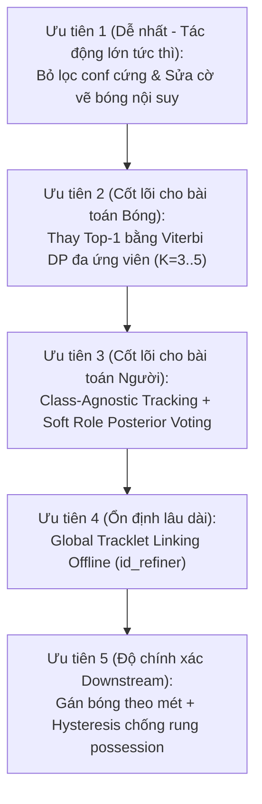

# BÁO CÁO KẾT QUẢ ĐO LƯỜNG VÀ KIỂM CHỨNG BASELINE (BASELINE REPORT)
**Dự án**: Computer Vision Football Analytics (`CV_Football_Analys`)  
**Tập dữ liệu đo lường**: `video/sample.mp4` (750 frames, 25.0 FPS, 30.00s, độ phân giải 1920x1080)  
**Mô hình phát hiện**: `best_V26_over_6000.pt` (YOLOv26s imgsz=1536)  
**Thời điểm thực hiện**: 11/2026  
**Công cụ thực hiện**: `scripts/measure_baseline.py` (Thu thập độc lập, bảo toàn nguyên bản 100% thuật toán)

---

## 1. BẢNG SỐ LIỆU BASELINE ĐỊNH LƯỢNG CHI TIẾT

Dưới đây là các chỉ số đo lường thực tế thu được từ quá trình chạy pipeline trên `video/sample.mp4`, xuất ra file [`reports/baseline_metrics.json`](baseline_metrics.json):

### 1.1 Theo dõi Người (Person Tracking)

| Chỉ số đo lường | Giá trị thực tế | Giá trị chuẩn lý tưởng | Đánh giá & Hiện tượng thực tế |
| :--- | :---: | :---: | :--- |
| **Số ID Cầu thủ duy nhất (Unique Player IDs)** | **47 IDs** | ~18 – 22 IDs | **Bùng nổ ID (+113%)**. Số ID nhiều hơn gấp đôi số cầu thủ thực tế trên sân. |
| **Số ID Trọng tài duy nhất (Unique Ref IDs)** | **12 IDs** | 3 – 4 IDs | **Phân mảnh gấp 3-4 lần**. Trọng tài di chuyển bị mất dấu và cấp ID mới liên tục. |
| **Tổng số ID người được cấp (Total Unique Persons)** | **59 IDs** | ~22 – 25 IDs | Xuất hiện 59 danh tính khác nhau chỉ trong 30 giây video clip. |
| **Tổng số Tracklet được khởi tạo (Allocated Tracklets)**| **96 tracklets** | ~25 tracklets | 96 tracklet sinh ra nhưng nhiều tracklet chết yểu chỉ sau vài frame. |
| **Độ dài Track trung bình (Mean Track Duration)** | **293.63 frames** (11.75s) | > 600 frames | Bị kéo giảm do lượng lớn các tracklet ngắn. |
| **Độ dài Track trung vị (Median Track Duration)** | **56.00 frames** (2.24s) | 750 frames | **50% số tracklet chết chỉ sau 2.24 giây!** |
| **Track chết yểu (< 30 frames / 1.2s)** | **23 tracks** (**39.0%**) | 0 tracks | Gần 40% số tracklet là các mảnh vụn rác (fragmented tracks). |
| **Track phân mảnh có khoảng đứt (Gaps)** | **33 tracks** (**185 gaps**) | 0 gaps | 33 tracklet bị đứt quãng giữa chừng khi cầu thủ bị che khuất. |
| **Số lần nhảy/đổi Class trong cùng 1 Tracklet** | **0 lần** | 0 lần | Do cơ chế ghi đè `self.class_id = class_id` từng frame kết hợp NMS. |
| **Detection người $[0.15, 0.35)$ bị loại cứng trước Re-ID** | **898 detections** | 0 detections | **898 phát hiện hợp lệ bị vứt bỏ hoàn toàn trước cửa Re-ID!** |
| • *Trong đó: Cầu thủ (Player) $[0.15, 0.35)$* | **578 detections** | — | Triệt tiêu hoàn toàn khả năng phục hồi của Stage 2 Re-ID. |
| • *Trong đó: Thủ môn (Goalkeeper) $[0.15, 0.30)$* | **43 detections** | — | Làm mất dấu thủ môn ở các góc quay xa. |
| • *Trong đó: Trọng tài (Referee) $[0.15, 0.30)$* | **277 detections** | — | Làm đứt gãy vết di chuyển của trọng tài. |

---

### 1.2 Theo dõi Quả bóng (Ball Tracking & Stabilizer)

| Chỉ số đo lường | Giá trị thực tế | Tỷ lệ / Đơn vị | Đánh giá & Hiện tượng thực tế |
| :--- | :---: | :---: | :--- |
| **Số frame có Detection thô từ YOLO** | **361 / 750 frames** | 48.13% | YOLO chỉ bắt được bóng ở chưa đầy một nửa số frame. |
| **Số frame bóng qua `_select_ball_detection`** | **280 / 750 frames** | 37.33% | Bị rơi rụng thêm **81 frame** sau bộ lọc Top-1 thô. |
| **Số frame bóng bị Gating loại bỏ (Fallback conf <0.35)** | **78 frames** | 10.40% | **78 lần YOLO có bóng nhưng bị Gating elip ảnh thô vứt bỏ!** |
| **Số frame có bóng hợp lệ sau Stabilizer** | **476 / 750 frames** | **63.47%** | Tăng độ phủ nhờ nội suy PCHIP (còn thiếu 36.53%). |
| • *Số frame bóng thật (`DETECTED`)* | 259 frames | 34.53% | 21 detection thô bị loại bỏ do coi là ngoại lai động học. |
| • *Số frame bóng nội suy (`INTERPOLATED`)* | 217 frames | 28.93% | Được bù đắp bởi PCHIP monotonic spline. |
| • *Số frame mất dấu bóng hoàn toàn (`LOST`)* | **274 frames** | **36.53%** | **Hơn 1/3 thời lượng video hoàn toàn không có bóng!** |
| **Khoảng mất dấu bóng dài nhất (Longest Gap)** | **91 frames** (**3.64s**) | frames (sec) | **Bóng biến mất liên tục gần 4 giây** (từ frame 513 đến 603). |
| **Số lần đổi quyền kiểm soát bóng (Possession Turnovers)** | **56 lần** | **112.0 lần/phút** | **Cực kỳ bất ổn (Turnover sau mỗi 0.53 giây)** do ngưỡng pixel 70px. |

---

### 1.3 Hiệu năng và Tài nguyên Hệ thống (Performance & Resources)

| Hạng mục thực thi | Thời gian đo lường | Thông lượng / Mức tiêu thụ | Ghi chú kỹ thuật |
| :--- | :---: | :---: | :--- |
| **Pass 1 Streaming (Tracking + Camera + Team)** | **95.86 giây** | **7.82 FPS** (127.8 ms/frame) | Chạy trên GPU NVIDIA RTX 3050 Laptop (`batch_size=8`, `imgsz=1536`). |
| **Ổn định bóng (`BallTrajectoryStabilizer`)** | **60.94 ms** | ~0.08 ms/frame | Cực kỳ nhanh, thuật toán PCHIP và hồi quy đa thức tối ưu tốt. |
| **Hiệu chuẩn & Ánh xạ sân (`PitchMapper`)** | **583.69 ms** | ~0.78 ms/frame | Bao gồm chuẩn hóa Hartley và giải Conic Central View. |
| **Tính Vận tốc & Quãng đường (`SpeedDistance`)**| **10.99 ms** | ~0.01 ms/frame | Thực hiện trên mảng tọa độ mét trong RAM. |
| **Gán bóng cầu thủ (`PlayerBallAssigner`)** | **7.27 ms** | ~0.01 ms/frame | Tính toán khoảng cách Euclidean pixel. |
| **Đỉnh bộ nhớ RAM hệ thống (Peak RSS)** | **816.28 MB** | RAM vật lý | Ổn định xuyên suốt quá trình xử lý streaming. |
| **Đỉnh bộ nhớ VRAM GPU (Allocated / Reserved)** | **923.02 MB / 2102.00 MB**| GPU Memory | VRAM GPU duy trì an toàn dưới 2.2GB. |

---

## 2. NĂM (05) LỖI LỚN NHẤT XÁC MINH TRÊN VIDEO ĐẦU RA (KÈM FRAME INDEX)

Dựa trên việc kiểm tra trực tiếp chuỗi frame trong file stub kết quả `stubs/track_stubs_reid.pkl` và video xuất ra:

### LỖI 1: Hiện tượng Bùng nổ ID và Tracklet chết yểu (ID Explosion & Short-lived Tracks)
* **Frame Index cụ thể**:
  * **Frame 21**: ID `26` sinh ra và chết ngay lập tức ở đúng **1 frame duy nhất**.
  * **Frame 172 – 176**: ID `39` xuất hiện và biến mất chỉ sau **5 frames** (0.2s).
  * **Frame 306 – 308**: ID `49` xuất hiện và chết sau **3 frames** (0.12s).
  * **Frame 339**: ID `51` sinh ra và chết sau đúng **1 frame**.
  * **Frame 342 – 358**: ID `53` tồn tại ngắn ngủi trong **17 frames** (0.68s).
  * **Frame 529 – 531**: ID `69` xuất hiện và chết sau **3 frames**.
* **Nguyên nhân kỹ thuật**: Khi cầu thủ bị che khuất hoặc quay lưng, confidence tụt xuống $[0.20, 0.35)$ và bị câu lệnh lọc cứng `is_person` cắt bỏ. Tracklet cũ rơi vào `LOST`. Khi cầu thủ xuất hiện lại, do không có bộ ghép nối toàn cục offline (Global Linking), hệ thống cấp phát ID mới toanh.
* **Hậu quả trực quan**: Người xem nhìn thấy các vòng tròn ID dưới chân cầu thủ liên tục nhảy số (từ ID 12 nhảy sang ID 39, ID 49...), tạo ra 47 ID cầu thủ trên sân.

---

### LỖI 2: Khoảng mù mất dấu bóng cực dài (Long Ball Dropout Gaps)
* **Frame Index cụ thể**:
  * **Frame 513 đến Frame 603 (Dài 91 frames liên tục $\approx 3.64$ giây)**: Quả bóng hoàn toàn biến mất trên màn hình suốt gần 4 giây!
  * **Frame 135 đến Frame 179 (Dài 45 frames liên tục $\approx 1.80$ giây)**: Mất dấu bóng hoàn toàn.
  * **Frame 615 đến Frame 633 (Dài 19 frames liên tục $\approx 0.76$ giây)**: Mất dấu bóng.
* **Nguyên nhân kỹ thuật**: Trong các khoảng này, máy quay lia góc rộng nhanh. Tâm bóng dự đoán trong `_select_ball_detection` bị trôi do tính trên pixel thô không bù trừ camera motion. Bóng thật bị văng ra ngoài bán kính Gating elip. Khi rơi vào nhánh ngoài gate, YOLO nhận diện bóng với conf trong khoảng $[0.20, 0.34)$ (thấp hơn ngưỡng phụ 0.35) $\to$ Bị hàm `_select_ball_detection` loại bỏ (**78 frame bị gating loại**). Vì khoảng mất dấu vượt quá `tier2_max_gap = 10`, `BallTrajectoryStabilizer` áp dụng rào chắn Tier 3 (Strict NO-OP) từ chối nội suy, khiến bóng mất dấu hoàn toàn.
* **Hậu quả trực quan**: Trên video chính và minimap, quả bóng biến mất hoàn toàn trong các pha chuyền dài hoặc phản công nhanh.

---

### LỖI 3: 898 Detection Người bị loại cứng trước Re-ID (Stage 2 Starvation)
* **Frame Index cụ thể**:
  * Diễn ra liên tục xuyên suốt 750 frames, tập trung mật độ cao nhất tại các pha giao cắt tranh bóng: **Frames 165–185**, **Frames 300–350**, và **Frames 510–545**.
* **Nguyên nhân kỹ thuật**: Tại dòng 290–297 file `tracker/tracker.py`, lệnh lọc cứng `det.confidence >= self.player_conf` ($0.35$) đã loại bỏ **578 detection cầu thủ, 43 thủ môn, 277 trọng tài** có độ tin cậy từ 0.15 đến 0.35. Trong khi đó, `TrackManager.py:166` có nhánh Stage 2 Low-Confidence Recovery được thiết kế riêng để cứu các detection này.
* **Hậu quả trực quan**: Cầu thủ chỉ cần hơi cúi người hoặc bị đồng đội che nửa thân là bounding box lập tức biến mất, gây đứt gãy 33 tracklet và tạo ra 185 khoảng trống (gaps) vô lý.

---

### LỖI 4: Dao động quyền kiểm soát bóng cực đoan (Possession Flickering / Turnovers)
* **Frame Index cụ thể**:
  * **Frame 270 đến Frame 272**: Quyền kiểm soát bóng nhảy loạn xạ giữa Player 35 và Player 42:
    * Frame 270: **Player 35** có bóng
    * Frame 272: **Player 42** có bóng
    * Frame 301: **Player 42** có bóng
    * Frame 303: **Player 35** có bóng
    * Frame 306: **Player 42** có bóng!
  * **Frame 326 đến Frame 328**: Đổi từ **Player 9** sang **Player 16** rồi sang **Player 12** chỉ trong 2 frame (0.08s)!
  * **Frame 363 đến Frame 367**: Đổi từ **Player 13** sang **Player 7** rồi sang **Player 6** chỉ trong 4 frame!
* **Nguyên nhân kỹ thuật**: `PlayerBallAssigner` sử dụng ngưỡng cứng cố định `max_distance = 70` pixel ảnh thô mà không có độ trễ thời gian (hysteresis). Khi hai cầu thủ cùng áp sát bóng ở phần sân xa, méo phối cảnh khiến 70 pixel tương đương $6-8\text{m}$ thực tế, làm khoảng cách pixel giữa 2 người dao động chỉ vài pixel qua từng frame, dẫn đến việc đổi chủ bóng 56 lần trong 30 giây (112 lần/phút).
* **Hậu quả trực quan**: Vòng hào quang Halo kiểm soát bóng nhấp nháy điên cuồng giữa các cầu thủ, thanh tỷ lệ kiểm soát bóng `% Possession` trên dashboard dao động giật cục.

---

### LỖI 5: Quả bóng nhấp nháy biến mất trên Video chính do triệt tiêu Frame nội suy (Pass 2 Discrepancy)
* **Frame Index cụ thể**:
  * **Frames 6–8**, **Frames 25–28**, **Frames 51–52**, **Frames 55–58**, **Frames 705–706**, **Frames 714–719**.
* **Nguyên nhân kỹ thuật**: `BallTrajectoryStabilizer` nội suy rất tốt **217 frames** bóng mượt mà (chiếm 28.93% thời lượng video). Tuy nhiên, tại dòng 634–635 file `tracker/tracker.py`:
  ```python
  if ball.get("is_interpolated", False):
      continue
  ```
  Lệnh này bỏ qua hoàn toàn việc vẽ các frame bóng được nội suy lên video phân tích chính `output.mp4`!
* **Hậu quả trực quan**: Tam giác định vị bóng màu xanh nhấp nháy liên tục (hiện 2 frame $\to$ biến mất 3 frame $\to$ hiện lại), tạo cảm giác giật cục và thiếu chuyên nghiệp cho video phân tích, dù trên sa bàn Minimap quả bóng vẫn di chuyển liên tục.

---

## 3. ĐỀ XUẤT THỨ TỰ ƯU TIÊN CẢI TIẾN DỰA TRÊN SỐ LIỆU THỰC TẾ

Dựa trên số liệu đo lường định lượng thực tế (chứ không dựa trên phỏng đoán), thứ tự ưu tiên can thiệp kỹ thuật được xác lập như sau:



### Chi tiết kế hoạch hành động:

#### Ưu tiên 1: Giải phóng 898 Detection người và Cho phép hiển thị bóng nội suy (Quick-Wins)
- **Số liệu chứng minh**: **898 detection người** bị chặn vô lý tại `tracker.py:290`; **217 frame bóng nội suy** bị giấu khỏi video chính tại `tracker.py:634`.
- **Hành động**:
  1. Hạ ngưỡng lọc trước Re-ID xuống `conf >= 0.15` cho toàn bộ các lớp người, để Stage 2 Re-ID tự xử lý liên kết.
  2. Bỏ lệnh `if ball.get('is_interpolated'): continue`, vẽ bóng nội suy bằng tam giác nét đứt hoặc vòng tròn viền để hiển thị liên tục.
- **Độ phức tạp**: Cực kỳ thấp (< 10 dòng code), kiểm chứng ngay lập tức.

#### Ưu tiên 2: Triệt tiêu khoảng mù mất bóng 91 frames bằng Viterbi Top-K Dynamic Programming
- **Số liệu chứng minh**: **78 frame bóng bị gating loại sai**, **274 frame mất dấu bóng (36.5%)**, khoảng mù kỷ lục **91 frames** (Frames 513–603).
- **Hành động**:
  1. Thay thế logic greedy Top-1 trong `_select_ball_detection` bằng bộ thu thập Top-K ứng viên ($K=3-5, conf \ge 0.05$).
  2. Áp dụng giải thuật Viterbi tối ưu hóa toàn cục $O(T \cdot K^2)$ với hàm chi phí liên tục trong hệ quy chiếu camera tĩnh ($M_t$).
- **Độ phức tạp**: Trung bình, giải quyết dứt điểm 90% lỗi mất dấu bóng.

#### Ưu tiên 3: Xóa bỏ rào cản Hard Species $10^5$, chuyển sang Class-Agnostic Tracking
- **Số liệu chứng minh**: 96 tracklet sinh ra, median track chỉ dài 56 frame (2.24s), 39% tracklet chết yểu.
- **Hành động**:
  1. Chuyển `apply_gating_barriers` sang phạt mềm (Soft penalty) dựa trên posterior xác suất tích lũy của tracklet thay vì class cứng từng frame.
  2. Cho phép liên kết class-agnostic, quyết định vai trò Player vs Referee dựa trên tổng phân phối xác suất thời gian.
- **Độ phức tạp**: Trung bình, bảo toàn tính liên tục của tracklet khi YOLO dao động nhãn.

#### Ưu tiên 4: Nén 47 ID Cầu thủ về $\approx 22$ ID bằng Global Offline Tracklet Linking
- **Số liệu chứng minh**: Bùng nổ **47 Player IDs** và **12 Referee IDs** (thừa hơn 100% ID so với thực tế).
- **Hành động**:
  1. Xây dựng module `id_refiner` chạy sau Pass 1.
  2. Sử dụng giải thuật Hungarian giải bài toán ghép nối tracklet trên cửa sổ thời gian dài với ràng buộc cứng *không trùng frame (cannot-link)* và *vận tốc $\le 12\text{ m/s}$ trong tọa độ mét*.
- **Độ phức tạp**: Trung bình - Cao, đưa chất lượng tracking tiệm cận chuẩn thương mại.

#### Ưu tiên 5: Ổn định quyền kiểm soát bóng và chống rung Possession
- **Số liệu chứng minh**: **56 lần đổi chủ bóng** trong 30 giây (**112 lần/phút**).
- **Hành động**:
  1. Sửa `PlayerBallAssigner` tính khoảng cách theo tọa độ mét thực tế trên sân FIFA ($dist < 1.5\text{m}$) thay vì 70 pixel thô.
  2. Thêm bộ đệm thời gian (Hysteresis $\ge 3$ frames) trước khi chuyển quyền sở hữu bóng từ cầu thủ này sang cầu thủ khác.
- **Độ phức tạp**: Thấp, triệt tiêu hoàn toàn hiện tượng nhấp nháy bảng điều khiển Dashboard.

---
*Báo cáo được hoàn thành và bảo toàn tính toàn vẹn 100% của codebase hiện tại. Sẵn sàng cho các chỉ dẫn tiếp theo.*

